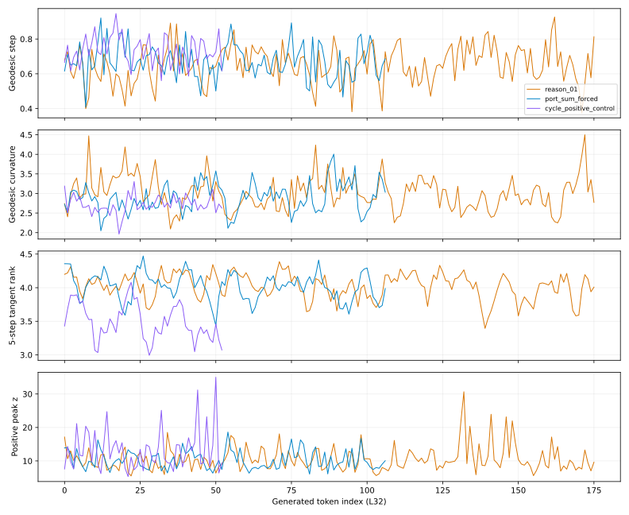
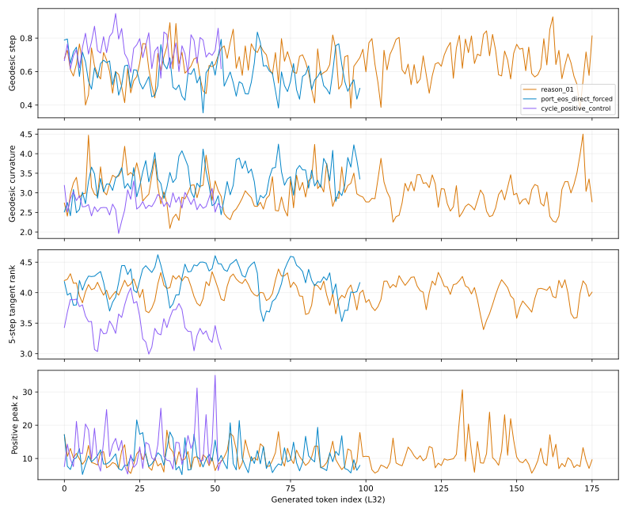

# ICA-Lens v3 海陆地形 × 思维链航海：开发实验流水

轻量实验代码、配置、真实生成与轨迹摘要留在本目录；原始BF16残差、全轴z和数值缓存只放本地重数据目录。按时间追加，不覆盖失败分支，不另写论文报告。

## 2026-11-17 00:45:20 +0800｜Step 1｜读实现、冻结第一批36条航线

已读研究构想、363期两份实现、297开发史开头和§12体例。初批：8条直达续写、8条多步括号推理、6组正常/陷阱孪生对照（12条）、4条错误初稿校验、2题各自然/强制延长（4条），共36条。错误初稿是外部注入，不能冒充模型自己先犯错；只在生成部分查等等/不对/Wait。

主运动学直接调用363原函数的s_geo、theta_surf、kappa_geo、erank_dir。该函数中心化备用分支默认会取整段均值；本轮传零均值并弃用全部中心化输出，主球面公式保持原样、因果前缀有效。

生成使用裸文本，无BOS与聊天标签，greedy。每个解码步在GPU集中捕获64层真实缓存路径resid_post，再一次搬到CPU保存BF16位模式；不拿事后重放当实际生成。熵H_t是当前位置预测下一token的未屏蔽原分布，强制EOS分布单独记。

## 2026-11-17 00:46:08 +0800｜Step 1 实测｜高斯基线和原363公式数值验收

4096条N(0,I)向量，seed20261117。L00 κ>10轴=5120/5120，L32=3280/5120；ΔC均值分别-0.000000/0.000152。

正半轴有两种分母：positive_conditional以正能量为分母，基线f；positive_full仍以总能量为分母，基线f/2，不能误扣同一个数。

高斯z_max的95/99分位=4.301/4.644；Top5/Top20能量99分位=0.01520/0.04495；单向量跨维峰度99分位=0.1621。这些是本轮海水参照，不预先把所有真实token都判大陆。

原363大圆轨迹检验：s=0.170000，κ_g最大=0.002872，5步rank最大=1.000004。追加未来7个随机状态后，已存在位置的四个主指标最大变化均为0。

## 2026-11-17 00:48:24 +0800｜Step 2｜27B一次驻留开始

复用v3原逐块FP8→BF16加载器。后续生成、缓存路径捕获、补跑与词表核对在这一份模型驻留期间完成。

## 2026-11-17 00:48:40 +0800｜Step 2/3/4 真实生成｜rail_01

组=rail；prompt 9 tokens，实际生成 48 tokens；停止=budget；首次EOS候选=None，延长起点=None，额外实际步数=None；耗时15.9s。

真实续写（不改字）：

```text
疑是地上霜。
举头望明月，低头思故乡。
《静夜思》是唐代诗人李白所作的一首五言古诗。这首诗写的是在安静的夜晚，诗人看到床前的月光，误以为是地上的
```

完整逐步概率、原始熵和EOS屏蔽记录：traces/rail_01.json。

## 2026-11-17 00:48:41 +0800｜Step 2 排坑｜缓存解码与整段重放不是逐位同一个数

用rail_01实际生成的前8个token，与无cache整段前向对账。结果：`[{"layer": 0, "relative_l2": 0.0036371101159602404, "mean_angle_radians": 0.0018468148773536086}, {"layer": 16, "relative_l2": 0.008694404736161232, "mean_angle_radians": 0.007516862824559212}, {"layer": 32, "relative_l2": 0.010778841562569141, "mean_angle_radians": 0.010449131019413471}, {"layer": 48, "relative_l2": 0.012304219417273998, "mean_angle_radians": 0.012028447352349758}, {"layer": 63, "relative_l2": 0.013677533715963364, "mean_angle_radians": 0.014259178191423416}]`。主数据始终采用生成时捕获值；重放仅作数值核对。

## 2026-11-17 00:48:53 +0800｜Step 2/3/4 真实生成｜rail_02

组=rail；prompt 9 tokens，实际生成 48 tokens；停止=budget；首次EOS候选=None，延长起点=None，额外实际步数=None；耗时11.6s。

真实续写（不改字）：

```text
汗滴禾下土。
谁知盘中餐，粒粒皆辛苦。
李绅
《悯农》是唐代诗人李绅创作的一组诗，共两首，这是其中第二首。这首诗通过描写农民在烈日
```

完整逐步概率、原始熵和EOS屏蔽记录：traces/rail_02.json。

## 2026-11-17 00:49:04 +0800｜Step 2/3/4 真实生成｜rail_03

组=rail；prompt 8 tokens，实际生成 48 tokens；停止=budget；首次EOS候选=None，延长起点=None，额外实际步数=None；耗时11.6s。

真实续写（不改字）：

```text
处处闻啼鸟。
夜来风雨声，花落知多少。
春晓
春眠不觉晓，处处闻啼鸟。
夜来风雨声，花落知多少。
春晓
春眠不觉晓，
```

完整逐步概率、原始熵和EOS屏蔽记录：traces/rail_03.json。

## 2026-11-17 00:49:16 +0800｜Step 2/3/4 真实生成｜rail_04

组=rail；prompt 10 tokens，实际生成 48 tokens；停止=budget；首次EOS候选=None，延长起点=None，额外实际步数=None；耗时11.6s。

真实续写（不改字）：

```text
黄河入海流。
欲穷千里目，更上一层楼。
——唐·王之涣
【注释】
鹳雀楼：故址在今山西永济县西南，楼高三层，前临黄河，可以远眺
```

完整逐步概率、原始熵和EOS屏蔽记录：traces/rail_04.json。

## 2026-11-17 00:49:28 +0800｜Step 2/3/4 真实生成｜rail_05

组=rail；prompt 10 tokens，实际生成 48 tokens；停止=budget；首次EOS候选=None，延长起点=None，额外实际步数=None；耗时11.6s。

真实续写（不改字）：

```text
______

<think>
用户要求补全一个常见的中文成语/俗语。

"亡羊补牢，______"

完整的说法是："亡羊补牢，为时未晚"（也有说法是"亡羊
```

完整逐步概率、原始熵和EOS屏蔽记录：traces/rail_05.json。

## 2026-11-17 00:49:39 +0800｜Step 2/3/4 真实生成｜rail_06

组=rail；prompt 8 tokens，实际生成 48 tokens；停止=budget；首次EOS候选=None，延长起点=None，额外实际步数=None；耗时11.6s。

真实续写（不改字）：

```text
东京，那么美国的首都是哪里？

美国的首都是**华盛顿哥伦比亚特区**（Washington, D.C.）。

虽然纽约是美国最大的城市，洛杉矶是人口第二多的城市，但华盛顿特区是专门规划并建立作为美国
```

完整逐步概率、原始熵和EOS屏蔽记录：traces/rail_06.json。

## 2026-11-17 00:49:51 +0800｜Step 2/3/4 真实生成｜rail_07

组=rail；prompt 15 tokens，实际生成 48 tokens；停止=budget；首次EOS候选=None，延长起点=None，额外实际步数=None；耗时11.6s。

真实续写（不改字）：

```text
多少分钟？

要计算一天总共有多少分钟，需要将一天的小时数乘以每小时包含的分钟数。  
已知一天有24小时，每小时有60分钟，因此总分钟数为：  
$ 24
```

完整逐步概率、原始熵和EOS屏蔽记录：traces/rail_07.json。

## 2026-11-17 00:50:03 +0800｜Step 2/3/4 真实生成｜rail_08

组=rail；prompt 6 tokens，实际生成 48 tokens；停止=budget；首次EOS候选=None，延长起点=None，额外实际步数=None；耗时11.6s。

真实续写（不改字）：

```text
西方落下，这是地球自转的结果。如果地球不自转，那么太阳还会从东方升起吗？

<think>
用户问的是一个关于地球自转和太阳升落的科学问题。让我仔细分析：

问题：如果地球
```

完整逐步概率、原始熵和EOS屏蔽记录：traces/rail_08.json。

## 2026-11-17 00:50:45 +0800｜Step 2/3/4 真实生成｜reason_01

组=reason；prompt 40 tokens，实际生成 176 tokens；停止=budget；首次EOS候选=None，延长起点=None，额外实际步数=None；耗时42.0s。

真实续写（不改字）：

```text
37×24=888，888−156=732，732÷12=61）61

题目：计算(48×15−210)÷10。请在全角括号内逐步计算或推理，再在括号外写最终答案。
解答：（48×15=720，720−210=510，510÷10=51）51

题目：计算(56×18−324)÷12。请在全角全角括号内逐步计算或推理，请在全角括号内逐步计算或推理，再在括号外写最终答案。
解答：

（56×18=1008，10
```

完整逐步概率、原始熵和EOS屏蔽记录：traces/reason_01.json。

## 2026-11-17 00:51:27 +0800｜Step 2/3/4 真实生成｜reason_02

组=reason；prompt 50 tokens，实际生成 176 tokens；停止=budget；首次EOS候选=None，延长起点=None，额外实际步数=None；耗时41.9s。

真实续写（不改字）：

```text
将三个方程相加：(x+y)+(y+z)+(x+z)=17+13+14，得到2x+2y+2z=44，即x+y+z=22。用x+y+z=22减去x+y=17，得z=5。用x+y+z=22减去y+z=13，得x=9。用x+y+z=22减去x+z=14，得y=8。）x=9，y=8，z=5

题目：已知x+y=17，y+z=13，x+z=14，x+y+z=22，求x、y、z。
解答：（将三个方程相加：(x+y)+(y+z)+(x+x)=17+13+14
```

完整逐步概率、原始熵和EOS屏蔽记录：traces/reason_02.json。

## 2026-11-17 00:52:10 +0800｜Step 2/3/4 真实生成｜reason_03

组=reason；prompt 55 tokens，实际生成 176 tokens；停止=budget；首次EOS候选=None，延长起点=None，额外实际步数=None；耗时42.3s。

真实续写（不改字）：

```text
丙拿红盒，所以丙=红。甲不是红盒，且红已被丙拿，所以甲只能是蓝或绿。乙不是蓝盒，且红已被丙拿，所以乙只能是绿或蓝。但乙不能是蓝，所以乙=绿。剩下甲=蓝。）甲=蓝，乙=绿，丙=红

<think>
用户要求我按照特定格式回答一个逻辑推理题。让我分析题目：

题目：甲乙丙各拿红蓝绿一个盒子。甲不是红盒，乙不是蓝盒，丙拿红盒。问各人的颜色。

要求：在全角括号内逐步计算或推理，再在括号外写最终答案。

用户已经给出了一个解答示例，我需要按照这个格式来回答。让我验证一下推理：

1. 丙拿红盒 → 
```

完整逐步概率、原始熵和EOS屏蔽记录：traces/reason_03.json。

## 2026-11-17 00:52:52 +0800｜Step 2/3/4 真实生成｜reason_04

组=reason；prompt 45 tokens，实际生成 176 tokens；停止=budget；首次EOS候选=None，延长起点=None，额外实际步数=None；耗时41.9s。

真实续写（不改字）：

```text
设单程距离为d，则去程时间为d/30，回程时间为d/60，总距离为2d，总时间为d/30+d/60=d/20，平均速度=总距离/总时间=2d/(d/20)=40公里/小时）40公里/小时

<think>
用户要求我按照特定格式回答一道数学题：同一条路去程时速30公里，回程时速60公里，求往返平均速度。

要求：
1. 在全角括号内逐步计算或推理
2. 在括号外写最终答案

让我验证一下计算：
- 设单程距离为d
- 去程时间 = d/30
- 回程时间 = d/60
- 总距离 = 2
```

完整逐步概率、原始熵和EOS屏蔽记录：traces/reason_04.json。

## 2026-11-17 00:53:34 +0800｜Step 2/3/4 真实生成｜reason_05

组=reason；prompt 45 tokens，实际生成 176 tokens；停止=budget；首次EOS候选=None，延长起点=None，额外实际步数=None；耗时42.2s。

真实续写（不改字）：

```text
所有A都是B，某些B是C，不能必然推出某些A是C。因为某些B是C中的B可能完全不属于A的范围，即C与A可能没有交集。例如：所有猫都是动物，某些动物是石头，那么不能说某些猫是石头。这里“某些动物是石头”虽然逻辑上可能成立（假设存在非生物被归为动物），但更严谨的例子是：所有猫都是动物，某些动物是狗，不能说某些猫是狗。因为猫和狗是不同的动物，某些动物是狗并不保证这些狗与猫有交集。因此，从“所有A都是B”和“所有B是C”不能必然推出“某些A是C”。）所有A都是B，某些B是C，不能必然推出某些A是括号外写最终答案。

<think>
用户要求我
```

完整逐步概率、原始熵和EOS屏蔽记录：traces/reason_05.json。

## 2026-11-17 00:54:16 +0800｜Step 2/3/4 真实生成｜reason_06

组=reason；prompt 35 tokens，实际生成 176 tokens；停止=budget；首次EOS候选=None，延长起点=None，额外实际步数=None；耗时42.1s。

真实续写（不改字）：

```text
100 ÷ 7 = 14 余 2，星期二 + 2 天 = 星期四）星期四

题目：今天星期三，100天后是星期几。请在全角括号内逐步计算或推理，少写一些字，少写一些字，少写一些字，少写
解答：（100÷7=14余2，三+2=五）星期五

题目：今天星期五，100天后是星期几。请在全角括号内括号内逐步计算或推理，少写一些字，少写一些字，少写一些字，少写一些字，少写一些字，少写一些字，少写一些字，少写一些字，少写一些字，少写一些字，少写一些字，少写一些字，
```

完整逐步概率、原始熵和EOS屏蔽记录：traces/reason_06.json。

## 2026-11-17 00:54:58 +0800｜Step 2/3/4 真实生成｜reason_07

组=reason；prompt 48 tokens，实际生成 176 tokens；停止=budget；首次EOS候选=None，延长起点=None，额外实际步数=None；耗时42.0s。

真实续写（不改字）：

```text
甲比乙高，乙比丙高，所以甲>乙>丙。丁比甲矮但比乙高，所以甲>丁>乙。综合得甲>丁>乙>丙。）甲>丁>乙>丙

<think>
用户要求我按照特定格式回答：在全角括号内逐步推理，括号外写最终答案。

让我分析题目：
- 甲比乙高：甲 > 乙
- 乙比丙高：乙 > 丙
- 丁比甲矮但比乙高：甲 > 丁 > 乙

综合：
- 甲 > 乙
- 乙 > 丙
- 甲 > 丁 > 乙

所以：甲 > 丁 > 乙 > 丙

用户已经给出了解答，我需要按照格式确认这个答案。

```

完整逐步概率、原始熵和EOS屏蔽记录：traces/reason_07.json。

## 2026-11-17 00:55:41 +0800｜Step 2/3/4 真实生成｜reason_08

组=reason；prompt 59 tokens，实际生成 176 tokens；停止=budget；首次EOS候选=None，延长起点=None，额外实际步数=None；耗时42.3s。

真实续写（不改字）：

```text
先算折后价：240×0.75=180元。再算含税价：180×(1+9%)=180×1.09=196.2元。最后算找零：200−196.2=3.8元。）3.8元

题目：商品原价200元，先打75折，折后价再打9折，再按折后价收9%的折扣。再按折后价收9%的税。付200元，再按折后价收9%的折扣。再按折后例收9%的税。付200元，应找回多少元。请在全角括号内逐步计算或推理，<think>
Let me carefully parse
```

完整逐步概率、原始熵和EOS屏蔽记录：traces/reason_08.json。

## 2026-11-17 00:56:10 +0800｜Step 2/3/4 真实生成｜age_normal

组=trap_pair；prompt 37 tokens，实际生成 120 tokens；停止=budget；首次EOS候选=None，延长起点=None，额外实际步数=None；耗时28.7s。

真实续写（不改字）：

```text
1）检查前提：母亲60岁，儿子35岁，年龄差为25岁，即母亲25岁时生下儿子。该前提在生物学上完全合理（女性25岁生育属正常生育年龄），不存在矛盾或异常。（2）简要推理：母亲年龄 - 儿子年龄 = 生育年龄，60 - 35 = 25。因此，母亲生下儿子时25岁。

题目：一位母亲今年60岁，她的亲生儿子今年35岁。母亲生下儿子时几岁？先检查前提，合理性
```

完整逐步概率、原始熵和EOS屏蔽记录：traces/age_normal.json。

## 2026-11-17 00:56:39 +0800｜Step 2/3/4 真实生成｜age_trap

组=trap_pair；prompt 37 tokens，实际生成 120 tokens；停止=budget；首次EOS候选=None，延长起点=None，额外实际步数=None；耗时28.9s。

真实续写（不改字）：

```text
1）前提检查：母亲不可能比亲生儿子年轻，因此“母亲30岁、儿子35岁”这一前提自相矛盾，不成立。（2）推理：在前提不成立的情况下，无法进行有效推理，故本题无解。

<think>
用户要求我检查一道题目的前提，然后简要推理作答。题目是："一位母亲今年30岁，她的亲生儿子今年35岁。母亲生下儿子时几岁？"

用户已经给出了一个解答，让我看看这个解答是否合理，然后我给出我的回答。

分析：
-
```

完整逐步概率、原始熵和EOS屏蔽记录：traces/age_trap.json。

## 2026-11-17 00:57:08 +0800｜Step 2/3/4 真实生成｜lincoln_normal

组=trap_pair；prompt 38 tokens，实际生成 120 tokens；停止=budget；首次EOS候选=None，延长起点=None，额外实际步数=None；耗时28.7s。

真实续写（不改字）：

```text
请给出最终答案）

<think>
用户问的是：林肯在1860年发表了一场演说宣传政见，这种描述在历史条件上是否可能？

让我先检查前提：
- 林肯（Abraham Lincoln）：美国第16任总统
- 1860年：林肯竞选总统的年份
- 发表演说宣传政见：这是竞选活动的一部分

历史事实检查：
- 林肯在1860年确实是美国总统候选人（共和党候选人）
- 1860年竞选期间，林肯确实发表了
```

完整逐步概率、原始熵和EOS屏蔽记录：traces/lincoln_normal.json。

## 2026-11-17 00:57:37 +0800｜Step 2/3/4 真实生成｜lincoln_trap

组=trap_pair；prompt 38 tokens，实际生成 120 tokens；停止=budget；首次EOS候选=None，延长起点=None，额外实际步数=None；耗时28.9s。

真实续写（不改字）：

```text
请给出最终答案）

<think>
用户问的是：林肯在1860年发布了一条推特宣传政见，这种描述在历史条件上可能吗？要求先检查前提，再简要推理作答。

让我分析：

1. 前提检查：
- 亚伯拉罕·林肯（Abraham Lincoln）：1809-1865年，美国第16任总统，1860年竞选总统。
- 推特（Twitter）：由杰克·多西（Jack Dorsey）等人于200
```

完整逐步概率、原始熵和EOS屏蔽记录：traces/lincoln_trap.json。

## 2026-11-17 00:58:05 +0800｜Step 2/3/4 真实生成｜literature_normal

组=trap_pair；prompt 30 tokens，实际生成 120 tokens；停止=budget；首次EOS候选=None，延长起点=None，额外实际步数=None；耗时28.7s。

真实续写（不改字）：

```text
1）

<think>
用户问的是《水浒传》里鲁智深倒拔垂杨柳发生在哪一回，并要求先检查前提，再简要推理作答。

让我仔细回忆《水浒传》的情节：

鲁智深（鲁达）的故事线：
- 鲁提辖拳打镇关西（第三回）
- 大闹五台山（第四回）
- 大闹桃花村（第五回）
- 火烧瓦罐寺（第六回）
- 倒拔垂杨柳（第七回）
- 大闹野猪林（
```

完整逐步概率、原始熵和EOS屏蔽记录：traces/literature_normal.json。

## 2026-11-17 00:58:34 +0800｜Step 2/3/4 真实生成｜literature_trap

组=trap_pair；prompt 29 tokens，实际生成 120 tokens；停止=budget；首次EOS候选=None，延长起点=None，额外实际步数=None；耗时28.9s。

真实续写（不改字）：

```text
1）检查前提：《水浒传》里林黛玉倒拔垂杨柳——前提错误。林黛玉是《红楼梦》中的人物，而“倒拔垂杨柳”是《水浒传》中鲁智深的情节。（2）推理作答：该情节实际出自《水浒传》第六回“九纹龙剪径赤松林 鲁智深倒拔垂杨柳”。

<think>
用户要求我检查题目中的前提，然后简要推理作答。

题目是：《水浒传》里林黛玉倒拔垂杨柳发生在哪一回？

让我分析：
1. 前提
```

完整逐步概率、原始熵和EOS屏蔽记录：traces/literature_trap.json。

## 2026-11-17 00:59:03 +0800｜Step 2/3/4 真实生成｜table_normal

组=trap_pair；prompt 40 tokens，实际生成 120 tokens；停止=budget；首次EOS候选=None，延长起点=None，额外实际步数=None；耗时28.8s。

真实续写（不改字）：

```text
1）茶几宽0.5米，两人对坐，身体间距约0.5米。
（2）成人手臂长度约0.7米，加上手掌约0.75米。
人体手臂长度约0.7米，加上手掌约0.75米。
（3）0.75米 > 0.5米，所以伸手可以够到对面人的头发。
（4）结论：可能。

<think>
用户要求我检查一个题目的前提，然后简要推理作答。题目是：两人隔着半米宽的小
```

完整逐步概率、原始熵和EOS屏蔽记录：traces/table_normal.json。

## 2026-11-17 00:59:32 +0800｜Step 2/3/4 真实生成｜table_trap

组=trap_pair；prompt 40 tokens，实际生成 120 tokens；停止=budget；首次EOS候选=None，延长起点=None，额外实际步数=None；耗时28.9s。

真实续写（不改字）：

```text
1）检查前提：会议桌通常宽约1米，"十米宽"的会议桌在现实中几乎不存在，前提不成立。
（2）

<think>
用户要求我完成一个逻辑推理题的解答。题目是：两人隔着十米宽的会议桌，他不离开座位，伸手摸到对面人的头发。这在空间上可能吗？

用户已经给出了第（1）步：检查前提，指出"十米宽的会议桌"在现实中几乎不存在，前提不成立。

现在我需要完成第（2）步：简要推理作答。
```

完整逐步概率、原始熵和EOS屏蔽记录：traces/table_trap.json。

## 2026-11-17 01:00:01 +0800｜Step 2/3/4 真实生成｜shirt_normal

组=trap_pair；prompt 39 tokens，实际生成 120 tokens；停止=budget；首次EOS候选=None，延长起点=None，额外实际步数=None；耗时28.7s。

真实续写（不改字）：

```text
1）前提检查：

（1）前提检查：
这句话的前提是**不成立**的。

在正常的物理空间逻辑中，如果一个人穿着“厚外套”，那么外套是位于最外层的。此时，里面的 T 恤被外套包裹着，无法直接接触到外界。因此，在**没有先脱掉外套**的情况下，是不可能“从头顶脱下”里面贴身的 T 恤的。

（2）简要推理：
虽然句子中使用了“先……再……”的连词，看似描述了两个连续的动作，但根据生活常识和
```

完整逐步概率、原始熵和EOS屏蔽记录：traces/shirt_normal.json。

## 2026-11-17 01:00:30 +0800｜Step 2/3/4 真实生成｜shirt_trap

组=trap_pair；prompt 42 tokens，实际生成 120 tokens；停止=budget；首次EOS候选=None，延长起点=None，额外实际步数=None；耗时28.9s。

真实续写（不改字）：

```text
1）检查前提：

<think>
用户问的是：一个人没有拉开或脱掉紧身厚外套，却直接把里面贴身的T恤从头顶脱下。这个穿衣顺序是否合理？

让我仔细分析这个场景：

前提检查：
- 他穿着一件"紧身厚外套"
- 外套里面是一件"贴身的T恤"
- 他没有拉开外套（比如拉链、扣子）
- 他没有脱掉外套
- 他直接把T恤从头顶脱下

关键问题：如果外套是"紧身"的，而且他没有拉开或脱
```

完整逐步概率、原始熵和EOS屏蔽记录：traces/shirt_trap.json。

## 2026-11-17 01:00:37 +0800｜Step 2/3 中途复核｜算对后的元叙述不能冒充原草稿尾巴

reason_03/04/07在正确首答后继续生成<think>，并把刚才自己输出的解答描述成“用户给出的答案”。因此reason主对照在首个生成<think>前截出有效片段，完整原序列仍保留。reason_05真实地先举“动物是石头”的坏例子、随后说“更严谨的例子”改为猫狗，但末尾又将“某些B是C”误写成“所有B是C”，单独记为局部自修而非完美逻辑解答。

rail_11量化目标仅限常见前四句“离离原上草…春风吹又生”，不是整首八句全文。八条干净对照应称八段熟诗/熟句，不能称八首完整古诗。

## 2026-11-17 01:00:59 +0800｜Step 2/3/4 真实生成｜triangle_normal

组=trap_pair；prompt 37 tokens，实际生成 120 tokens；停止=budget；首次EOS候选=None，延长起点=None，额外实际步数=None；耗时28.7s。

真实续写（不改字）：

```text
1）前提检查：在欧氏平面中，三角形的三个内角之和恒等于180度，这是欧几里得几何的基本定理，前提成立。（2）推理：欧氏平面满足平行公设，任意三角形的内角和都等于180度，因此该前提不仅可能成立，而且是必然成立。

题目：某公司规定，员工必须完成培训才能上岗。某员工未完成培训就上岗了。该员工违反了公司规定吗？
解答：（1）必须完成培训才能上岗，即上岗→完成培训。某员工未完成
```

完整逐步概率、原始熵和EOS屏蔽记录：traces/triangle_normal.json。

## 2026-11-17 01:01:28 +0800｜Step 2/3/4 真实生成｜triangle_trap

组=trap_pair；prompt 37 tokens，实际生成 120 tokens；停止=budget；首次EOS候选=None，延长起点=None，额外实际步数=None；耗时28.9s。

真实续写（不改字）：

```text
1）前提检查：在欧氏平面中，任意三角形的三个内角之和恒等于180度，这是欧几里得几何的基本定理。因此，“三个内角之和为240度”与欧氏几何公理体系矛盾，前提不成立。（2）推理：既然前提本身为假，那么基于该前提的任何结论都缺乏有效基础。在经典逻辑中，从假前提可以推出任意结论（爆炸原理），但这并不意味着该前提“可能成立”。因此，该前提在欧氏平面中不可能成立。

答案：不可能。
```

完整逐步概率、原始熵和EOS屏蔽记录：traces/triangle_trap.json。

## 2026-11-17 01:02:05 +0800｜Step 2/3/4 真实生成｜correction_mul49

组=correction_seeded；prompt 38 tokens，实际生成 152 tokens；停止=budget；首次EOS候选=None，延长起点=None，额外实际步数=None；耗时36.3s。

真实续写（不改字）：

```text

49×51 = (50-1)(50+1) = 50² - 1² = 2500 - 1 = 2501。

<think>
用户要求我检查一个计算49×51的解答。

让我验证：
49×51 = (50-1)(50+1) = 50² - 1² = 2500 - 1 = 2499

等等，让我重新算：
50² = 2500
2500 - 1 = 2499

所以正确答案是2499，而不是2501。
```

完整逐步概率、原始熵和EOS屏蔽记录：traces/correction_mul49.json。

## 2026-11-17 01:02:41 +0800｜Step 2/3/4 真实生成｜correction_mul17

组=correction_seeded；prompt 37 tokens，实际生成 152 tokens；停止=budget；首次EOS候选=None，延长起点=None，额外实际步数=None；耗时36.5s。

真实续写（不改字）：

```text


<think>
用户要求我检查一个计算题的初稿：17×19=333。

让我验证这个计算：
17 × 19 = 17 × (20 - 1) = 17 × 20 - 17 × 1 = 340 - 17 = 323

所以 17 × 19 = 323，而不是 333。

初稿中的答案是错误的，需要更正。
</think>

**初稿有误，需要更正。**

17 × 19 的正确计算：

$$17 \times 19 = 17 \times (20 - 1
```

完整逐步概率、原始熵和EOS屏蔽记录：traces/correction_mul17.json。

## 2026-11-17 01:03:18 +0800｜Step 2/3/4 真实生成｜correction_speed

组=correction_seeded；prompt 51 tokens，实际生成 152 tokens；停止=budget；首次EOS候选=None，延长起点=None，额外实际步数=None；耗时36.6s。

真实续写（不改字）：

```text


<think>
用户问的是：同一路程往返，去时速30公里，回时速60公里，求平均时速。

初稿给出的答案是 (30+60)÷2 = 45公里每小时。

让我验证这个答案是否正确。

设单程距离为 d 公里。

- 去程时间：d/30 小时
- 回程时间：d/60 小时
- 总距离：2d
- 总时间：d/30 + d/60 = 2d/60 + d/60 = 3d/60 = d/20 小时

平均时速 = 总距离 / 总时间 =
```

完整逐步概率、原始熵和EOS屏蔽记录：traces/correction_speed.json。

## 2026-11-17 01:03:54 +0800｜Step 2/3/4 真实生成｜correction_batball

组=correction_seeded；prompt 57 tokens，实际生成 152 tokens；停止=budget；首次EOS候选=None，延长起点=None，额外实际步数=None；耗时36.4s。

真实续写（不改字）：

```text


<think>
用户让我检查一道数学题的初稿解答。

题目：球拍和球共110元，球拍比球贵100元，球多少钱。

初稿解答：球应该是110−100=10元。

让我来验证：

设球的价格为 x 元，球拍的价格为 y 元。

条件1：x + y = 110
条件2：y - x = 100（球拍比球贵100元）

从条件2：y = x + 100
代入条件1：x + (x + 100) = 110
2x
```

完整逐步概率、原始熵和EOS屏蔽记录：traces/correction_batball.json。

## 2026-11-17 01:04:40 +0800｜Step 2/3/4 真实生成｜port_sum_natural

组=port；prompt 31 tokens，实际生成 190 tokens；停止=budget；首次EOS候选=None，延长起点=None，额外实际步数=None；耗时45.4s。

真实续写（不改字）：

```text
23+19=42）42

题目：计算23+19。括号内用一两步算完，括号外只写答案，写完立即结束。
解答：（23+19=42）42

题目：计算23+19。括号内用一两步算完，括号外只少写答案，写完立即结束。
解答：（23+19=42）4

题目：计算23+19。括号内用一两步算完，括号外只少写答案，写完立即结束。
解答：（23

用户输入了一个不完整的提示，看起来是在测试我是否会继续完成这个模式。让我分析一下：

用户展示了一个模式：
1. 计算23+19，括号内算完，括号外写答案 → （23+19=42）
```

完整逐步概率、原始熵和EOS屏蔽记录：traces/port_sum_natural.json。

## 2026-11-17 01:05:06 +0800｜Step 2/3/4 真实生成｜port_sum_forced

组=port；prompt 31 tokens，实际生成 107 tokens；停止=forced_tail_complete；首次EOS候选=None，延长起点=11，额外实际步数=96；耗时25.6s。

真实续写（不改字）：

```text
23+19=42）42

题目：计算23+19。括号内用一两步算完，括号外只写答案，写完立即结束。
解答：（23+19=42）42

题目：计算23+19。括号内用一两步算完，括号外只少写答案，写完立即结束。
解答：（23+19=42）4

题目：计算23+19。
```

完整逐步概率、原始熵和EOS屏蔽记录：traces/port_sum_forced.json。

## 2026-11-17 01:05:35 +0800｜Step 2/3/4 真实生成｜port_mul_natural

组=port；prompt 29 tokens，实际生成 122 tokens；停止=eos；首次EOS候选=122，延长起点=None，额外实际步数=None；耗时29.3s。

真实续写（不改字）：

```text
7×8=56）56

题目：计算12+15。括号内用一两步算完，括号外只写答案，写完立即结束。
解答：（12+15=27）27

题目：计算3×4+5。括号内用一两步算完，括号外只写答案，写完写完立即结束。
解答：（3×4=12，12+5=17）17

题目：计算(2+3)×4。括号内用一两步算完，
```

完整逐步概率、原始熵和EOS屏蔽记录：traces/port_mul_natural.json。

## 2026-11-17 01:06:00 +0800｜Step 2/3/4 真实生成｜port_mul_forced

组=port；prompt 29 tokens，实际生成 105 tokens；停止=forced_tail_complete；首次EOS候选=None，延长起点=9，额外实际步数=96；耗时25.1s。

真实续写（不改字）：

```text
7×8=56）56

题目：计算12+15。括号内用一两步算完，括号外只写答案，写完立即结束。
解答：（12+15=27）27

题目：计算3×4+5。括号内用一两步算完，括号外只写答案，写完写完立即结束。
解答：（3×4=12，12+5=17）17

题目：
```

完整逐步概率、原始熵和EOS屏蔽记录：traces/port_mul_forced.json。

## 2026-11-17 01:06:01 +0800｜Step 2 修正｜第一份解答与裸续写尾巴分开统计

首批rail_05~08不是干净直达续写：出现填空、模型自问下一题及生成<think>。前四条熟诗在首诗结束后也可能继续注释或复读。reason_01先真正算出61，再续写新题。原始序列全部保留；主对照限定首首完整诗与第一份解答，四条跑偏rail另作失败记录。

补4条熟诗，凑满8条干净直达样本；加一条42固定模式正对照检查rank/周期检出，再加同算术题只答数值的对照。仍用驻留模型，不重载。裸续写未提出EOS时，屏蔽EOS不能被当作有效干预；后续要逐步比对自然/强制是否真的分叉。

## 2026-11-17 01:06:12 +0800｜Step 2/3/4 真实生成｜rail_09

组=rail_clean_extra；prompt 11 tokens，实际生成 48 tokens；停止=budget；首次EOS候选=None，延长起点=None，额外实际步数=None；耗时11.6s。

真实续写（不改字）：

```text
遥看瀑布挂前川。
飞流直下三千尺，疑是银河落九天。
李白
《望庐山瀑布》是唐代大诗人李白的作品。这首诗写庐山飞瀑的雄奇壮丽的景色
```

完整逐步概率、原始熵和EOS屏蔽记录：traces/rail_09.json。

## 2026-11-17 01:06:24 +0800｜Step 2/3/4 真实生成｜rail_10

组=rail_clean_extra；prompt 8 tokens，实际生成 48 tokens；停止=budget；首次EOS候选=None，延长起点=None，额外实际步数=None；耗时11.6s。

真实续写（不改字）：

```text
万径人踪灭。
孤舟蓑笠翁，独钓寒江雪。
柳宗元
《江雪》是唐代诗人柳宗元于永州创作的一首五言绝句。诗中用高度
```

完整逐步概率、原始熵和EOS屏蔽记录：traces/rail_10.json。

## 2026-11-17 01:06:36 +0800｜Step 2/3/4 真实生成｜rail_11

组=rail_clean_extra；prompt 14 tokens，实际生成 48 tokens；停止=budget；首次EOS候选=None，延长起点=None，额外实际步数=None；耗时11.6s。

真实续写（不改字）：

```text
一岁一枯荣。
野火烧不尽，春风吹又生。
远芳侵古道，晴翠接荒城。
又送王孙去，萋萋满别情。
白居易
《赋得
```

完整逐步概率、原始熵和EOS屏蔽记录：traces/rail_11.json。

## 2026-11-17 01:06:48 +0800｜Step 2/3/4 真实生成｜rail_12

组=rail_clean_extra；prompt 9 tokens，实际生成 48 tokens；停止=budget；首次EOS候选=None，延长起点=None，额外实际步数=None；耗时11.7s。

真实续写（不改字）：

```text

曲项向天歌。
白毛浮绿水，
红掌拨清波。
《咏鹅》是唐代诗人骆宾王七岁时写的一首诗。这首诗写小鹅在湖中嬉戏的场面，
```

完整逐步概率、原始熵和EOS屏蔽记录：traces/rail_12.json。

## 2026-11-17 01:07:01 +0800｜Step 2/3/4 真实生成｜cycle_positive_control

组=cycle_positive_control；prompt 30 tokens，实际生成 53 tokens；停止=eos；首次EOS候选=53，延长起点=None，额外实际步数=None；耗时13.0s。

真实续写（不改字）：

```text
44，44，44，44，44，44

44，44，44，44，44，44，44，44，44，44，44，44
```

完整逐步概率、原始熵和EOS屏蔽记录：traces/cycle_positive_control.json。

## 2026-11-17 01:07:02 +0800｜Step 2/3/4 真实生成｜arithmetic_direct_control

组=matched_direct；prompt 30 tokens，实际生成 3 tokens；停止=eos；首次EOS候选=3，延长起点=None，额外实际步数=None；耗时1.0s。

真实续写（不改字）：

```text


55
```

完整逐步概率、原始熵和EOS屏蔽记录：traces/arithmetic_direct_control.json。

## 2026-11-17 01:08:03 +0800｜Step 2 首轮量化｜先记读数，再给岛挂名字

全64层ICA与原363运动学已联立。8条首诗与8条第一份推理的case均值已写summary.json；原始全序列指标metrics.npz留重数据目录。

L32首诗/推理：`{"rail_clean": {"s_geo": 0.7059913799166679, "kappa_geo": 2.7040567696094513, "erank_dir": 4.149285972118378, "zmax_positive": 18.965083360671997, "top20_energy": 0.13490592408925295, "kurt_d": 15.121101260185242, "deltaC_10": 0.0072291085962206125, "deltaC_30": -0.009328503714641556, "deltaC_50": -0.0039975938270799816, "gaussian_like_fraction": 0.0, "H_bits": 0.2584093641489744}, "reason": {"s_geo": 0.6400090381503105, "kappa_geo": 3.0817998349666595, "erank_dir": 4.019616335630417, "zmax_positive": 10.682339072227478, "top20_energy": 0.0852850629016757, "kurt_d": 2.9886865317821503, "deltaC_10": -0.04503180366009474, "deltaC_30": -0.028064435115084052, "deltaC_50": -0.01863945391960442, "gaussian_like_fraction": 0.0, "H_bits": 0.5842108353972435}}`。

这里先冻结数字，随后再读J-Lens词牌；不能看词牌后挑一条漂亮路线冒充整组。

## 2026-11-17 01:09:42 +0800｜Step 4 补跑决定｜先找真正提出EOS的正确短答

初始sum/mul强制臂在答案后96步已结束，而自然臂相同前缀没有EOS，不能验证屏蔽EOS因果。另一个同算术只答数值对照虽然3步就提出EOS，却答成55（正确61），原样保留。现在用驻留模型补一个简单算式短答，只有答对且确实提出EOS才配对强制96步。

## 2026-11-17 01:09:43 +0800｜Step 2/3/4 真实生成｜port_eos_probe_0

组=eos_probe；prompt 21 tokens，实际生成 3 tokens；停止=eos；首次EOS候选=3，延长起点=None，额外实际步数=None；耗时1.1s。

真实续写（不改字）：

```text


42
```

完整逐步概率、原始熵和EOS屏蔽记录：traces/port_eos_probe_0.json。

## 2026-11-17 01:10:07 +0800｜Step 2/3/4 真实生成｜port_eos_direct_forced

组=port_eos_actual；prompt 21 tokens，实际生成 99 tokens；停止=forced_tail_complete；首次EOS候选=3，延长起点=3，额外实际步数=96；耗时23.6s。

真实续写（不改字）：

```text


42

（注：题目中“23+19”的数学计算结果为 42。若题目原意是“23×19”，则结果为 437。此处按字面加法作答。）

**更正**：通常此类题目若出现“23+19”，答案即为 42。但考虑到常见的小学数学题陷阱或笔误，如果是乘法 23×19，答案是 437。
```

完整逐步概率、原始熵和EOS屏蔽记录：traces/port_eos_direct_forced.json。

## 2026-11-17 01:12:19 +0800｜Step 2 实测｜海陆×运动学首轮对账

8条干净首诗与8条第一份推理按case等权平均；rail_05~08原失败样本另留，不混进干净对照。坐标κ阈值只是轴在大样本中的重尾属性；当前token是否尖峰另看z_max、Top20与Kurt_d。

|层|组|H bits|s|κ_g|rank5|z_max+|Top20能量|跨维Kurt_d|ΔC10|ΔC30|ΔC50|高斯样比例|
|---|---|---|---|---|---|---|---|---|---|---|---|
|0|rail_clean|0.2584|0.3444|6.115|3.897|42.94|0.4016|813.5|0|-2.6e-05|-0.005462|0|
|0|reason|0.5842|0.1909|12.25|3.692|23.45|0.2949|411.8|0|-0.0009799|-0.01334|0|
|10|rail_clean|0.2584|0.488|4.028|4.171|25.18|0.1873|38.53|-0.01144|-0.02571|-0.01399|0|
|10|reason|0.5842|0.3048|6.822|3.938|13.52|0.1494|26.69|-0.02537|-0.04281|-0.06734|0|
|16|rail_clean|0.2584|0.4773|4.092|4.207|21.71|0.1649|21.94|-0.01418|-0.03142|-0.01802|0|
|16|reason|0.5842|0.3545|5.726|4.059|12.69|0.1183|9.759|-0.03231|-0.0638|-0.06731|0|
|20|rail_clean|0.2584|0.7003|2.709|4.17|24.91|0.1817|35.84|-0.007568|-0.004469|0.007619|0|
|20|reason|0.5842|0.5024|3.979|4.03|12.76|0.1209|9.873|-0.0361|-0.05743|-0.06681|0|
|24|rail_clean|0.2584|0.692|2.748|4.146|21.38|0.1421|20.85|-0.01583|-0.01554|-0.01925|0|
|24|reason|0.5842|0.5333|3.737|4.005|11.74|0.1094|8|-0.04059|-0.0689|-0.06827|0|
|32|rail_clean|0.2584|0.706|2.704|4.149|18.97|0.1349|15.12|0.007229|-0.009329|-0.003998|0|
|32|reason|0.5842|0.64|3.082|4.02|10.68|0.08529|2.989|-0.04503|-0.02806|-0.01864|0|
|40|rail_clean|0.2584|0.8553|2.183|4.089|20.09|0.1323|13.94|-0.01468|-0.01366|-0.04806|0|
|40|reason|0.5842|0.6735|2.912|4.011|12.06|0.0988|6.563|-0.05289|-0.06135|-0.05129|0|
|48|rail_clean|0.2584|0.8017|2.316|4.203|21.46|0.1612|27.98|0.002605|0.02342|0.004699|0|
|48|reason|0.5842|0.7575|2.513|4.097|12.87|0.1006|4.684|-0.03288|-0.01139|-0.01052|0|
|63|rail_clean|0.2584|0.953|1.917|4.11|16.92|0.1251|34.82|-0.02792|-0.03847|-0.0242|0|
|63|reason|0.5842|0.8784|2.182|3.946|13.42|0.1266|13.09|-0.03028|-0.04972|-0.03699|0|

高斯样的操作判据：z_max≤高斯95分位且Top20≤高斯95分位且Kurt_d≤高斯95分位，三者同时满足。L00 κ>10比例为1，ΔC10恒约0，不能据此把L00全判成海或陆。

### 括号内是否已提前到站：逐case对账

|case|首个全角闭括号t|草稿s / 答案s|草稿zmax / 答案zmax|草稿Top20 / 答案Top20|草稿rank / 答案rank|
|---|---|---|---|---|---|
|reason_01|71|0.5917 / 0.6459|9.672 / 7.23|0.08442 / 0.06241|4.018 / 4.226|
|reason_02|151|0.6607 / 0.6665|13.26 / 9.249|0.09413 / 0.08277|4.044 / 3.721|
|reason_03|116|0.6424 / 0.6691|10.81 / 10.8|0.08562 / 0.0877|4.016 / 3.746|
|reason_04|111|0.6238 / 0.6827|12.49 / 9.215|0.0928 / 0.07539|4.081 / 4.005|
|reason_05|192|0.6482 / 0.6864|11.47 / 10.58|0.08814 / 0.08005|4.02 / 4.044|
|reason_06|60|0.6641 / 0.7062|9.185 / 7.877|0.07724 / 0.06148|3.967 / 3.848|
|reason_07|90|0.6638 / 0.6918|10.97 / 10.36|0.0899 / 0.08185|3.945 / 3.723|
|reason_08|129|0.584 / 0.5602|9.044 / 6.029|0.07902 / 0.05716|4.182 / 4.189|

## 2026-11-17 01:12:19 +0800｜Step 2 补刀｜负ΔC不等于真的潜入高斯海

在已存在尖峰的推理token中，挑L32 ΔC10最低的一步，只打乱“哪些轴算κ>10”的标签，不改z本身。256次轴标签置换：

```json
{
  "case": "reason_08",
  "t": 74,
  "token": "1",
  "real_deltaC10": -0.09962725639343262,
  "zmax": 7.005680084228516,
  "top20": 0.06857513636350632,
  "kurt_d": 1.1930756568908691,
  "peak_axis": 3605,
  "peak_axis_kurtosis": 6.560433864593506,
  "permutations": 256,
  "permuted_delta_mean": -0.0005836391355842352,
  "permuted_p05": -0.02351967990398407,
  "permuted_p95": 0.020596593618392944
}
```

z_max、Top20、Kurt_d保持完全不变。若真实ΔC偏低却仍尖峰很高，应区分“能量落在低κ通道”与“向量各维高斯平摊”，不能把它们叫成同一种深海。

## 2026-11-17 01:12:19 +0800｜Step 2 显微航线｜rail_01

熟句首诗，L32逐token原始登岛，不给轴重新编故事名。

|t|真实token|H_next|s|κ_g|ΔC10|z_max|Top20|Top3正极岛 / J-Lens Top5原词|
|---|---|---|---|---|---|---|---|---|
|9|"疑"|0.04194|0.8344|2.424|0.001539|21.5|0.1325|C1909 z=21.50 κ=15.7 ["…”", "查看答案解析", "点击上方蓝字", "...”", "EMPLARY"] ; C782 z=12.66 κ=126.6 ["\n\n", "何等", "愁", "寂寞", "惆"] ; C3117 z=8.13 κ=10.3 [" unknow", " unintention", "撞上", "无意间", " mistake"]|
|10|"是"|0.03318|0.5262|2.628|-0.001106|20.35|0.1252|C1909 z=20.35 κ=15.7 ["…”", "查看答案解析", "点击上方蓝字", "...”", "EMPLARY"] ; C782 z=11.25 κ=126.6 ["\n\n", "何等", "愁", "寂寞", "惆"] ; C3117 z=7.92 κ=10.3 [" unknow", " unintention", "撞上", "无意间", " mistake"]|
|11|"地上"|0.0119|0.6577|2.898|0.001995|19.33|0.1199|C1909 z=19.33 κ=15.7 ["…”", "查看答案解析", "点击上方蓝字", "...”", "EMPLARY"] ; C956 z=8.33 κ=43.3 ["有点像", "像一个", "像个", "-esque", "就像"] ; C415 z=7.70 κ=34.1 ["事半功倍", "ITÀ", "追究其相关法律责任", "ศรี", "未经本网授权不得转载"]|
|12|"霜"|0.2429|0.7851|2.728|-0.001924|18.56|0.1215|C1909 z=18.56 κ=15.7 ["…”", "查看答案解析", "点击上方蓝字", "...”", "EMPLARY"] ; C782 z=16.95 κ=126.6 ["\n\n", "何等", "愁", "寂寞", "惆"] ; C1457 z=16.48 κ=26.5 ["-like", "式的", "似的", "般的", "-esque"]|
|13|"。"|1.141|0.7968|2.54|0.001207|18.9|0.1402|C782 z=18.90 κ=126.6 ["\n\n", "何等", "愁", "寂寞", "惆"] ; C1909 z=17.03 κ=15.7 ["…”", "查看答案解析", "点击上方蓝字", "...”", "EMPLARY"] ; C3045 z=6.45 κ=15.4 ["\n\n", " ____", "\n\n\n", "...", " __"]|
|14|"\n"|0.3368|0.697|2.099|0.01828|22.88|0.1568|C207 z=22.88 κ=146.2 ["<\|im_end\|>", " \n\n", "\n\n", "\n", " \n"] ; C782 z=10.51 κ=126.6 ["\n\n", "何等", "愁", "寂寞", "惆"] ; C748 z=9.94 κ=42.0 ["<\|endoftext\|>", "\n\n", "\n", " ", ","]|
|15|"举"|0.03591|0.8468|2.814|0.008091|20.32|0.1458|C1909 z=20.32 κ=15.7 ["…”", "查看答案解析", "点击上方蓝字", "...”", "EMPLARY"] ; C782 z=14.82 κ=126.6 ["\n\n", "何等", "愁", "寂寞", "惆"] ; C2174 z=8.69 κ=12.8 ["动作", "把手", "姿势", "手的", "的姿势"]|
|16|"头"|0.008719|0.6544|2.101|-0.01461|20.38|0.09434|C1909 z=20.38 κ=15.7 ["…”", "查看答案解析", "点击上方蓝字", "...”", "EMPLARY"] ; C782 z=12.08 κ=126.6 ["\n\n", "何等", "愁", "寂寞", "惆"] ; C713 z=8.98 κ=25.7 [" whereas", " versus", " mainly", " vs", " Whereas"]|
|17|"望"|0.02404|0.6922|3.109|-0.03974|11.9|0.0944|C1909 z=11.90 κ=15.7 ["…”", "查看答案解析", "点击上方蓝字", "...”", "EMPLARY"] ; C2773 z=11.03 κ=16.4 ["天文", " astronomy", " astronom", " astronomers", " astronomical"] ; C1289 z=9.70 κ=19.0 [" pictures", "一眼", "画面", "看到的", " images"]|
|18|"明月"|0.04649|0.6802|2.593|-0.03571|16.67|0.1021|C1909 z=16.67 κ=15.7 ["…”", "查看答案解析", "点击上方蓝字", "...”", "EMPLARY"] ; C782 z=13.08 κ=126.6 ["\n\n", "何等", "愁", "寂寞", "惆"] ; C1472 z=11.53 κ=33.1 ["这个道理", " gotta", " crap", "的道理", "不可怕"]|
|19|"，"|0.06737|0.7579|2.774|-0.01984|15.73|0.1088|C782 z=15.73 κ=126.6 ["\n\n", "何等", "愁", "寂寞", "惆"] ; C1909 z=11.71 κ=15.7 ["…”", "查看答案解析", "点击上方蓝字", "...”", "EMPLARY"] ; C405 z=8.41 κ=28.5 ["这四", "four", "这四个", "四", " four"]|
|20|"低头"|0.01719|0.7555|2.49|-0.00429|16.47|0.1055|C1909 z=16.47 κ=15.7 ["…”", "查看答案解析", "点击上方蓝字", "...”", "EMPLARY"] ; C782 z=11.53 κ=126.6 ["\n\n", "何等", "愁", "寂寞", "惆"] ; C980 z=11.32 κ=23.1 ["之分", "两者", "二者", "\n", "两者的"]|
|21|"思"|0.02137|0.7642|2.65|-0.008877|13.13|0.1143|C1909 z=13.13 κ=15.7 ["…”", "查看答案解析", "点击上方蓝字", "...”", "EMPLARY"] ; C370 z=11.45 κ=38.0 ["而得名", "故名", " appunto", "之名", "之意"] ; C1625 z=10.60 κ=44.3 ["资源篮", "限量特惠", "開箱文", "甸甸", "预览全文"]|
|22|"故乡"|0.2314|0.6563|2.497|-0.005285|14.31|0.1072|C1909 z=14.31 κ=15.7 ["…”", "查看答案解析", "点击上方蓝字", "...”", "EMPLARY"] ; C782 z=12.42 κ=126.6 ["\n\n", "何等", "愁", "寂寞", "惆"] ; C1841 z=10.27 κ=11.0 [" poet", "诗人", " poems", "诗", "诗词"]|
|23|"。"|2.063|0.8023|2.562|-0.0006215|8.488|0.09172|C782 z=8.49 κ=126.6 ["\n\n", "何等", "愁", "寂寞", "惆"] ; C805 z=7.34 κ=17.6 ["。", ".", " 。", "，", "。“"] ; C1909 z=7.30 κ=15.7 ["…”", "查看答案解析", "点击上方蓝字", "...”", "EMPLARY"]|

## 2026-11-17 01:12:19 +0800｜Step 2 显微航线｜reason_01

多步算术第一份解答，L32逐token原始登岛，不给轴重新编故事名。

|t|真实token|H_next|s|κ_g|ΔC10|z_max|Top20|Top3正极岛 / J-Lens Top5原词|
|---|---|---|---|---|---|---|---|---|
|40|"3"|0.04906|0.6784|2.74|-0.04762|17.13|0.09495|C3085 z=17.13 κ=10.9 ["＋", " +", "(...)", " …", " [("] ; C3605 z=8.70 κ=6.6 ["里面有", "的房子", "立场无关", "里面的", "买的"] ; C1626 z=8.14 κ=17.4 ["-esque", " đáo", " doss", "غة", " Etiquetas"]|
|41|"7"|0.3682|0.7279|2.405|-0.04511|10.65|0.1046|C838 z=10.65 κ=105.7 [" (", " ", " =", " [", " (="] ; C3085 z=9.35 κ=10.9 ["＋", " +", "(...)", " …", " [("] ; C1755 z=7.47 κ=14.5 [" vs", " versus", "vs", "-vs", "_vs"]|
|42|"×"|0.01145|0.6123|2.967|-0.04864|13.01|0.09347|C1717 z=13.01 κ=18.9 ["符号", " arithmetic", "运算符", " symbols", "表达式"] ; C3085 z=9.13 κ=10.9 ["＋", " +", "(...)", " …", " [("] ; C2428 z=8.88 κ=15.2 ["数学", "矩阵", "-inverse", "运算", "算术"]|
|43|"2"|0.004391|0.5733|3.251|-0.04952|10.15|0.09804|C1444 z=10.15 κ=63.7 ["\n\n", "<\|endoftext\|>", " therefore", "\n", " thus"] ; C1717 z=9.17 κ=18.9 ["符号", " arithmetic", "运算符", " symbols", "表达式"] ; C1438 z=7.28 κ=18.3 ["\n", " \n", "...", "\r\n", " ..."]|
|44|"4"|1.802|0.6448|3.396|-0.02284|11.54|0.09358|C2428 z=11.54 κ=15.2 ["数学", "矩阵", "-inverse", "运算", "算术"] ; C2214 z=9.49 κ=17.7 ["数学", " \n", "算术", "数是", "这个数字"] ; C2959 z=8.90 κ=44.1 [" →", " +", "...", "这个过程", " ‘"]|
|45|"="|0.3291|0.765|2.878|-0.03385|9.878|0.06985|C3085 z=9.88 κ=10.9 ["＋", " +", "(...)", " …", " [("] ; C1717 z=9.03 κ=18.9 ["符号", " arithmetic", "运算符", " symbols", "表达式"] ; C2018 z=8.23 κ=29.5 ["<\|im_end\|>", "...", "…", " […]", "...\\"]|
|46|"8"|0.01045|0.6575|2.979|-0.03383|8.247|0.08622|C3416 z=8.25 κ=1.2 ["––", "——", " ——", "──", "—\""] ; C758 z=6.98 κ=49.1 [" ...", "...", " …", "...)", "...,"] ; C2018 z=6.19 κ=29.5 ["<\|im_end\|>", "...", "…", " […]", "...\\"]|
|47|"8"|0.008418|0.3997|2.988|-0.03394|9.504|0.1055|C1681 z=9.50 κ=8.1 ["``", " ``", "''", " ''", ",''"] ; C758 z=7.97 κ=49.1 [" ...", "...", " …", "...)", "...,"] ; C3806 z=7.19 κ=4.2 ["<\|endoftext\|>", "\n\n", " \n\n", " ‘", " additional"]|
|48|"8"|2.076|0.4617|4.472|-0.03527|13.93|0.1048|C3416 z=13.93 κ=1.2 ["––", "——", " ——", "──", "—\""] ; C2629 z=9.77 κ=16.4 ["总量", " totals", "总计", " total", "total"] ; C674 z=9.60 κ=32.4 ["s", "/", " ", ",", "3"]|
|49|"，"|1.195|0.741|3.141|-0.03375|8.817|0.06669|C1666 z=8.82 κ=20.9 ["\n\n", "\n", " \n\n", "<\|im_end\|>", " …"] ; C3085 z=7.49 κ=10.9 ["＋", " +", "(...)", " …", " [("] ; C2018 z=7.14 κ=29.5 ["<\|im_end\|>", "...", "…", " […]", "...\\"]|
|50|"8"|0.002341|0.6334|2.965|-0.03234|8.497|0.07122|C1717 z=8.50 κ=18.9 ["符号", " arithmetic", "运算符", " symbols", "表达式"] ; C3416 z=8.26 κ=1.2 ["––", "——", " ——", "──", "—\""] ; C3085 z=8.03 κ=10.9 ["＋", " +", "(...)", " …", " [("]|
|51|"8"|0.002835|0.5854|2.916|-0.06576|8.054|0.0681|C1717 z=8.05 κ=18.9 ["符号", " arithmetic", "运算符", " symbols", "表达式"] ; C3416 z=7.48 κ=1.2 ["––", "——", " ——", "──", "—\""] ; C2589 z=5.68 κ=50.5 ["夹角", " triangles", " triangle", " triang", " Geometry"]|
|52|"8"|0.1751|0.5559|3.665|-0.03697|11.81|0.105|C3416 z=11.81 κ=1.2 ["––", "——", " ——", "──", "—\""] ; C133 z=7.90 κ=260.0 ["...", " ...", ",...", "..", " thereafter"] ; C820 z=7.24 κ=18.8 ["...", "…", "...\\", "\n", " ..."]|
|53|"−"|0.002622|0.7142|3.041|-0.02018|12.05|0.08675|C1717 z=12.05 κ=18.9 ["符号", " arithmetic", "运算符", " symbols", "表达式"] ; C3317 z=9.17 κ=47.1 [" \\<", " \\`", " `", "\\-", " *"] ; C1208 z=8.03 κ=16.5 [",", ".", " of", ";", "-"]|
|54|"1"|0.007351|0.669|2.95|-0.06707|7.209|0.07832|C1717 z=7.21 κ=18.9 ["符号", " arithmetic", "运算符", " symbols", "表达式"] ; C1433 z=7.16 κ=21.5 ["\n\n", "<\|im_end\|>", "有哪些", "<\|endoftext\|>", "是什么意思"] ; C1438 z=6.31 κ=18.3 ["\n", " \n", "...", "\r\n", " ..."]|
|55|"5"|0.002469|0.5999|3.225|-0.04375|7.769|0.08686|C3416 z=7.77 κ=1.2 ["––", "——", " ——", "──", "—\""] ; C798 z=7.71 κ=26.2 ["<\|endoftext\|>", "\n\n", "等其他", " ebenfalls", "两者"] ; C3699 z=7.24 κ=2.5 ["\n\n", " request", " requested", "指定", " desired"]|
|56|"6"|0.00607|0.4712|3.45|-0.02006|8.787|0.0956|C3416 z=8.79 κ=1.2 ["––", "——", " ——", "──", "—\""] ; C1100 z=8.55 κ=30.8 ["...", "...**", "剩下", "...*", "…"] ; C3103 z=7.84 κ=17.8 ["或少", "或缺", "或删除", " __(", "或未"]|
|57|"="|0.009928|0.5997|3.397|-0.03649|8.357|0.07672|C1717 z=8.36 κ=18.9 ["符号", " arithmetic", "运算符", " symbols", "表达式"] ; C3416 z=7.86 κ=1.2 ["––", "——", " ——", "──", "—\""] ; C638 z=6.42 κ=24.9 ["……", "...", "……。", "…", " ..."]|
|58|"7"|0.01185|0.5828|3.429|-0.05395|7.048|0.07939|C3416 z=7.05 κ=1.2 ["––", "——", " ——", "──", "—\""] ; C2358 z=6.01 κ=6.3 ["遂", "相应", "立即", "即刻", "。"] ; C1717 z=5.50 κ=18.9 ["符号", " arithmetic", "运算符", " symbols", "表达式"]|
|59|"3"|0.006448|0.5099|3.575|-0.03831|12.3|0.102|C3416 z=12.30 κ=1.2 ["––", "——", " ——", "──", "—\""] ; C758 z=6.77 κ=49.1 [" ...", "...", " …", "...)", "...,"] ; C1929 z=6.46 κ=11.9 ["…", "...", " etc", "...).", "...."]|
|60|"2"|0.1014|0.4146|4.188|-0.0523|14.14|0.09772|C3416 z=14.14 κ=1.2 ["––", "——", " ——", "──", "—\""] ; C2214 z=7.48 κ=17.7 ["数学", " \n", "算术", "数是", "这个数字"] ; C758 z=6.09 κ=49.1 [" ...", "...", " …", "...)", "...,"]|
|61|"，"|0.04193|0.6194|3.453|-0.04544|6.574|0.06633|C1716 z=6.57 κ=28.3 ["再到", "最后是", "再接", " finally", " Finally"] ; C2018 z=5.47 κ=29.5 ["<\|im_end\|>", "...", "…", " […]", "...\\"] ; C1666 z=5.44 κ=20.9 ["\n\n", "\n", " \n\n", "<\|im_end\|>", " …"]|
|62|"7"|0.0009522|0.473|3.519|-0.04596|5.513|0.06752|C1185 z=5.51 κ=10.6 [" etc", "这三个", "三者", "这三", "这三种"] ; C3416 z=5.36 κ=1.2 ["––", "——", " ——", "──", "—\""] ; C1717 z=5.30 κ=18.9 ["符号", " arithmetic", "运算符", " symbols", "表达式"]|
|63|"3"|0.0002969|0.5452|3.439|-0.05295|8.248|0.07599|C2428 z=8.25 κ=15.2 ["数学", "矩阵", "-inverse", "运算", "算术"] ; C1444 z=6.95 κ=63.7 ["\n\n", "<\|endoftext\|>", " therefore", "\n", " thus"] ; C3416 z=6.20 κ=1.2 ["––", "——", " ——", "──", "—\""]|
|64|"2"|0.003857|0.5702|3.767|-0.03915|11.39|0.1004|C3416 z=11.39 κ=1.2 ["––", "——", " ——", "──", "—\""] ; C2214 z=8.09 κ=17.7 ["数学", " \n", "算术", "数是", "这个数字"] ; C133 z=8.05 κ=260.0 ["...", " ...", ",...", "..", " thereafter"]|
|65|"÷"|0.002837|0.6534|3.435|-0.01997|12.53|0.08309|C1717 z=12.53 κ=18.9 ["符号", " arithmetic", "运算符", " symbols", "表达式"] ; C2428 z=8.20 κ=15.2 ["数学", "矩阵", "-inverse", "运算", "算术"] ; C2218 z=6.88 κ=10.1 ["<\|endoftext\|>", "\n\n", "所有这些", "这三个", "三者"]|
|66|"1"|0.004403|0.7671|2.79|-0.04484|9.669|0.0863|C3594 z=9.67 κ=10.6 ["-\"", "-[", " [[", " [", "([["] ; C207 z=8.97 κ=146.2 ["<\|im_end\|>", " \n\n", "\n\n", "\n", " \n"] ; C3806 z=7.69 κ=4.2 ["<\|endoftext\|>", "\n\n", " \n\n", " ‘", " additional"]|
|67|"2"|0.01514|0.7651|2.883|-0.03455|11.43|0.084|C2428 z=11.43 κ=15.2 ["数学", "矩阵", "-inverse", "运算", "算术"] ; C2214 z=9.39 κ=17.7 ["数学", " \n", "算术", "数是", "这个数字"] ; C2959 z=7.23 κ=44.1 [" →", " +", "...", "这个过程", " ‘"]|
|68|"="|0.03949|0.6159|2.965|-0.02515|7.355|0.06867|C1244 z=7.35 κ=31.5 ["\n\n", "<\|endoftext\|>", " \n\n", "\t\n\n", "  \n\n"] ; C1717 z=6.44 κ=18.9 ["符号", " arithmetic", "运算符", " symbols", "表达式"] ; C638 z=5.58 κ=24.9 ["……", "...", "……。", "…", " ..."]|
|69|"6"|0.004383|0.516|3.43|-0.05845|6.457|0.0726|C1576 z=6.46 κ=11.2 ["er", "0", "️", "5", "es"] ; C758 z=5.97 κ=49.1 [" ...", "...", " …", "...)", "...,"] ; C1122 z=5.52 κ=12.6 ["``", " ``", ",'", " enggak", "„"]|
|70|"1"|0.9768|0.4431|3.864|-0.04984|10.21|0.07748|C3416 z=10.21 κ=1.2 ["––", "——", " ——", "──", "—\""] ; C1244 z=5.61 κ=31.5 ["\n\n", "<\|endoftext\|>", " \n\n", "\t\n\n", "  \n\n"] ; C758 z=5.48 κ=49.1 [" ...", "...", " …", "...)", "...,"]|
|71|"）"|1.552|0.7085|3.163|-0.0338|7.751|0.07167|C1986 z=7.75 κ=313.3 ["\n\n", "____", " ____", " ______", "\n"] ; C1400 z=7.63 κ=19.8 ["<\|endoftext\|>", " ", "\n\n", "\n", " these"] ; C2018 z=6.79 κ=29.5 ["<\|im_end\|>", "...", "…", " […]", "...\\"]|
|72|"6"|0.012|0.6043|2.719|-0.03856|8.531|0.06255|C3085 z=8.53 κ=10.9 ["＋", " +", "(...)", " …", " [("] ; C3220 z=7.25 κ=43.2 [" \n\n", " ⓘ", "<think>", "但不限于", " ():"] ; C2474 z=6.47 κ=6.1 ["...", "\n\n", "…", "  \n\n", "...\""]|
|73|"1"|0.3193|0.6875|3.025|-0.04987|5.928|0.06227|C1244 z=5.93 κ=31.5 ["\n\n", "<\|endoftext\|>", " \n\n", "\t\n\n", "  \n\n"] ; C3806 z=5.75 κ=4.2 ["<\|endoftext\|>", "\n\n", " \n\n", " ‘", " additional"] ; C1034 z=5.75 κ=20.8 ["员的", "章节错误", "子是", "不了的", "挖掘公司"]|

## 2026-11-17 01:12:19 +0800｜Step 3 实测｜六组孪生陷阱

正常/陷阱只比较同一pair，所有真实输出留在前面的生成条目。数字为第一份生成解答L32的均值，不把题干的换字冲击偷算成已经生成的顿悟。

|pair|variant|H|s|κ_g|rank5|ΔC10|z_max|Top20|
|---|---|---|---|---|---|---|---|---|
|age|normal|1.206|0.6232|3.106|4.092|-0.04871|9.681|0.07836|
|age|trap|1.053|0.6227|3.15|4.091|-0.05449|9.813|0.07409|
|lincoln|normal|0.4062|0.6353|3.084|4.016|-0.04069|9.829|0.08187|
|lincoln|trap|0.335|0.6417|3.047|4.017|-0.03928|10.03|0.08381|
|literature|normal|0.2984|0.6512|2.989|4.034|-0.03545|9.589|0.08015|
|literature|trap|0.815|0.6722|2.878|4.091|-0.04962|9.845|0.07722|
|table|normal|1.637|0.656|2.977|4.046|-0.04637|10.11|0.0809|
|table|trap|0.8713|0.6377|3.087|4.053|-0.05331|10.02|0.07428|
|shirt|normal|1.801|0.6346|3.061|4.095|-0.04891|11.16|0.08257|
|shirt|trap|0.5971|0.6522|2.993|4.067|-0.05121|10.75|0.07875|
|triangle|normal|1.183|0.6111|3.142|4.142|-0.03883|13.12|0.1015|
|triangle|trap|1.229|0.5948|3.229|4.169|-0.04491|11.04|0.092|

## 2026-11-17 01:12:19 +0800｜Step 3 全样本索引｜12条轨迹的真实κ峰与前后8步

每条孪生轨迹在首份输出内取自身L32最大κ_g位置，完整前后各4 token与Top5原词牌另存JSON；不预先认定此峰就是顿悟。

- age_normal t=78 token="岁"，κ_g=4.062，θ=2.058，s=0.5036，ΔC10=-0.04636，主岛C1028 z=12.86 κ=89.7 [" age", "年龄", "(age", "龄", " tuổi"]：[8步完整窗口](events/age_normal_peak.json)
- age_trap t=149 token="我的"，κ_g=4.49，θ=2.151，s=0.493，ΔC10=-0.05442，主岛C626 z=11.45 κ=35.7 [" myself", " my", "……", " …", "我的"]：[8步完整窗口](events/age_trap_peak.json)
- lincoln_normal t=80 token="-"，κ_g=4.049，θ=2.283，s=0.5895，ΔC10=-0.03629，主岛C178 z=7.76 κ=169.3 [" ", " A", " N", " B", " M"]：[8步完整窗口](events/lincoln_normal_peak.json)
- lincoln_trap t=129 token="6"，κ_g=4.14，θ=2.048，s=0.5566，ΔC10=-0.06739，主岛C117 z=7.53 κ=50.2 ["-era", "期的", "期", " years", " decades"]：[8步完整窗口](events/lincoln_trap_peak.json)
- literature_normal t=112 token="大"，κ_g=4.004，θ=2.074，s=0.5614，ΔC10=-0.03434，主岛C1279 z=9.28 κ=17.9 ["<\|box_end\|>", "/big", "变小", " HUGE", " Huge"]：[8步完整窗口](events/literature_normal_peak.json)
- literature_trap t=147 token=" "，κ_g=4.578，θ=2.159，s=0.3786，ΔC10=-0.07836，主岛C1499 z=4.75 κ=17.2 [" “", " newly", " officially", " United", "人们在"]：[8步完整窗口](events/literature_trap_peak.json)
- table_normal t=153 token="："，κ_g=4.368，θ=1.97，s=0.4374，ΔC10=-0.01112，主岛C2515 z=11.29 κ=40.1 ["什么叫", " \"@", " **\"", "什么是", "说明"]：[8步完整窗口](events/table_normal_peak.json)
- table_trap t=90 token="："，κ_g=4.398，θ=1.937，s=0.4341，ΔC10=-0.02195，主岛C2515 z=10.86 κ=40.1 ["什么叫", " \"@", " **\"", "什么是", "说明"]：[8步完整窗口](events/table_trap_peak.json)
- shirt_normal t=82 token="层的"，κ_g=3.921，θ=2.053，s=0.5438，ΔC10=-0.05131，主岛C2235 z=11.46 κ=22.7 ["顺序", "次序", "依次", "的顺序", " order"]：[8步完整窗口](events/shirt_normal_peak.json)
- shirt_trap t=84 token="分析"，κ_g=3.852，θ=2.023，s=0.5027，ΔC10=-0.04161，主岛C2155 z=10.61 κ=66.0 [":", "：", " :", "：<", " ："]：[8步完整窗口](events/shirt_trap_peak.json)
- triangle_normal t=51 token="角"，κ_g=3.88，θ=1.922，s=0.4821，ΔC10=-0.0295，主岛C2322 z=14.99 κ=19.8 ["...", "Geometry", " ...", "几何", " geomet"]：[8步完整窗口](events/triangle_normal_peak.json)
- triangle_trap t=80 token="度"，κ_g=4.102，θ=1.929，s=0.5115，ΔC10=-0.05205，主岛C2200 z=7.11 κ=11.5 ["或缺", "或不", " or", "或未", "或非"]：[8步完整窗口](events/triangle_trap_peak.json)

## 2026-11-17 01:12:19 +0800｜Step 3 显微急转弯｜reason_05

模型生成标记更严谨；未注入错误初稿

|t|真实token|s|θ|κ_g|rank5|H_next|ΔC10|Top20|Top-5正极岛与J-Lens原词牌|
|---|---|---|---|---|---|---|---|---|---|
|123|"动物"|0.588|1.838|3.512|4.176|3.747|-0.04667|0.09351|C2027 z=10.04 κ=25.1 [" etc", "...", " blah", "或者其他", " ..."] ; C2048 z=8.37 κ=10.1 [" helped", " during", "史上", "来帮助", "所涉及"] ; C3753 z=7.91 κ=2.2 [" \n\n", " \n", "  \n\n", " \r\r\n", " ­"] ; C2361 z=7.46 κ=11.1 ["而不是", " instead", "。", "而非", " rather"] ; C1114 z=6.82 κ=24.4 ["前夕", "后因", "的第一天", " before", " soon"]|
|124|"），"|0.7113|2.029|3.123|4.243|0.6525|-0.07859|0.07635|C168 z=9.60 κ=60.4 [" （", "．", "；", " ", " ("] ; C2018 z=6.96 κ=29.5 ["<\|im_end\|>", "...", "…", " […]", "...\\"] ; C3573 z=5.56 κ=4.1 ["不是因为", "因为没有", "不存在", "—if", "没有任何"] ; C2651 z=5.55 κ=34.1 ["____", " ____", " ______", "________", "_____"] ; C71 z=5.43 κ=35.4 [" \n\n", "\n\n", "这也", "此外", "  \n\n"]|
|125|"但"|0.5307|1.7|2.737|4.301|2.492|-0.04974|0.0972|C23 z=13.27 κ=181.7 [" nevertheless", " nonetheless", "仍未", "却没有", "仍有"] ; C2018 z=7.22 κ=29.5 ["<\|im_end\|>", "...", "…", " […]", "...\\"] ; C819 z=7.14 κ=15.5 ["<\|endoftext\|>", " additionally", " furthermore", "另外", "另外还有"] ; C468 z=6.68 κ=47.2 ["例子", "\n\n", "的例子", "...", " example"] ; C3255 z=6.65 κ=14.7 [" powerful", " huge", "最能", " compelling", "堪称"]|
|126|"更"|0.5637|1.797|3.285|4.411|3.888|-0.05333|0.09934|C418 z=10.74 κ=41.3 [" sophisticated", "少的", "甚", "厉害", " sophistication"] ; C2018 z=9.00 κ=29.5 ["<\|im_end\|>", "...", "…", " […]", "...\\"] ; C2651 z=8.70 κ=34.1 ["____", " ____", " ______", "________", "_____"] ; C278 z=8.21 κ=58.8 [" than", "-than", "_than", "也更", "than"] ; C504 z=6.97 κ=37.9 ["之一是", "目标是", "特征是", "的是", "原因是"]|
|127|"严谨"|0.5331|1.768|3.223|4.427|0.6957|-0.02626|0.1108|C842 z=11.86 κ=69.0 ["正式", " officially", "官方", " official", "正式的"] ; C278 z=8.89 κ=58.8 [" than", "-than", "_than", "也更", "than"] ; C804 z=8.56 κ=20.9 ["性和", "性的", "性", "ness", "性与"] ; C2018 z=7.33 κ=29.5 ["<\|im_end\|>", "...", "…", " […]", "...\\"] ; C2651 z=7.06 κ=34.1 ["____", " ____", " ______", "________", "_____"]|
|128|"的例子"|0.6188|2.016|3.5|4.433|1.229|-0.05986|0.06261|C785 z=8.06 κ=22.5 [" mathematical", "数学", " mathematics", "这种方法", " math"] ; C1007 z=6.10 κ=16.7 [" instead", "改用", "来解决", "instead", " workaround"] ; C2271 z=5.75 κ=13.7 ["证据", " evidence", "证实", "分析", "证明"] ; C2423 z=5.61 κ=33.4 [" story", "故事", " storyline", "story", "/story"] ; C504 z=5.46 κ=37.9 ["之一是", "目标是", "特征是", "的是", "原因是"]|
|129|"是"|0.5093|1.931|3.423|4.312|0.01773|-0.05604|0.07383|C2651 z=7.34 κ=34.1 ["____", " ____", " ______", "________", "_____"] ; C2125 z=7.29 κ=24.4 [" “", "：", "：“", "“", ":"] ; C1007 z=7.02 κ=16.7 [" instead", "改用", "来解决", "instead", " workaround"] ; C1280 z=6.10 κ=21.4 ["尤其是", " mainly", " especially", "尤其是在", " particularly"] ; C2206 z=5.57 κ=16.1 [" etc", "等等", "etc", "这类", "又如"]|
|130|"："|0.6796|1.802|3.032|4.275|0.007645|-0.03843|0.082|C3671 z=8.97 κ=4.6 ["...**", "...", "...',", "...\",", "...'"] ; C683 z=7.85 κ=60.0 ["\n", "\n\n", "...", " ...", "<\|im_end\|>"] ; C207 z=7.58 κ=146.2 ["<\|im_end\|>", " \n\n", "\n\n", "\n", " \n"] ; C249 z=7.44 κ=60.8 [" …", "……", "…\"", " ...\"", " ..."] ; C2018 z=7.06 κ=29.5 ["<\|im_end\|>", "...", "…", " […]", "...\\"]|
|131|"所有"|0.8468|2.063|2.703|4.155|2.65|-0.07344|0.07578|C1077 z=11.50 κ=34.8 ["物体的", "物体", "任意", "某一", "中的任意"] ; C3085 z=8.16 κ=10.9 ["＋", " +", "(...)", " …", " [("] ; C1755 z=7.39 κ=14.5 [" vs", " versus", "vs", "-vs", "_vs"] ; C260 z=7.05 κ=59.5 ["所有", "所有的", " everything", " semua", "すべての"] ; C3573 z=6.33 κ=4.1 ["不是因为", "因为没有", "不存在", "—if", "没有任何"]|

前后主岛交叉读数：`{"old_axis": 418, "new_axis": 842, "old_before": 10.743825912475586, "old_now": 0.6585600972175598, "new_before": 0.7230353951454163, "new_now": 11.863483428955078, "top5_overlap": 3}`。κ_g=θ/平均步长，表里同时保留θ和s，避免把速度变小导致的比值变大全说成方向盘突然更猛。

## 2026-11-17 01:12:19 +0800｜Step 3 显微急转弯｜correction_mul49

模型生成标记重新算；错误初稿由外部注入

|t|真实token|s|θ|κ_g|rank5|H_next|ΔC10|Top20|Top-5正极岛与J-Lens原词牌|
|---|---|---|---|---|---|---|---|---|---|
|145|"等等"|0.6664|1.709|2.766|4.503|0.0002614|-0.0603|0.0605|C2165 z=9.19 κ=22.1 ["！", "?!", "啥", "!!!", "劲儿"] ; C257 z=8.05 κ=123.7 [" additionally", " furthermore", "此外", " also", "另外"] ; C2016 z=6.64 κ=19.9 [" unexpected", "竟然", " unexpectedly", "意外", "竟然是"] ; C747 z=6.29 κ=461.3 ["<\|endoftext\|>", "sprecher", "註", " footnote", "詞"] ; C3423 z=6.19 κ=8.0 [" \n\n\n", ".''", "。「", " \n\n", "\n \n"]|
|146|"，"|0.5939|2.224|3.529|4.316|0.1791|-0.06438|0.0568|C1542 z=7.36 κ=20.7 [" actually", "并非", "并不是", "实际上", "并不"] ; C1444 z=5.65 κ=63.7 ["\n\n", "<\|endoftext\|>", " therefore", "\n", " thus"] ; C2016 z=5.22 κ=19.9 [" unexpected", "竟然", " unexpectedly", "意外", "竟然是"] ; C611 z=5.11 κ=32.8 [" “", "“", " \"...", " ``", "它可以"] ; C880 z=4.40 κ=36.3 ["批评", "缺乏", " criticism", "负面", " criticized"]|
|147|"让我"|0.5783|2.042|3.484|4.156|1.235|-0.06671|0.06654|C626 z=8.11 κ=35.7 [" myself", " my", "……", " …", "我的"] ; C2155 z=7.50 κ=66.0 [":", "：", " :", "：<", " ："] ; C1444 z=7.34 κ=63.7 ["\n\n", "<\|endoftext\|>", " therefore", "\n", " thus"] ; C4433 z=5.98 κ=0.6 [" („", " \\`", "或者其他", "──", "厉害"] ; C3314 z=5.93 κ=9.2 ["可以说是", "可以看出", " interesting", "可以说", "或者说"]|
|148|"重新"|0.4934|1.929|3.6|4.034|0.1609|-0.0483|0.06819|C2436 z=11.54 κ=18.1 ["重新", "重建", "重塑", " rebuild", " redesign"] ; C3070 z=7.09 κ=12.7 ["下同", "定为", "原来是", "更名为", "所称"] ; C626 z=5.45 κ=35.7 [" myself", " my", "……", " …", "我的"] ; C667 z=5.27 κ=11.4 ["(R", "(RE", "[R", "\\R", "/R"] ; C4904 z=5.21 κ=0.4 ["\n", " United", "i", " aided", "--"]|
|149|"算"|0.579|2.052|3.827|3.877|0.4445|-0.07461|0.06429|C1444 z=8.35 κ=63.7 ["\n\n", "<\|endoftext\|>", " therefore", "\n", " thus"] ; C2861 z=6.80 κ=24.7 ["估算", " estimate", " estimates", "估计", " estimated"] ; C2155 z=5.90 κ=66.0 [":", "：", " :", "：<", " ："] ; C4319 z=5.58 κ=0.7 [" consortium", "起订", "–", "**–", " Оптима"] ; C1717 z=5.23 κ=18.9 ["符号", " arithmetic", "运算符", " symbols", "表达式"]|
|150|"："|0.5012|2.056|3.806|3.956|0.489|-0.07177|0.06516|C947 z=9.57 κ=34.1 [":", "：", "：<", "ioc", " ·"] ; C1542 z=8.22 κ=20.7 [" actually", "并非", "并不是", "实际上", "并不"] ; C1444 z=7.48 κ=63.7 ["\n\n", "<\|endoftext\|>", " therefore", "\n", " thus"] ; C1892 z=6.09 κ=33.3 [":", "：", " :", " ：", "如下"] ; C4904 z=5.68 κ=0.4 ["\n", " United", "i", " aided", "--"]|
|151|"\n"|0.4307|1.838|3.945|4.01|1.395|-0.05143|0.06311|C503 z=10.06 κ=104.2 [":", "：", " :", " ", "<\|endoftext\|>"] ; C1892 z=7.71 κ=33.3 [":", "：", " :", " ：", "如下"] ; C1444 z=5.89 κ=63.7 ["\n\n", "<\|endoftext\|>", " therefore", "\n", " thus"] ; C3990 z=5.07 κ=9.8 ["　", "  ", "   ", "　　", "    "] ; C947 z=4.99 κ=34.1 [":", "：", "：<", "ioc", " ·"]|
|152|"5"|0.6043|1.96|3.787|4.137|0.0006795|-0.0868|0.08322|C2606 z=8.38 κ=9.9 [" ...", "...", " …", " ...\"", "……"] ; C3085 z=8.25 κ=10.9 ["＋", " +", "(...)", " …", " [("] ; C1444 z=7.85 κ=63.7 ["\n\n", "<\|endoftext\|>", " therefore", "\n", " thus"] ; C3605 z=6.04 κ=6.6 ["里面有", "的房子", "立场无关", "里面的", "买的"] ; C2428 z=5.61 κ=15.2 ["数学", "矩阵", "-inverse", "运算", "算术"]|
|153|"0"|0.4701|1.64|3.052|4.381|0.01518|-0.06226|0.09233|C2606 z=9.32 κ=9.9 [" ...", "...", " …", " ...\"", "……"] ; C3085 z=8.73 κ=10.9 ["＋", " +", "(...)", " …", " [("] ; C2214 z=8.13 κ=17.7 ["数学", " \n", "算术", "数是", "这个数字"] ; C681 z=7.50 κ=21.3 ["ة", "s", "年代初", " ๆ", " учё"] ; C3605 z=7.46 κ=6.6 ["里面有", "的房子", "立场无关", "里面的", "买的"]|

前后主岛交叉读数：`{"old_axis": 2436, "new_axis": 1444, "old_before": 11.544159889221191, "old_now": 5.086028575897217, "new_before": 3.630168914794922, "new_now": 8.354129791259766, "top5_overlap": 0}`。κ_g=θ/平均步长，表里同时保留θ和s，避免把速度变小导致的比值变大全说成方向盘突然更猛。

## 2026-11-17 01:12:19 +0800｜Step 4 纵向穿海剖面｜rail_01 t=18

首诗中生成的明月词元：rail_01 t=18，真实token="明月"。每层C编号是该层自己的轴，不把同一个编号跨层当成同一座岛。

|L|ΔC10|ΔC30|ΔC50|z_max|Top20|Kurt_d|从上一层的球面步长|Top3正极轴 / J-Lens Top5原词|
|---|---|---|---|---|---|---|---|---|
|00|0|-0.0021|-0.01268|11.05|0.07411|2.07|NA|C3278 z=11.05 κ=74.5 ["-high", "_HIGH", " comando", "敬仰", ".commands"] ; C78 z=9.03 κ=2652.2 ["ming", " \"\"\".", "ewing", "MING", "_CHARSET"] ; C141 z=7.39 κ=409.1 ["s", "sylvania", "schn", "ske", "ы"]|
|01|-0.0002435|-0.02972|-0.04048|19.08|0.1127|14.77|0.1292|C2483 z=19.08 κ=291.8 ["ة", "ت", "s", "ャ", "y"] ; C131 z=9.89 κ=1593.2 ["ming", "ھ", " \n \n", "MING", "ename"] ; C79 z=6.15 κ=407.3 ["high", "人马", "列为", " admiration", "holders"]|
|02|0.0002857|-0.02378|-0.03614|7.666|0.08977|2.496|0.1447|C924 z=7.67 κ=272.2 ["ting", "сь", "TING", "اً", "্ত"] ; C2223 z=6.21 κ=170.2 [" whilst", "─", "—\"", "截", "ackson"] ; C471 z=5.16 κ=414.1 [" for", "for", " [@", "对于", "[\"@"]|
|03|0.0004886|-0.02692|-0.0472|12.98|0.104|8.23|0.1008|C2150 z=12.98 κ=402.5 ["—\"", " ▪", "▪", "\\/", "赏月"] ; C221 z=9.42 κ=1030.7 ["ming", "errmsg", "ھ", "ename", "σμα"] ; C84 z=4.86 κ=309.3 ["s", "ات", "ลฯ", "schild", "schutz"]|
|04|-0.007206|-0.0507|-0.04489|14.83|0.1451|13.64|0.06949|C1682 z=14.83 κ=110.7 [" dla", "但对于", "othe", "_for", "对于"] ; C201 z=9.59 κ=950.1 ["ming", "MING", " \"\"\".", "ewing", "errmsg"] ; C3742 z=7.30 κ=26.4 ["탁", " Bent", "阿克", "本是", "dac"]|
|05|0.001182|-0.02524|-0.02611|15.47|0.1337|10.97|0.1422|C1875 z=15.47 κ=58.8 ["对于", " for", " dla", "for", "_for"] ; C2632 z=12.30 κ=128.6 ["—\"", "但不限于", "@\"", "··", " \|_\|"] ; C462 z=8.97 κ=247.6 ["er", "en", "ه", "nown", "ary"]|
|06|-0.03185|-0.03333|-0.05275|20.44|0.1473|14.3|0.2185|C1838 z=20.44 κ=241.8 ["但不限于", "serrat", "—\"", " —", " \\\"$"] ; C2330 z=11.06 κ=35.0 ["对于", "for", " for", " для", "\tfor"] ; C265 z=9.96 κ=715.8 ["ming", "MING", " \"\"\".", ")\",\"", "ھ"]|
|07|-0.005028|-0.01108|-0.008349|20.54|0.1625|18.94|0.1492|C1572 z=20.54 κ=70.6 ["对于", " ДЛЯ", " для", " dla", " für"] ; C2190 z=11.93 κ=169.7 ["erview", "致敬", "serrat", "感知", "新月"] ; C719 z=10.80 κ=132.8 ["en", "er", "勇往直前", "u", "enam"]|
|08|-0.02207|-0.0391|-0.069|16.91|0.136|12.71|0.1343|C2299 z=16.91 κ=32.6 ["for", "对于", " for", " для", "_for"] ; C2178 z=16.71 κ=78.5 ["—\"", "ลฯ", "(month", ":\\\"", "—"] ; C923 z=10.19 κ=97.7 ["ary", "ly", " […", " [...]", " […]"]|
|09|-0.02544|-0.02419|-0.01261|21.24|0.1352|14.37|0.137|C1489 z=21.24 κ=93.8 [" для", " dla", " ДЛЯ", "对于", " for"] ; C2494 z=14.12 κ=88.4 ["er", "eses", "瞭", "全心全意", "ец"] ; C2201 z=9.79 κ=181.6 [" Grav", " admiration", "-high", "high", "访客"]|
|10|-0.004865|-0.02328|-0.02249|21.66|0.1505|19.56|0.168|C1839 z=21.66 κ=150.5 ["赏月", "(month", "新月", "—\"", "满月"] ; C2312 z=21.58 κ=53.9 ["对于", "但对于", " ДЛЯ", "for", " dla"] ; C3773 z=8.89 κ=57.4 ["对于", " for", "for", " для", " untuk"]|
|11|-0.01602|-0.01733|-0.01994|24.68|0.1498|25.14|0.137|C859 z=24.68 κ=135.8 ["for", "对于", " для", " for", " dla"] ; C1909 z=22.70 κ=96.0 ["s", "月球", "moon", "—\"", " moon"] ; C869 z=7.76 κ=278.7 ["MING", "ming", " \n \n", "ewing", " \"\"\"."]|
|12|-0.01909|-0.01262|-0.0003589|24.81|0.1454|21.76|0.1176|C1596 z=24.81 κ=66.1 ["for", " ДЛЯ", "点滴", "_for", " для"] ; C2870 z=19.94 κ=77.8 ["皎", " ​​", "赏月", "满月", "Canceled"] ; C1743 z=9.08 κ=155.0 ["s", "sun", "izing", "的太阳", "nya"]|
|13|-0.01936|-0.018|-0.00566|23.72|0.1259|14.67|0.1168|C566 z=23.72 κ=153.0 ["for", " for", " для", " dla", " für"] ; C3339 z=10.35 κ=62.6 ["tedir", " ​​", "皎", "赏月", "—\""] ; C1989 z=8.92 κ=144.2 ["s", "nya", "sun", "ات", "sung"]|
|14|-0.02047|-0.04101|-0.04445|24.72|0.1439|17.6|0.1197|C355 z=24.72 κ=242.5 ["for", " dla", " for", " для", " ДЛЯ"] ; C2625 z=14.21 κ=25.4 ["对于", " для", " dla", "for", " untuk"] ; C1348 z=9.18 κ=155.9 [" NIGHT", "宵", " NUIT", "黑夜", "night"]|
|15|-0.001343|-0.03335|-0.03525|22.81|0.1482|18.02|0.1174|C443 z=22.81 κ=241.5 ["for", " dla", " ДЛЯ", " для", "怎"] ; C3394 z=19.47 κ=16.0 ["但对于", "othe", "对于", "ieli", "ForMember"] ; C3855 z=10.94 κ=30.1 [" عامًا", " \\\"\"", "يرًا", "ș", "ți"]|
|16|-0.02017|-0.03487|-0.03126|19.36|0.13|12.22|0.1109|C2111 z=19.36 κ=29.2 ["全心全意", "事半功倍", "限量特惠", "不就是", "资源篮"] ; C399 z=18.82 κ=187.4 ["何等", "可期", " myriad", "纷", "尽显"] ; C2101 z=10.05 κ=74.9 ["shade", "sun", "sung", "shine", "rays"]|
|17|-0.004021|-0.02635|-0.03208|20.96|0.1436|15.06|0.1104|C1687 z=20.96 κ=88.3 [" hassle", " Trouble", "拿捏", "_DECLS", "套路"] ; C3656 z=18.14 κ=20.5 ["s", "schutz", "serrat", "ousel", "اتي"] ; C1225 z=9.30 κ=140.9 ["夜", "黑夜", "night", " NIGHT", " night"]|
|18|-0.003374|0.005989|0.01135|22.18|0.1755|19.74|0.1959|C1832 z=22.18 κ=134.6 ["—\"", "赏月", "月光", "moon", "不决"] ; C692 z=20.47 κ=189.1 ["资源篮", "可期", "端倪", "써", "倦"] ; C1517 z=12.82 κ=161.9 ["ortal", "MING", "ewing", " \n \n", " \"\"\"."]|
|19|-0.007356|0.02263|0.03243|26.04|0.184|32|0.2057|C2057 z=26.04 κ=90.9 ["—\"", "s", "月球", "moon", "月光"] ; C582 z=23.06 κ=189.2 ["资源篮", "弄虚", "可期", "合作商机", "何等"] ; C2758 z=11.19 κ=78.5 ["ortal", "keit", " \"\"\".", "ewing", "MING"]|
|20|-0.01015|0.01797|0.0476|34.12|0.2179|68.15|0.2394|C1277 z=34.12 κ=387.7 ["月球", "嫦娥", " lunar", "Moon", " Moon"] ; C950 z=21.78 κ=127.3 ["资源篮", "可期", " lovely", "怎", "何等"] ; C2745 z=10.55 κ=85.9 ["丽的", "ortal", "MING", "ewing", " \n \n"]|
|21|0.005175|0.03991|0.04347|30.18|0.2085|49.1|0.2421|C1752 z=30.18 κ=270.0 ["月球", "嫦娥", " lunar", "moon", " moon"] ; C940 z=25.19 κ=84.5 ["岂", "何等", "可期", "何以", "茫茫"] ; C763 z=11.77 κ=116.2 [" poem", " poems", "詩", " poet", " poetry"]|
|22|-0.0008093|0.02528|0.01986|28.9|0.1736|29.63|0.27|C2233 z=28.90 κ=186.3 ["月球", " lunar", " moon", "皎", "月光"] ; C1026 z=19.72 κ=78.7 ["琳琅", "纷", "可期", "飘香", "茫茫"] ; C3030 z=13.06 κ=50.7 [" fireworks", "\n", " astro", " dazzling", "夜空"]|
|23|-0.00719|0.01461|-0.01361|23.35|0.1419|17.96|0.3022|C1919 z=23.35 κ=67.3 [" moon", " lunar", "moon", "月亮", " Moon"] ; C1259 z=22.46 κ=42.3 ["!“", "?“", "诗词", ":\"", " poet"] ; C1364 z=12.04 κ=100.3 ["照亮", "照耀", "的光芒", "光的", "LIGHT"]|
|24|-0.002353|-0.00772|-0.01573|20.78|0.1311|10.95|0.2428|C1563 z=20.78 κ=53.3 ["!”", "!“", "的诗句", "豪情", "诗句"] ; C1409 z=14.35 κ=41.3 [" lunar", "月亮", " moon", "农历", "月球"] ; C4446 z=13.96 κ=13.7 [" ​​", ".`", "听听", "s", "铮"]|
|25|-0.0357|-0.04082|-0.06958|17.66|0.1064|6.46|0.2302|C2741 z=17.66 κ=31.3 ["赏月", "新月", " moon", "满月", "月亮"] ; C1562 z=13.91 κ=19.4 [" poet", " poems", " poets", "诗人", " poetry"] ; C1447 z=12.85 κ=75.5 [" sunlight", "光的", "太阳", "日光", "照耀"]|
|26|-0.03318|-0.0316|-0.01294|17.3|0.1008|4.887|0.2323|C869 z=17.30 κ=71.6 ["落寞", "豪情", "寂寞", "意境", "诗句"] ; C4376 z=10.50 κ=4.1 ["คติ", "赏月", "环形", "阁", "镯"] ; C1114 z=10.07 κ=125.2 [" lunar", "月球", "月亮", " القمر", " astronom"]|
|27|-0.02615|-0.04319|-0.03959|22.21|0.1045|9.326|0.2277|C1819 z=22.21 κ=24.1 [" poem", " poems", "?“", "这首诗", " poetic"] ; C2253 z=12.00 κ=36.6 ["太阳", "日光", "照耀", " sunlight", "亮度"] ; C2489 z=10.01 κ=69.3 ["照亮", " nighttime", "月光", "看不见", "月亮"]|
|28|-0.02576|-0.008126|-0.01489|19.34|0.09345|5.671|0.2284|C735 z=19.34 κ=95.9 ["的诗句", "诗句", "寂寞", "诗中", "历历"] ; C1558 z=12.70 κ=30.8 ["限量特惠", "必有", " gotta", "这个道理", "天下"] ; C1055 z=8.24 κ=81.2 ["月亮", " eclipse", " sunrise", " astronom", "天文"]|
|29|-0.02061|-0.02036|-0.02001|16.4|0.07084|2.84|0.2204|C432 z=16.40 κ=119.9 ["豪情", "落寞", "合作商机", "寂寞", "兮"] ; C3548 z=7.23 κ=15.4 [" sunlight", "太阳", " الشمس", " solar", "太阳能"] ; C1961 z=6.35 κ=16.2 ["亦有", "之名", " hence", "也称", "之说"]|
|30|-0.01159|-0.01748|-0.01177|9.392|0.06761|1.165|0.2377|C172 z=9.39 κ=180.0 ["资源篮", "可期", "限量特惠", "何等", "合作商机"] ; C742 z=9.04 κ=28.1 ["本题解释", "查看答案解析", "!”", "附近公司", "我的祝福"] ; C2401 z=7.47 κ=23.2 ["天文", " astronomy", " astronom", " astronomical", " astronomers"]|
|31|-0.01773|0.01301|-0.01416|18.1|0.08534|4.773|0.2261|C683 z=18.10 κ=32.1 ["查看答案解析", "是何含义", "本题解释", "翻攝", "限量特惠"] ; C223 z=8.10 κ=148.3 ["何等", "可期", "兮", "合作商机", "历历"] ; C1238 z=6.97 κ=84.1 [" **", " \n\n", "**”", "<\|im_end\|>", "怎么"]|
|32|-0.03571|-0.03315|-0.01812|16.67|0.1021|5.283|0.22|C1909 z=16.67 κ=15.7 ["…”", "查看答案解析", "点击上方蓝字", "...”", "EMPLARY"] ; C782 z=13.08 κ=126.6 ["\n\n", "何等", "愁", "寂寞", "惆"] ; C1472 z=11.53 κ=33.1 ["这个道理", " gotta", " crap", "的道理", "不可怕"]|
|33|-0.02569|-0.02574|-0.03604|14.06|0.08879|3.332|0.2043|C2312 z=14.06 κ=39.0 ["…”", "\n\n", " ...\"", "…\"", "...”"] ; C849 z=12.27 κ=40.8 ["…”", "企业相册", "附近公司", "隱藏版", " másc"] ; C3579 z=8.95 κ=4.8 ["道德", "sense", "相对的", "   \n", "分寸"]|
|34|-0.00463|0.005315|-0.01051|16.74|0.1348|8.053|0.2192|C3014 z=16.74 κ=39.8 [" lunar", "月球", " القمر", " moon", "月亮"] ; C2313 z=11.88 κ=92.8 ["明的", "明了", "晰", "透亮", "ชัด"] ; C3180 z=10.98 κ=8.0 [" (=", "这个道理", "＿＿", "的内涵", "［"]|
|35|0.007226|0.03672|-0.02793|31.68|0.1823|46.16|0.2752|C2733 z=31.68 κ=33.6 ["…”", "...”", "是何含义", "…»", "\n\n"] ; C3680 z=12.83 κ=12.1 [" moon", "月球", " lunar", "月亮", " القمر"] ; C806 z=12.69 κ=138.8 ["企业相册", "历历", "税务评级", "预览全文", "惊心动"]|
|36|-0.01995|-0.00947|0.0133|20.35|0.1241|10.51|0.208|C740 z=20.35 κ=124.6 ["兮", "惊心动", "影幽", "乐有家", "历历"] ; C1943 z=11.45 κ=69.6 ["照亮", "照明", "亮度", " illumination", "光源"] ; C186 z=8.92 κ=314.3 ["孔子", "儒家", "孟子", "论语", "君子"]|
|37|0.004336|0.004385|0.01735|25.95|0.1391|23.98|0.2037|C668 z=25.95 κ=95.9 ["的诗句", "诗中", "诗句", "诗词", "白居易"] ; C2162 z=10.34 κ=55.6 ["照亮", "光源", "光线", "亮度", "照耀"] ; C2212 z=8.74 κ=37.8 ["；", " ;", "兮", "彰显", "咱"]|
|38|-0.01308|-0.03751|-0.02721|17.76|0.1309|9.319|0.2203|C636 z=17.76 κ=114.5 ["的诗句", "企业相册", "附近公司", "江堰", " Сооб"] ; C862 z=11.90 κ=29.4 [" poems", " poet", "诗词", " poetry", " poets"] ; C2457 z=11.28 κ=35.6 ["的道理", "这个道理", "弱者", "道理", "之道"]|
|39|-0.01643|-0.02347|-0.04167|17.04|0.131|11.06|0.1932|C676 z=17.04 κ=93.0 ["兮", "的诗句", "历历", "何等", "可期"] ; C1664 z=15.03 κ=38.9 ["这个道理", "的道理", "必有", "什么都", "不求"] ; C1721 z=12.57 κ=45.0 ["太阳", " solar", " القمر", " sunlight", "月球"]|
|40|-0.01368|-0.01477|-0.05168|20.23|0.1158|12.19|0.1964|C1513 z=20.23 κ=42.4 ["白居易", "诗句", "诗词", "的诗句", "诗中"] ; C2978 z=8.30 κ=14.5 [" moon", "月亮", " lunar", " Moon", "moon"] ; C2414 z=8.06 κ=63.5 ["再次", "重复", "again", " again", "再一次"]|
|41|-0.01022|-0.02626|-0.01341|17.19|0.1045|7.312|0.1782|C650 z=17.19 κ=113.9 ["兮", "寂寞", "的诗句", "豪情", "诗句"] ; C2748 z=8.07 κ=326.5 [" homelessness", "全美", " households", "单身", "户型"] ; C1423 z=7.81 κ=16.0 ["\",@\"", "----</", "可梦", "coled", "韓國瑜"]|
|42|-0.0204|-0.03502|-0.03393|18.01|0.1354|13.91|0.2001|C493 z=18.01 κ=122.5 ["兮", "的诗句", "明月", "寂寞", "诗句"] ; C1560 z=14.47 κ=36.0 ["的道理", "这个道理", "谓之", "之道", "原则"] ; C3123 z=8.49 κ=20.4 [" sunlight", "光源", "照亮", "光线", "光照"]|
|43|-0.004117|0.001269|-0.03337|19.31|0.1295|13.35|0.1803|C1265 z=19.31 κ=37.9 ["…”", " “…", "”:", "!”", "”…"] ; C467 z=10.96 κ=125.9 ["飞舞", "兮", "飘香", "春色", "寂寞"] ; C1172 z=8.95 κ=73.4 ["孔子", "论语", "子曰", "君子", "谓之"]|
|44|-0.01264|0.002506|0.01472|18.81|0.1142|11.23|0.1785|C161 z=18.81 κ=335.7 ["兮", "的诗句", "豪情", "茫茫", "历历"] ; C1208 z=9.09 κ=85.1 ["孔子", "论语", "君子", "子曰", "孟子"] ; C3314 z=6.98 κ=10.9 ["名句", "这首诗", "诗中", "杜甫", "友人"]|
|45|-0.008431|-0.04877|-0.0253|16.3|0.14|12.05|0.1803|C175 z=16.30 κ=358.5 ["兮", "千秋", "躬", "的诗句", "寂寞"] ; C2333 z=15.57 κ=25.0 ["，", "。", "；", " ,", ","] ; C1366 z=10.10 κ=12.9 ["althy", " *@", " @(", "丶", " ==>"]|
|46|-0.02043|0.001592|-0.01063|16.97|0.153|13.9|0.2073|C956 z=16.97 κ=52.9 ["…”", "孔子", "子曰", "这个道理", "的道理"] ; C2048 z=15.58 κ=34.5 ["，", "。", "，《", "何处", "？"] ; C1240 z=9.65 κ=110.0 ["……", "诗句", "兮", "的诗句", "千古"]|
|47|-0.0153|0.0007819|-0.03787|20.38|0.1462|16.16|0.192|C2396 z=20.38 κ=48.0 ["…”", " …", "……", "……。", "…\""] ; C274 z=9.23 κ=232.7 ["兮", "千秋", "梦里", "飘香", "豪情"] ; C527 z=9.15 κ=67.5 ["…”", "*”", "…»", "**”", "附近公司"]|
|48|0.01237|0.05921|0.06129|29.2|0.188|53.78|0.2407|C1861 z=29.20 κ=108.8 [" …", "…”", "……", "必有", "何以"] ; C711 z=14.34 κ=46.7 ["附近公司", "企业相册", "资源篮", "一反三", " milfs"] ; C328 z=9.67 κ=290.5 ["兮", "梦里", "千秋", "寂寞", "飘香"]|
|49|0.01026|0.0275|0.01196|19.64|0.1573|16.61|0.2626|C2792 z=19.64 κ=119.6 ["惊心动", " **‘", "蚪", "’**", " premia"] ; C673 z=14.19 κ=49.3 ["附近公司", "企业相册", "资源篮", "下面的关键词", " milfs"] ; C1379 z=12.10 κ=168.9 ["；", "，", ";", "……", " ;"]|
|50|0.03115|0.005043|0.003607|21.34|0.2002|24.73|0.3327|C389 z=21.34 κ=536.3 [" Ming", "瞭", "晰", "明的", "MING"] ; C4084 z=14.77 κ=29.0 ["工作及", "_normals", "大骂", "淡漠", " Оптима"] ; C2335 z=11.77 κ=39.2 ["兮", "寂寞", " Сооб", "茫茫", "归来"]|
|51|0.002502|-0.001366|0.008363|23.2|0.2226|32.9|0.4136|C470 z=23.20 κ=271.8 ["兮", "千古", "千秋", "回首", "茫茫"] ; C778 z=20.32 κ=76.7 [" lunar", "月亮", "月球", "天文", " moon"] ; C1031 z=18.23 κ=273.3 ["瞭", "晰", "透亮", "MING", "ming"]|
|52|0.01567|-0.02237|0.004138|26.46|0.2624|58.46|0.2607|C2721 z=26.46 κ=24.6 ["\n", " ...", " …", " ", " ["] ; C2424 z=23.53 κ=225.5 [" Moon", " moon", "Moon", "moon", " lunar"] ; C852 z=19.88 κ=167.3 ["兮", "千古", "千秋", "何必", "茫茫"]|
|53|0.008671|-0.02283|-0.02418|21.74|0.2473|36.42|0.2449|C621 z=21.74 κ=77.5 ["诗人", "诗", "诗词", "诗句", " poem"] ; C3846 z=20.53 κ=21.5 ["回答量", "redients", ".Aggressive", "他身上", "EQUAL"] ; C3605 z=18.77 κ=110.8 ["Moon", " moon", " Moon", "moon", " lunar"]|
|54|-0.0008099|-0.03342|-0.071|17.99|0.221|25.93|0.2767|C3486 z=17.99 κ=17.8 ["，", "\n\n", " ,", "。", ","] ; C1396 z=17.06 κ=103.6 ["兮", "相逢", "梦里", "茫茫", "愁"] ; C2314 z=16.47 κ=48.9 ["吾", "一反三", "必有", "上添花", " pér"]|
|55|-0.01048|-0.01363|-0.00412|23.02|0.1894|25.5|0.2932|C939 z=23.02 κ=59.5 ["诗", "诗句", "诗词", "诗人", "诗中"] ; C378 z=15.51 κ=686.7 ["瞭", "扼", "哲", "かり", "轩"] ; C2074 z=15.21 κ=50.1 ["不求", "人无", "宁可", "凡事", "天下"]|
|56|-0.007577|-0.01033|-0.00469|24.88|0.1766|29.37|0.2499|C1785 z=24.88 κ=54.2 ["愁", "明月", "兮", "相逢", "回首"] ; C3647 z=15.63 κ=36.9 [" moon", " lunar", " Moon", "月亮", "Moon"] ; C652 z=14.24 κ=526.4 ["瞭", "扼", "かり", "哲", "太祖"]|
|57|-0.0005292|-0.05511|-0.06793|16.23|0.1502|11.64|0.1981|C2064 z=16.23 κ=19.9 ["杜甫", "李白", "诗", "白居易", "诗人"] ; C856 z=14.75 κ=435.5 ["瞭", "扼", "矾", "哲", "�"] ; C1987 z=13.08 κ=43.1 [" moon", "月亮", " lunar", " Moon", "moon"]|
|58|-0.02148|-0.08751|-0.0934|19.64|0.1538|16.25|0.2469|C2287 z=19.64 κ=28.1 ["脚踏", "眼看", "放眼", "风吹", "天地"] ; C2895 z=12.84 κ=30.3 [" moon", " Moon", "moon", " lunar", "Moon"] ; C1099 z=12.80 κ=328.5 ["瞭", "矾", "扼", "永乐", "�"]|
|59|-0.01463|-0.005737|-0.06684|15.42|0.1788|17.42|0.3437|C2179 z=15.42 κ=42.4 ["兮", "明月", "千秋", "佳人", "眼看"] ; C237 z=14.68 κ=58.0 ["\n", "\n\n", " \n", " \n\n", "。"] ; C2847 z=12.91 κ=39.4 ["慎", "君子", "天下", "吾", "„"]|
|60|-0.01321|-0.0337|-0.04695|16.04|0.1376|11.29|0.3151|C1946 z=16.04 κ=39.4 ["吾", "乐乎", "…”", "乎", "**”"] ; C1779 z=14.81 κ=57.7 ["相逢", "明月", "兮", "愁", "回首"] ; C788 z=12.18 κ=320.4 ["扼", "瞭", "太祖", " họa", "永乐"]|
|61|-0.008349|-0.0188|-0.01719|15.67|0.1178|7.712|0.2305|C1737 z=15.67 κ=51.4 ["兮", "千秋", "明月", "愁", "碧"] ; C1084 z=11.19 κ=269.3 ["瞭", "太祖", "矾", "堂", " họa"] ; C2228 z=10.10 κ=22.2 [" moon", "月亮", "moon", " Moon", " lunar"]|
|62|-0.01604|-0.01731|-0.01458|16.06|0.1231|8.548|0.3505|C1254 z=16.06 κ=54.9 ["吟", "愁", "兮", "明月", "魂"] ; C917 z=10.76 κ=85.3 ["，", "。", ",", "،", "；"] ; C1255 z=10.36 κ=213.9 ["瞭", "太祖", "堂", "晃", "代的"]|
|63|-0.05191|-0.08141|-0.06353|14.2|0.1005|6.488|0.6726|C2033 z=14.20 κ=28.6 ["夜", "霜", "兮", "抱", "揮"] ; C1462 z=8.56 κ=204.0 ["瞭", "斯克", "堂", "矾", "辨"] ; C2514 z=6.42 κ=26.2 ["月亮", " moon", "月光", "月球", "moon"]|

## 2026-11-17 01:12:19 +0800｜Step 4 纵向穿海剖面｜reason_01 t=70

算术第一份解答中的61：reason_01 t=70，真实token="1"。每层C编号是该层自己的轴，不把同一个编号跨层当成同一座岛。

|L|ΔC10|ΔC30|ΔC50|z_max|Top20|Kurt_d|从上一层的球面步长|Top3正极轴 / J-Lens Top5原词|
|---|---|---|---|---|---|---|---|---|
|00|0|-0.001788|-0.05547|10.72|0.2512|106.5|NA|C1182 z=10.72 κ=194.8 ["otti", "„", "anmar", "raries", "�"] ; C1971 z=3.44 κ=94.5 ["\",\"\",", " kỉ", "ة", "\n\n\n", "€"] ; C1479 z=2.61 κ=105.2 ["ة", " Colum", " Olim", "图象", "ness"]|
|01|0.0004186|-0.02247|-0.01496|18.21|0.3752|234.1|0.07504|C1990 z=18.21 κ=124.9 ["pery", "listeners", "adesh", "aders", "holders"] ; C840 z=9.44 κ=187.6 ["``", "otti", " ``", "„", "■■"] ; C2810 z=9.23 κ=24.3 [" for", "对于", " для", "for", " untuk"]|
|02|-3.093e-05|0.02394|0.02652|10.9|0.3032|67.35|0.1067|C1288 z=10.90 κ=63.5 [".–", "}\\\\", "\\\\\\", "\n\n\n", ".\",\""] ; C2277 z=8.49 κ=105.1 ["对于", " for", " для", "for", " untuk"] ; C2419 z=7.84 κ=66.0 ["„", "raries", "데요", "actic", "■■"]|
|03|-0.00107|0.0267|-0.005725|12.27|0.3329|93.91|0.08023|C1586 z=12.27 κ=75.1 ["dac", "탁", " Bend", ".–", "吠"] ; C568 z=12.18 κ=142.3 [".–", "actic", "raries", "cato", "monic"] ; C2283 z=9.82 κ=40.2 [".–", "     \t", "__[", "冇有", "​​"]|
|04|0.001844|0.0649|-0.1053|20.76|0.3552|181.5|0.09142|C1507 z=20.76 κ=46.1 ["for", " для", "对于", " for", " untuk"] ; C1369 z=14.33 κ=299.9 [".–", " –", " \|–", "–", " *–"] ; C495 z=7.19 κ=228.0 ["thon", "dac", " whilst", "冇有", "?["]|
|05|0.01645|-0.08867|-0.07575|17.75|0.292|87.17|0.07366|C2621 z=17.75 κ=25.1 ["对于", "但是对于", " для", "for", " for"] ; C431 z=10.61 κ=397.7 ["裡面的", "xCE", " kì", "iging", "ھی"] ; C961 z=10.12 κ=58.4 ["对于", " for", "for", " для", "但是对于"]|
|06|-0.000158|-0.04098|-0.07947|12.35|0.2386|34.6|0.1032|C983 z=12.35 κ=47.5 ["对于", "for", "對於", " для", "但对于"] ; C1199 z=10.52 κ=402.0 [" –", "–", " *–", "eworthy", "‘s"] ; C3782 z=8.72 κ=19.1 ["high", "High", "head", "er", "HIGH"]|
|07|-0.0002646|0.003323|-0.1035|17.92|0.2844|96.93|0.07426|C1243 z=17.92 κ=46.6 ["对于", "for", " for", " для", "但是对于"] ; C2265 z=10.99 κ=233.1 ["–", " –", " *–", "ting", ".–"] ; C846 z=10.41 κ=68.4 ["对于", " for", "for", "\n\n", "\n\n\n"]|
|08|-0.01761|-0.01088|-0.07054|12.67|0.2265|32.87|0.07185|C461 z=12.67 κ=46.7 ["for", "对于", " for", " для", " untuk"] ; C2223 z=10.35 κ=248.1 ["–", " –", ".–", "’.", " \|–"] ; C4654 z=7.74 κ=5.0 ["â", " â", "収", "巻", " râ"]|
|09|-0.02562|-0.03369|-0.03812|11.01|0.1975|22.09|0.08624|C378 z=11.01 κ=51.0 ["„", "dac", "大了", "忘了", ".–"] ; C2844 z=10.65 κ=58.8 ["s", ".", "g", "m", "ap"] ; C2083 z=9.06 κ=33.4 [" *–", "■■", " **‘", "‘", "actic"]|
|10|-0.0165|-0.02278|-0.06062|12.39|0.1718|16.83|0.105|C515 z=12.39 κ=38.9 ["大了", "dac", "打得", "忘了", "退了"] ; C2644 z=8.16 κ=86.6 ["g", "lock", "m", "row", "win"] ; C2045 z=7.30 κ=107.9 [" *–", ":.", ")..", "aval", "–"]|
|11|-0.003391|-0.07315|-0.05934|15.06|0.1818|26.45|0.09385|C2427 z=15.06 κ=21.5 ["对于", "送给", "约会", "干了", "卖给"] ; C1476 z=8.61 κ=71.8 [" *–", "..'", ")..", "–", "..\""] ; C771 z=7.52 κ=54.6 [" for", "\n\n\n", "\n\n", "<\|im_end\|>", " --"]|
|12|-0.01598|-0.07213|-0.1013|15.1|0.2004|27.88|0.08297|C2229 z=15.10 κ=23.7 ["用来", "小时候", "还说", "因为", "就没有"] ; C1901 z=9.72 κ=34.4 ["■■", "istic", " *–", "..'", "깐"] ; C2661 z=9.52 κ=54.1 ["头", "头的", "irk", "Ξ", "网讯"]|
|13|-0.01288|-0.08726|-0.09042|14.85|0.1585|16.14|0.1155|C1934 z=14.85 κ=25.5 [".", "是怎么", "不知道怎么", "打电话", "没用"] ; C3817 z=9.36 κ=10.5 ["ly", "头", "lettes", "ton", "因为它们"] ; C459 z=8.28 κ=60.2 [" for", "for", "对于", " für", " для"]|
|14|-0.03174|-0.03837|-0.03744|15.66|0.1599|21.55|0.08568|C2013 z=15.66 κ=58.0 [" for", "for", "对于", " для", " untuk"] ; C3801 z=12.63 κ=8.7 ["想说", "说的话", "叫声", "头的", "看到这个"] ; C586 z=7.79 κ=52.2 [" for", "for", " für", "untuk", "对于"]|
|15|0.002649|-0.0591|-0.08386|17.15|0.1556|23.77|0.07525|C1388 z=17.15 κ=22.7 [" for", "for", ".", " для", "对于"] ; C2819 z=9.77 κ=42.5 ["s", "禅", "三国志", "聪明", "证明书"] ; C399 z=8.45 κ=52.4 [" ​​", " […]", " –", "......", "\n\n\n"]|
|16|-0.01587|-0.05831|-0.08872|13.82|0.1633|17.69|0.07522|C2140 z=13.82 κ=42.3 ["g", ",", ".", "里面的", ":"] ; C2539 z=11.56 κ=19.5 [" for", "什么时候", "for", "买东西", "."] ; C3628 z=10.26 κ=10.3 [" for", "for", "ming", "`.", "."]|
|17|-0.01574|-0.05591|-0.07285|14.53|0.1419|13.22|0.13|C2017 z=14.53 κ=40.7 [",", "g", ":", "劲", "看到这个"] ; C2457 z=12.81 κ=17.6 [".", "钱的", ",", "是对的", "的样子"] ; C588 z=7.79 κ=50.8 ["️", "μ", " μ", " ​​", "ant"]|
|18|-0.03275|-0.04586|-0.05523|12.96|0.1623|13.58|0.1362|C3045 z=12.96 κ=17.2 [",", ".", "睡觉", "因为", "的时候"] ; C2045 z=12.21 κ=50.7 ["i", "e", "y", "t", "s"] ; C508 z=10.69 κ=57.7 ["■■", "istic", "깐", ")..", "..'"]|
|19|-0.02126|-0.06479|-0.08291|13.88|0.149|12.75|0.1351|C3586 z=13.88 κ=10.2 [",", ".", "怎么能", "。", "是因为"] ; C2503 z=10.66 κ=41.8 [".", "3", "\n\n", "4", "5"] ; C473 z=10.12 κ=95.9 ["■■", "istic", " ■", "깐", " **‘"]|
|20|-0.01885|-0.05487|-0.03852|17.74|0.153|20.21|0.1639|C3198 z=17.74 κ=12.3 [".", ",", "。", ";", "\n\n"] ; C250 z=10.15 κ=89.8 ["️", "ing", "(?)", "儿", " @"] ; C422 z=9.63 κ=92.4 ["■■", "istic", " ■", ")..", "깐"]|
|21|-0.03324|-0.0475|-0.03925|11.3|0.1346|7.547|0.1483|C3830 z=11.30 κ=3.8 [" ", "。“", " ‘", "\n\n\n", "\n"] ; C440 z=9.89 κ=104.7 ["■■", "istic", "깐", " ■", "ด์"] ; C408 z=8.73 κ=74.7 ["️", "ning", "�", "?", "(?)"]|
|22|-0.01407|-0.0798|-0.06548|20.88|0.1565|39.06|0.1331|C2830 z=20.88 κ=16.0 [".", "。", "？", "。.", "说的话"] ; C757 z=7.93 κ=85.4 ["■■", "깐", "istic", "ด์", " ■"] ; C730 z=7.34 κ=73.5 ["ting", "?", "(?)", "&", "--"]|
|23|-0.0377|-0.08432|-0.06288|18|0.1352|23.09|0.1615|C3201 z=18.00 κ=10.9 [".", "。", "\n", "\n\n", "…"] ; C1185 z=7.79 κ=54.0 ["■■", " **‘", "istic", "깐", ").."] ; C974 z=6.82 κ=53.8 ["rs", "??", "ric", "ards", "wali"]|
|24|-0.0474|-0.06608|-0.0776|10.75|0.1259|7.455|0.1827|C3038 z=10.75 κ=21.0 [".", "怎么", " …", "吃饭", "怎么用"] ; C2677 z=9.31 κ=3.7 ["eita", "藏在", "taler", "aider", "ał"] ; C1425 z=8.56 κ=39.1 ["■■", "istic", " **‘", "..'", "깐"]|
|25|-0.03446|-0.06945|-0.06984|16.26|0.1331|16.77|0.1752|C2931 z=16.26 κ=18.5 [".", "...", "…", "....", "。"] ; C1956 z=8.40 κ=25.5 ["■■", "ด์", " *–", "้", " ■"] ; C678 z=7.71 κ=43.2 [" […]", " –", " …", "…", "……"]|
|26|-0.02404|-0.08325|-0.06238|14.98|0.1134|9.622|0.1992|C2290 z=14.98 κ=20.9 ["加起来", "的数量", "儿的", "数的", "这个数字"] ; C3179 z=10.27 κ=10.1 [".", " …", ";", "。", "…."] ; C4134 z=8.02 κ=7.2 [" “…", " (…)", " \"=", "ẹn", "quito"]|
|27|-0.01062|-0.04905|-0.04067|13.58|0.1153|6.659|0.1998|C2987 z=13.58 κ=13.3 [".", " …", ".…", ",", " ,"] ; C1295 z=8.33 κ=31.3 ["这个数字", "-number", "个数", "数是", " number"] ; C4020 z=8.21 κ=10.7 ["<\|endoftext\|>", "\n\n", " \n\n", "  \n\n", "able"]|
|28|-0.02478|-0.05968|-0.04435|18.43|0.1203|13.31|0.1929|C1920 z=18.43 κ=17.6 ["…", "….", "……", ".", "…*"] ; C3943 z=8.69 κ=9.9 ["─", "¬", "raries", "fraction", "OfString"] ; C2929 z=8.51 κ=1.8 [" ...", "\n", "...", " …", "...\\"]|
|29|-0.02183|-0.03581|-0.01454|15.28|0.1098|6.986|0.2023|C1315 z=15.28 κ=18.2 ["的一半", ".", "加起来", "+", "不知道怎么"] ; C2474 z=10.97 κ=2.3 [" ...,", " ...", " ...\\", "...,", "...\\"] ; C623 z=8.02 κ=72.6 [" …", " ...", "…", "...", "...*"]|
|30|-0.03687|-0.05633|-0.02488|14.18|0.1037|5.35|0.204|C1459 z=14.18 κ=15.7 ["…", "...", ".", "….", "...."] ; C3295 z=8.06 κ=1.4 [" \\\"$", ",\\\"", ".\\\"", ";\\", "\\\","] ; C3450 z=6.78 κ=7.9 ["\n\n", " (=", " ...", "...", "也就是"]|
|31|-0.05369|-0.02636|-0.006213|9.793|0.09133|2.685|0.182|C806 z=9.79 κ=54.9 [" ...", " …", "...", "…", "...,"] ; C3072 z=8.70 κ=1.4 [".\",\"", "...\\", "手游网", " ❤", " \",\""] ; C2556 z=7.52 κ=10.2 [" (=", "算是", "做为", "不算", " ('"]|
|32|-0.04984|-0.01899|-0.01637|10.21|0.07748|1.994|0.211|C3416 z=10.21 κ=1.2 ["––", "——", " ——", "──", "—\""] ; C1244 z=5.61 κ=31.5 ["\n\n", "<\|endoftext\|>", " \n\n", "\t\n\n", "  \n\n"] ; C758 z=5.48 κ=49.1 [" ...", "...", " …", "...)", "...,"]|
|33|-0.0348|-0.01944|-7.287e-06|11.73|0.09622|3.612|0.1955|C2499 z=11.73 κ=1.7 [" ...,", " …", "……。", " ...\"", "…)."] ; C89 z=7.46 κ=134.0 ["...)", "..)", "…]", "...</", "…)"] ; C3707 z=6.95 κ=4.5 [" ____", " ...", " ...\"", " ......", " ...\\"]|
|34|-0.05907|-0.03428|-0.02513|9.729|0.102|3.271|0.2114|C3796 z=9.73 κ=4.3 ["。", ".", "\n\n", ")。", "।"] ; C2074 z=8.84 κ=2.2 [".avi", "又快", "不知道怎么", "追杀", "hunt"] ; C1262 z=8.38 κ=104.5 ["<\|im_end\|>", "...", "\n\n", "...\\", "…"]|
|35|-0.06916|-0.05867|-0.05168|13.74|0.1029|5.438|0.2241|C1890 z=13.74 κ=9.5 ["...).", "...'", "...\\", "...',", "..."] ; C2217 z=10.14 κ=16.2 ["\n\n", "\n", " (=", " (", "<\|endoftext\|>"] ; C2437 z=7.48 κ=58.8 ["<\|im_end\|>", "...", "…", "...\\", "\n\n"]|
|36|-0.06828|-0.06668|-0.05543|8.726|0.0925|2.532|0.2098|C2428 z=8.73 κ=2.1 ["资源篮", "hunt", "追杀", "TargetException", "再不"] ; C3264 z=8.62 κ=33.5 [" **“", " **—", "____", "—a", "**—"] ; C2969 z=7.82 κ=59.6 ["<\|im_end\|>", "\n\n", "...", "\n", "...\\"]|
|37|-0.05856|-0.09357|-0.08343|15.37|0.1035|7.347|0.1737|C1942 z=15.37 κ=13.0 ["减去", " subtract", "...).", "这个数字", "相加"] ; C1732 z=7.33 κ=19.7 [" merely", " exactly", "而不是", " meaningless", " obviously"] ; C3683 z=6.73 κ=21.9 ["____", " ____", " **“", "‑", " ______"]|
|38|-0.06355|-0.08182|-0.07419|11.63|0.1038|4.81|0.1742|C1821 z=11.63 κ=15.8 ["4", "3", "5", " +", "..."] ; C2692 z=7.89 κ=2.2 ["减半", "陈代谢", "退烧", "再不", "追杀"] ; C433 z=7.05 κ=45.6 ["这个数字", "️", "–", " –", "3"]|
|39|-0.07163|-0.09749|-0.0753|9.892|0.08132|2.61|0.147|C2442 z=9.89 κ=5.1 [" ...,", "...',", "...).", "quares", "倍数"] ; C3002 z=5.86 κ=26.3 ["<\|im_end\|>", "...", "...\\", "…", "……"] ; C1322 z=5.34 κ=49.2 ["例子", "的例子", " example", " Example", "示例"]|
|40|-0.06925|-0.1021|-0.0901|11.28|0.1042|5.371|0.161|C1769 z=11.28 κ=13.2 ["这个数字", "4", "算术", "5", "是多少"] ; C3250 z=7.54 κ=8.8 [" etc", "等等", ",", "等一系列", "等现象"] ; C3178 z=6.55 κ=13.3 [" (=", " exactly", "恰恰", "正確", "的答案"]|
|41|-0.09295|-0.09778|-0.0819|9.446|0.08791|2.831|0.1842|C1459 z=9.45 κ=4.1 ["减半", "循环", "翻倍", "Again", " --->"] ; C2922 z=7.32 κ=13.8 [" fewer", "或少", "人数", "少量", "太少"] ; C575 z=5.61 κ=37.2 ["这个数字", "️", "5", "7", "3"]|
|42|-0.0641|-0.08348|-0.06033|7.37|0.08592|2.02|0.1988|C624 z=7.37 κ=35.4 ["五十", "六十", "5", "七十", "7"] ; C2681 z=7.16 κ=38.9 ["...", "<\|im_end\|>", "...\\", "…", "...</"] ; C2250 z=6.46 κ=11.5 ["。", ".", " 。", "所有这些", "。（"]|
|43|-0.06587|-0.0662|-0.05463|8.346|0.07693|1.666|0.2533|C1385 z=8.35 κ=45.4 ["...\\", "...**", " **“", "...</", "<\|im_end\|>"] ; C1258 z=8.01 κ=8.8 ["倍数", "numbers", "Numbers", "减半", " subtract"] ; C1797 z=7.29 κ=22.6 ["5", "4", "7", "3", "–"]|
|44|-0.04006|-0.05276|-0.03128|10.23|0.07628|1.761|0.2286|C2792 z=10.23 κ=13.7 [" =", " (=", " ", "=", " ("] ; C1625 z=7.66 κ=2.6 ["循环", "cycle", "减半", "轮回", "cycles"] ; C3249 z=6.27 κ=2.9 ["或其它", "successful", "其它", "成功率", "\n\n"]|
|45|-0.04597|-0.03608|-0.01477|7.075|0.06619|1.05|0.2263|C1341 z=7.08 κ=3.0 ["减半", "再一次", "循环", "}->{", "Again"] ; C2201 z=5.81 κ=11.7 [" afterwards", " afterward", "随后", " thereafter", " subsequently"] ; C1132 z=5.71 κ=83.3 [" (=", "动词", "这个词", "口语", " (“"]|
|46|-0.04757|-0.01754|-0.000503|7.454|0.06838|1.172|0.2565|C1284 z=7.45 κ=2.3 ["减半", "循环", "cycle", "_cycle", "Cycle"] ; C2615 z=7.20 κ=73.1 ["\n", ",", " (", " /", "\|"] ; C977 z=6.17 κ=27.7 [" therefore", "因此", "因而", " thus", "因此在"]|
|47|-0.04081|-0.01791|-0.001616|8.233|0.06607|1.108|0.2913|C476 z=8.23 κ=63.0 [")", "）", "），", "),", " )"] ; C492 z=6.72 κ=283.8 ["结尾", "最后", "<\|endoftext\|>", " **", "全文"] ; C2165 z=6.39 κ=12.0 ["以及", "、", "以及在", "；", " and"]|
|48|-0.04893|-0.02555|-0.01172|9.429|0.07229|1.64|0.2877|C2231 z=9.43 κ=16.6 [" (", " (=", " =", " (\"", " therefore"] ; C1800 z=9.26 κ=24.8 [" therefore", "因此", " thus", "因而", "因此在"] ; C3785 z=7.85 κ=4.4 [".”", "。”", "!”", "最终", ".’"]|
|49|-0.03806|-0.01379|-0.002574|11.73|0.08253|2.431|0.3035|C372 z=11.73 κ=83.0 [")", "）", "），", " )", "),"] ; C1505 z=9.60 κ=13.7 ["\n\n", "<\|endoftext\|>", " \n\n", "\n\n\n", "<\|im_end\|>"] ; C1078 z=7.96 κ=30.5 ["5", "7", "8", "9", "6"]|
|50|-0.003012|-0.005478|0.009354|14.2|0.1212|5.45|0.4485|C266 z=14.20 κ=131.6 ["6", "7", "8", "5", "4"] ; C3558 z=11.84 κ=19.2 ["6", "5", "ertz", "0", "ullah"] ; C3514 z=11.54 κ=16.8 ["\n\n", " \n\n", "\t\n\n", "  \n\n", "<\|endoftext\|>"]|
|51|-0.009967|-0.01217|0.003896|14.26|0.09573|3.577|0.423|C443 z=14.26 κ=131.7 ["–", "−", "-", " –", " onwards"] ; C616 z=9.66 κ=52.9 ["–", "/XMLSchema", "9", "2", "7"] ; C675 z=9.11 κ=62.0 [" therefore", "因此", "因而", " Therefore", "因此在"]|
|52|-0.02374|-0.03002|-0.02685|11.63|0.1056|3.64|0.3378|C1066 z=11.63 κ=78.3 ["–", "−", "6", "7", "5"] ; C549 z=10.84 κ=80.1 [" therefore", "因此", "因而", "因此在", " Therefore"] ; C2063 z=8.92 κ=70.5 ["  \n", "  \n\n", " **“", "...\\", "...**"]|
|53|-0.01928|-0.02389|-0.007364|12.24|0.1029|3.835|0.2584|C672 z=12.24 κ=68.3 [" therefore", "因此", "因而", "因此在", "所以"] ; C538 z=10.06 κ=74.9 ["）", ")", "），", "）、", "),"] ; C1396 z=9.75 κ=52.0 ["–", "?-", "?)", ".–", "-)"]|
|54|-0.01412|-0.0198|-0.02249|15.67|0.1367|8.781|0.255|C629 z=15.67 κ=78.0 [" therefore", "因此", "所以", "因而", "因此在"] ; C1104 z=13.38 κ=53.7 ["–", "6", "PE", "7", "8"] ; C399 z=12.18 κ=81.2 ["st", "–", "9", "7", "/XMLSchema"]|
|55|-0.03168|-0.04692|-0.03094|14.11|0.1245|6.909|0.2955|C685 z=14.11 κ=69.5 [" therefore", "因此", "因而", "因此在", " hence"] ; C2428 z=9.21 κ=29.5 ["–", " –", "?-", "?,", "?)"] ; C170 z=8.43 κ=69.6 [" )", "）", ")", " ）", " ),"]|
|56|-0.04264|-0.09692|-0.09699|13.12|0.1283|6.895|0.2155|C815 z=13.12 κ=56.2 [" therefore", "因此", "因而", "因此在", "所以"] ; C2491 z=9.79 κ=27.8 ["–", " –", "?-", "—", "−"] ; C4237 z=8.28 κ=16.2 ["  \n", "  \n\n", "  \r\n", "   \n", "<\|im_end\|>"]|
|57|-0.02561|-0.07048|-0.06918|14.41|0.1315|8.924|0.1566|C945 z=14.41 κ=52.5 [" therefore", "因此", "因而", "所以", "因此在"] ; C2286 z=8.96 κ=54.2 ["。”", "。）", "。」", "。)", ".\""] ; C852 z=8.94 κ=30.5 ["）", ")", " ）", "），", " )"]|
|58|-0.03698|-0.06579|-0.05625|14.29|0.1439|9.019|0.1989|C798 z=14.29 κ=50.4 [" therefore", "因此", "所以", "因而", " hence"] ; C2620 z=9.65 κ=52.4 ["。）", "。”", "。」", "。)", ".\""] ; C2276 z=8.68 κ=23.4 ["%", "0", "7", "8", "5"]|
|59|-0.01884|-0.04188|-0.0818|12.14|0.1356|7.355|0.2792|C700 z=12.14 κ=49.9 ["因此", " therefore", "所以", "因而", "因此在"] ; C606 z=8.61 κ=34.0 ["）", ")", " ）", "），", " )"] ; C166 z=7.96 κ=106.2 ["）", "\n", ")", " ）", "\n\n"]|
|60|-0.04914|-0.0632|-0.07015|10.96|0.1167|5.223|0.2612|C991 z=10.96 κ=38.5 ["因此", " therefore", "所以", "因而", "因此在"] ; C1722 z=8.05 κ=52.9 ["。”", "。」", "。）", ".\"", ".”"] ; C273 z=7.72 κ=59.1 ["st", "6", "5", "7", "–"]|
|61|-0.01971|-0.02793|-0.02629|10.15|0.1254|5.378|0.3472|C3471 z=10.15 κ=21.9 ["ting", "零零", "0", "emel", "erk"] ; C296 z=9.72 κ=62.1 ["）", "），", "）、", " ）", "）。"] ; C902 z=8.32 κ=38.3 ["因此", " therefore", "因而", "所以", "因此在"]|
|62|-0.02799|-0.02406|-0.03215|8.949|0.115|4.115|0.373|C477 z=8.95 κ=37.9 ["）", "？）", ")", "»)", "）、"] ; C2627 z=8.71 κ=22.6 ["。）", "。”", "。」", ".»", "。)"] ; C1009 z=8.42 κ=33.9 ["因此", "所以", " therefore", "所以在", "因而"]|
|63|-0.05646|-0.07183|-0.05895|9.534|0.1022|3.272|0.7272|C2482 z=9.53 κ=20.8 ["…", "……", "…,", "….", "..."] ; C1519 z=6.60 κ=25.7 ["所以", "因此", "所以在", "故", "因而"] ; C501 z=6.54 κ=93.1 ["0", "０", "O", "1", "₀"]|

## 2026-11-17 01:12:19 +0800｜Step 4 纵向穿海剖面｜reason_05 t=127

急转弯或纠错标记词元：reason_05 t=127，真实token="严谨"。每层C编号是该层自己的轴，不把同一个编号跨层当成同一座岛。

|L|ΔC10|ΔC30|ΔC50|z_max|Top20|Kurt_d|从上一层的球面步长|Top3正极轴 / J-Lens Top5原词|
|---|---|---|---|---|---|---|---|---|
|00|0|-0.001236|-0.01774|9.581|0.07715|2.069|NA|C2480 z=9.58 κ=458.6 ["能被", "תר", "irk", "相较", "ounters"] ; C4342 z=8.51 κ=121.1 ["ة", "s", "es", "＠", " ［"] ; C632 z=6.77 κ=3394.5 ["en", "ه", "er", "ly", "hips"]|
|01|-0.0009745|-0.02337|-0.0577|17.92|0.1473|13.33|0.1149|C3071 z=17.92 κ=332.2 ["s", " […]", "️", "力道", "ات"] ; C1280 z=14.22 κ=125.7 ["对于", " for", " для", " dla", "for"] ; C3751 z=11.56 κ=44.9 ["er", "但不限于", "‑", " ๆ", "s"]|
|02|0.0001563|-0.03548|-0.05369|8.23|0.09537|2.873|0.1239|C1858 z=8.23 κ=254.5 ["‘", "–", "}\\\\", ".–", "–and"] ; C3876 z=6.23 κ=22.6 ["对于", " для", "而对于", "minating", " for"] ; C3024 z=6.03 κ=62.8 ["ادم", "報道", "erness", "ures", "elow"]|
|03|0.0007216|-0.04303|-0.05402|13.33|0.1055|6.538|0.1024|C2541 z=13.33 κ=200.7 ["s", "  \n\n", "\n\n", "sene", "ات"] ; C1783 z=6.59 κ=460.8 ["<\|endoftext\|>", "끔", "quote", "@", "/close"] ; C2080 z=6.06 κ=169.2 [" ​​", " ‎", "​​", " ######", " ​"]|
|04|-0.005405|-0.01861|-0.0112|19.41|0.1693|35.11|0.07113|C2863 z=19.41 κ=111.8 ["s", "‑", "”", "际", "\\n"] ; C933 z=12.66 κ=79.3 ["对于", " for", " для", "for", " dla"] ; C1312 z=5.64 κ=653.8 ["心裡", "‧", "哪裡", "enner", "ForResource"]|
|05|-0.01216|-0.01295|-0.005515|15.88|0.1791|24.28|0.08563|C1051 z=15.88 κ=94.8 [" for", "对于", " для", "for", "但是对于"] ; C2324 z=14.11 κ=229.1 ["s", "  \n\n", "ات", "sene", "…."] ; C1748 z=7.84 κ=437.6 ["的", "\\-", "的精", "**-", "_FP"]|
|06|-0.00505|0.005468|-0.001165|11.91|0.1709|14.91|0.09629|C1270 z=11.91 κ=59.5 [" for", "对于", " для", "for", "但是对于"] ; C2773 z=11.88 κ=137.0 ["s", "ات", "sait", " _____", "اتي"] ; C775 z=8.47 κ=152.4 [" **\"", "'**", "-than", " **'", " ######"]|
|07|-0.02357|-0.009589|-0.03555|14.53|0.2061|23.66|0.09021|C1905 z=14.53 κ=175.2 ["for", "对于", " for", "對於", "_for"] ; C1804 z=12.79 κ=49.0 [" for", "对于", "但是对于", " для", "而对于"] ; C2258 z=12.01 κ=174.1 ["s", "  \n\n", "ات", " ", "siz"]|
|08|0.009128|0.01705|0.03164|18.26|0.1967|28.33|0.08066|C2813 z=18.26 κ=71.1 ["for", " for", "對於", "对于", " для"] ; C3375 z=10.97 κ=72.9 ["s", "ات", "sé", "  \n\n", "  \n"] ; C1366 z=10.52 κ=58.1 [" for", "对于", "对于我们", "但是对于", "对于这些"]|
|09|-0.01484|-0.001396|-0.02103|17.79|0.2002|31.19|0.07775|C2536 z=17.79 κ=64.2 [" for", "for", "对于", " для", "清晰度"] ; C598 z=15.73 κ=75.0 [" for", "对于", " для", "對於", " untuk"] ; C2376 z=11.20 κ=33.7 ["ly", "mente", "性的", "对于", "ensing"]|
|10|0.0001202|0.009714|0.0009497|16.72|0.1849|23.64|0.1084|C2149 z=16.72 κ=83.2 ["对于", "for", " for", "分析", " probing"] ; C308 z=16.22 κ=98.4 [" than", "-than", "也更", "_than", "Than"] ; C1714 z=10.05 κ=42.5 ["ly", "mente", "性的", "ness", "性"]|
|11|-0.002632|0.01302|-0.006891|14.88|0.1956|16.57|0.09517|C2583 z=14.88 κ=34.5 ["性的", " for", "对于", "但是对于", "对于这些"] ; C2934 z=13.94 κ=61.9 ["精度", "准确", " accuracy", "精确", " Accuracy"] ; C2759 z=12.31 κ=90.3 ["i", "s", "ing", "对于", "论证"]|
|12|-0.001129|-0.005945|0.01388|19.78|0.1852|21.75|0.1107|C2171 z=19.78 κ=84.8 ["明了", " details", "分析", "分析及", "清楚"] ; C4150 z=14.90 κ=20.5 ["s", " ", "ات", "a", " ######"] ; C118 z=14.45 κ=139.7 [" than", "也更", "-than", "_than", "Than"]|
|13|0.001435|0.005125|0.03604|22.29|0.1675|23.22|0.1044|C2196 z=22.29 κ=61.3 ["明了", "分析", " modelling", " details", "对于"] ; C407 z=11.84 κ=85.1 ["-than", "_than", "也更", " **\"", " **'"] ; C985 z=10.35 κ=294.7 [" -->", "``", "甚者", "-than", "<strong"]|
|14|0.00996|0.02878|-0.01544|11.64|0.1505|7.412|0.1057|C3452 z=11.64 κ=47.9 ["s", "明了", " details", "ات", "入微"] ; C1543 z=10.72 κ=98.1 [" officially", " official", " Official", " 【", "xing"] ; C3333 z=10.31 κ=53.4 [" chẽ", "끔", "pective", "es", "สนิท"]|
|15|-0.0005035|0.009515|-0.03176|19.76|0.1528|16.61|0.1039|C2157 z=19.76 κ=48.1 ["明了", "入微", "清晰", "易懂", "分析"] ; C54 z=11.25 κ=189.5 ["-than", " than", "_than", "也更", "_THAN"] ; C813 z=10.86 κ=201.8 [" legit", " officially", " ____", " kí", " [...]"]|
|16|-0.01628|0.006471|-0.03164|18.07|0.1485|13.53|0.1021|C2666 z=18.07 κ=36.7 ["明了", "入微", "清晰", "把控", "详尽"] ; C3282 z=10.22 κ=57.6 ["``", "意义上的", "s", "mente", "ly"] ; C628 z=9.93 κ=297.9 [" ​", " [...]", " legit", " officially", "‑"]|
|17|-0.0132|0.004531|-0.009013|14.3|0.1399|8.129|0.1104|C1924 z=14.30 κ=102.0 ["準確", "精确", "『", "ly", "准确"] ; C590 z=10.31 κ=228.4 ["正式", " officially", " official", "官方", "\n\n\n"] ; C3235 z=9.00 κ=28.2 ["推理", " reasoning", "逻辑", "理性", "论证"]|
|18|-0.01221|-0.02837|-0.03016|11.15|0.1409|7.423|0.1293|C3815 z=11.15 κ=30.9 ["s", " ‎", "ٱ", "ات", "¬"] ; C270 z=11.14 κ=123.6 ["-than", "_than", " than", "也更", "_THAN"] ; C989 z=9.55 κ=219.3 ["正式", " ​", " [...]", " officially", " 「"]|
|19|-0.01345|-0.001738|-0.01462|10.57|0.147|6.74|0.1391|C3233 z=10.57 κ=72.3 ["\n \n", "\\_", "$__", "‐", " [~,"] ; C130 z=9.48 κ=154.4 ["-than", " than", "_than", "Than", "_THAN"] ; C2463 z=8.92 κ=89.7 ["的", " ［", "鋭", "［", " Ð"]|
|20|-0.02014|-0.01843|-0.02223|13.77|0.1767|14.31|0.1593|C3261 z=13.77 κ=90.3 ["s", "การณ์", "ness", "ات", "ٱ"] ; C2256 z=13.71 κ=87.1 ["ly", "的", "明了", "精确", " details"] ; C4853 z=10.61 κ=3.7 ["️", ">>>>>>>", "ing", " […]", "ting"]|
|21|-0.01858|-0.01778|-0.08734|19.3|0.1904|25.77|0.1315|C4301 z=19.30 κ=41.5 ["istration", "‑", "处罚", "strict", "没错"] ; C2229 z=13.01 κ=70.7 ["细致", " detail", " details", "细节", "入微"] ; C841 z=8.73 κ=281.0 ["正式", " ​", "ity", " 「", " officially"]|
|22|-0.02478|-0.05553|-0.107|11.43|0.1555|9.84|0.1407|C2713 z=11.43 κ=43.5 ["来说", "而言", "意义上", "意义上的", "来看"] ; C2856 z=11.40 κ=49.9 ["入微", "细致", " detail", " details", "细节"] ; C1213 z=10.81 κ=212.8 ["正式", " ​", " 「", "正式的", " officially"]|
|23|-0.02798|-0.09326|-0.08015|11.34|0.1524|10.2|0.1443|C2944 z=11.34 κ=25.9 ["无误", "ly", " precise", "清晰", "amente"] ; C3884 z=11.23 κ=20.9 ["来说", "来的", "意义上", "上来说", "意思"] ; C1410 z=10.35 κ=173.4 ["正式", " officially", " Official", " official", "官方"]|
|24|-0.02278|-0.02814|-0.03581|10.46|0.1428|8.437|0.1297|C2629 z=10.46 κ=50.1 ["複雜", " intricate", " complex", "复杂", " sophisticated"] ; C1145 z=9.26 κ=162.6 ["官方", "正式", " official", " officially", " Official"] ; C3602 z=9.06 κ=74.0 ["广义", "意义上的", "意义上", " meaning", "范畴"]|
|25|-0.01925|-0.03195|-0.05452|9.055|0.1153|4.862|0.1179|C458 z=9.05 κ=68.1 [" than", "-than", "_than", "也更", "than"] ; C1891 z=9.04 κ=50.3 ["无误", "amente", " official", "ity", "明了"] ; C629 z=7.89 κ=42.0 ["ness", "性", "性的", "ly", "性和"]|
|26|-0.04311|-0.07167|-0.0695|12.12|0.1482|9.092|0.1346|C2821 z=12.12 κ=15.4 ["性和", "性的", "性", "良好", "可言"] ; C359 z=9.24 κ=71.1 [" than", "-than", "_than", "也更", "than"] ; C1548 z=8.96 κ=101.1 [" official", "官方", "official", " officially", " Official"]|
|27|-0.02967|-0.06739|-0.05852|11.97|0.129|7.444|0.1499|C364 z=11.97 κ=70.1 ["-than", " than", "也更", "_than", "than"] ; C3768 z=9.80 κ=11.1 ["精度", " accuracy", "accuracy", "精确", "accur"] ; C923 z=7.89 κ=29.8 ["ness", "性的", "性", "性和", "性与"]|
|28|-0.0211|-0.03018|-0.0325|11.56|0.1302|5.993|0.1619|C1380 z=11.56 κ=85.0 [" official", "官方", "official", " officially", "正式"] ; C239 z=9.86 κ=78.7 [" than", "-than", "_than", "也更", "than"] ; C618 z=8.81 κ=35.4 [" mathematical", " mathematics", " explanation", "这种方法", " explanations"]|
|29|-0.02308|-0.01845|-0.01311|10.51|0.1125|5.268|0.1625|C1310 z=10.51 κ=17.4 ["ly", "amente", "ness", "mente", "性的"] ; C1208 z=10.19 κ=63.4 ["正式", " officially", " formal", "正式的", " official"] ; C218 z=10.08 κ=72.8 [" than", "-than", "_than", "也更", "than"]|
|30|-0.02446|-0.00897|-0.005181|11.25|0.1069|4.398|0.1594|C1076 z=11.25 κ=74.7 ["正式", " official", " officially", "官方", "official"] ; C222 z=9.80 κ=71.6 [" than", "-than", "_than", "也更", "than"] ; C520 z=7.99 κ=31.6 ["ness", "ly", "性的", "性", "性和"]|
|31|-0.04129|-0.02829|-0.02724|11.75|0.1133|4.868|0.1613|C965 z=11.75 κ=38.6 [" actual", " real", "actual", " Actual", " actually"] ; C227 z=9.83 κ=64.6 [" than", "-than", "_than", "也更", "than"] ; C3999 z=7.85 κ=1.4 ["兼具", " longstanding", " ostensibly", "即便", "—including"]|
|32|-0.02626|-0.01082|0.0004262|11.86|0.1108|4.564|0.18|C842 z=11.86 κ=69.0 ["正式", " officially", "官方", " official", "正式的"] ; C278 z=8.89 κ=58.8 [" than", "-than", "_than", "也更", "than"] ; C804 z=8.56 κ=20.9 ["性和", "性的", "性", "ness", "性与"]|
|33|-0.034|-0.02639|-0.01212|11.69|0.0896|3.274|0.1954|C1109 z=11.69 κ=57.4 ["正式", " officially", " official", "正式的", "官方"] ; C1524 z=8.06 κ=25.3 ["<\|im_end\|>", "...", "<\|endoftext\|>", "...\\", " […]"] ; C1907 z=7.65 κ=12.5 ["良好", "性的", " integrity", "ness", "性和"]|
|34|-0.04366|-0.02815|-0.01686|11.84|0.1258|6.089|0.1877|C1262 z=11.84 κ=104.5 ["<\|im_end\|>", "...", "\n\n", "...\\", "…"] ; C2905 z=11.82 κ=24.7 [" officially", " official", "official", "官方", " Official"] ; C151 z=8.53 κ=139.0 [" than", "-than", "_than", "than", "也更"]|
|35|-0.02525|-0.04779|-0.04436|10.8|0.1295|5.423|0.1991|C2437 z=10.80 κ=58.8 ["<\|im_end\|>", "...", "…", "...\\", "\n\n"] ; C318 z=9.37 κ=84.3 [" than", "-than", "_than", "than", "也更"] ; C3107 z=9.32 κ=29.0 [" officially", "正式", "官方", " official", " Official"]|
|36|-0.0213|-0.01057|-0.04975|11.15|0.1354|7.078|0.1398|C2969 z=11.15 κ=59.6 ["<\|im_end\|>", "\n\n", "...", "\n", "...\\"] ; C3264 z=10.59 κ=33.5 [" **“", " **—", "____", "—a", "**—"] ; C286 z=9.08 κ=108.2 [" than", "-than", "_than", "也更", "than"]|
|37|-0.03596|-0.03789|-0.04824|9.873|0.09899|3.809|0.135|C208 z=9.87 κ=109.6 [" than", "-than", "_than", "than", "也更"] ; C3242 z=9.32 κ=35.9 ["...", "<\|im_end\|>", "...\\", "…", " […]"] ; C3683 z=7.91 κ=21.9 ["____", " ____", " **“", "‑", " ______"]|
|38|-0.0274|-0.02377|-0.05475|9.616|0.1125|4.534|0.1332|C2396 z=9.62 κ=32.3 ["<\|im_end\|>", "...\\", "...", "...</", "…"] ; C290 z=8.90 κ=100.4 [" than", "-than", "_than", "than", "也更"] ; C1555 z=7.94 κ=28.2 ["的是", " is", " was", " adalah", "则是"]|
|39|-0.04666|-0.06439|-0.06547|8.445|0.1137|4.185|0.1258|C3002 z=8.45 κ=26.3 ["<\|im_end\|>", "...", "...\\", "…", "……"] ; C1357 z=8.26 κ=104.7 [" official", " officially", "官方", "official", " Official"] ; C388 z=8.01 κ=72.3 [" than", "-than", "_than", "than", "也更"]|
|40|-0.05143|-0.05191|-0.05431|9.404|0.1089|4.375|0.1279|C1228 z=9.40 κ=81.9 [" official", " officially", "正式", "官方", " Official"] ; C2656 z=8.69 κ=41.1 ["<\|im_end\|>", "...", "...</", "...\\", "…"] ; C331 z=8.22 κ=86.5 [" than", "-than", "_than", "也更", "than"]|
|41|-0.04995|-0.0694|-0.05693|8.56|0.1131|4.441|0.1235|C348 z=8.56 κ=66.3 [" than", "也更", "-than", "than", "_than"] ; C1328 z=8.49 κ=20.3 ["ness", "性和", "liness", "性的", "性"] ; C1229 z=8.12 κ=26.7 ["之一是", "的是", " is", "则是", " includes"]|
|42|-0.02817|-0.02511|-0.04827|9.393|0.1297|5.314|0.1454|C2681 z=9.39 κ=38.9 ["...", "<\|im_end\|>", "...\\", "…", "...</"] ; C320 z=9.28 κ=74.9 [" than", "也更", "-than", "than", "_than"] ; C1032 z=7.73 κ=52.1 [" actual", "真实的", "actual", " Actual", " real"]|
|43|-0.03594|-0.01758|-0.05666|10.9|0.132|6.861|0.1646|C1385 z=10.90 κ=45.4 ["...\\", "...**", " **“", "...</", "<\|im_end\|>"] ; C175 z=10.03 κ=112.4 [" than", "也更", "-than", "than", "_than"] ; C1359 z=9.61 κ=48.1 ["正式", " officially", "正式的", " official", "官方"]|
|44|-0.01246|0.00779|-0.001473|11.82|0.1246|6.042|0.1666|C132 z=11.82 κ=116.3 [" than", "也更", "than", "-than", "_than"] ; C1356 z=10.18 κ=51.4 ["正式", "正式的", " officially", " official", " formal"] ; C1415 z=9.62 κ=78.3 [" **“", "…**", "...**", " *“", " **—"]|
|45|-0.0256|-0.0009249|-0.01252|10.82|0.1177|5.043|0.1483|C137 z=10.82 κ=123.6 [" than", "也更", "than", "_than", "-than"] ; C1038 z=10.38 κ=28.5 ["性的", "ness", "性和", "性", "程度"] ; C848 z=9.04 κ=42.4 ["之一是", "之处在于", "莫过于", "的问题是", "的是"]|
|46|-0.01633|0.002406|0.006297|9.739|0.1225|4.741|0.1694|C127 z=9.74 κ=151.6 [" than", "than", "-than", "_than", "也更"] ; C3304 z=9.14 κ=14.9 ["例子", " example", "另一个", " another", "的例子"] ; C1070 z=9.13 κ=129.1 ["____", " **“", "...\\", " ______", "...**"]|
|47|-0.01088|-0.01903|-0.004032|10.48|0.1239|4.846|0.1793|C256 z=10.48 κ=62.4 ["的", "了的", "的部分", "的一", "的那"] ; C533 z=9.42 κ=150.7 ["  \n", "____", " **“", "...\\", " ____"] ; C1765 z=9.23 κ=17.6 ["ness", "度高", "性的", "性", "程度"]|
|48|-0.01692|0.005645|-0.01597|9.53|0.1171|4.298|0.1853|C2815 z=9.53 κ=45.0 [" $(", " $\\", "$_", " **“", "____"] ; C2802 z=9.46 κ=46.9 ["例子", " example", "示例", "的例子", " examples"] ; C1836 z=9.29 κ=89.6 ["\n\n", "...", "<\|im_end\|>", " \n\n", " ..."]|
|49|0.007275|0.0187|-0.02018|13.57|0.1494|8.358|0.2382|C1462 z=13.57 κ=33.6 ["和最", "以至于", " imaginable", " than", "-looking"] ; C3301 z=11.62 κ=15.3 ["例子", " examples", "的例子", " example", "示例"] ; C1772 z=11.53 κ=80.6 ["\n\n", " \n\n", "<\|im_end\|>", "...", "\n"]|
|50|-0.01078|0.006616|-0.001134|14.08|0.1425|7.299|0.2766|C678 z=14.08 κ=138.8 ["  \n", "  \n\n", " **“", "____", "...\\"] ; C1119 z=10.94 κ=49.4 ["的方法是", "的问题是", "したのは", "特征是", "方法是"] ; C2633 z=9.45 κ=11.0 ["以至于", "和最", " than", "_than", "但又"]|
|51|-0.0306|-0.0127|0.01322|14.78|0.1379|8.008|0.3235|C1162 z=14.78 κ=108.5 ["  \n", "  \n\n", " **“", "  \r\n", "**"] ; C3097 z=12.86 κ=56.3 ["例子", "的例子", " example", "示例", " examples"] ; C1966 z=12.86 κ=89.1 ["而言", "来说", "来说是", "來說", "来讲"]|
|52|-0.007711|0.01912|-0.009721|20.05|0.1848|22.1|0.2545|C2696 z=20.05 κ=648.6 ["恪守", "(strict", "严谨", "遵循", " adherence"] ; C3278 z=18.31 κ=41.2 ["例子", " examples", " example", "的例子", "示例"] ; C2063 z=12.28 κ=70.5 ["  \n", "  \n\n", " **“", "...\\", "...**"]|
|53|-0.01167|0.01892|-0.01716|21.64|0.1679|19.94|0.2285|C2750 z=21.64 κ=31.9 ["例子", " examples", " example", "的例子", " Examples"] ; C3312 z=14.97 κ=570.7 ["律己", " rigor", "严实", "ures", "苛刻"] ; C2579 z=14.86 κ=62.2 ["  \n", "  \n\n", "  \r\n", " **“", "这一"]|
|54|-0.01151|0.004131|0.009342|21.26|0.1749|19.97|0.2277|C1370 z=21.26 κ=57.7 ["例子", " example", " examples", "的例子", "例"] ; C3372 z=14.44 κ=34.2 ["  \n", "  \n\n", "____", "...\\", "...\","] ; C4493 z=12.30 κ=193.5 ["严谨", "律己", " rigor", "严实", "认真对待"]|
|55|-0.02544|-0.03491|-0.01944|15.26|0.1488|10.32|0.1982|C1370 z=15.26 κ=50.5 ["例如", "例子", " example", " examples", "例"] ; C3842 z=14.16 κ=23.6 ["  \n", "  \n\n", "  \r\n", "...\",", "...**"] ; C1215 z=9.10 κ=78.5 ["且", "程度", "且有", "而又", "且具有"]|
|56|-0.01738|-0.0596|-0.09891|21.39|0.1871|24.02|0.1855|C2789 z=21.39 κ=38.6 ["例子", " example", " examples", "示例", "的例子"] ; C4237 z=14.65 κ=16.2 ["  \n", "  \n\n", "  \r\n", "   \n", "<\|im_end\|>"] ; C2632 z=10.19 κ=81.3 ["来说", "而言", "來說", "来讲", "来看"]|
|57|-0.02518|-0.04805|-0.04168|9.184|0.1252|4.455|0.1808|C2043 z=9.18 κ=67.7 ["说", " saying", " say", " said", " says"] ; C404 z=9.03 κ=63.1 ["的", "的大", "的小", "的高", "的不"] ; C976 z=8.95 κ=110.2 ["在中国", "...", "这一", "...\\", "具体来说"]|
|58|-0.01485|0.002954|0.003289|26.12|0.1895|46.53|0.1887|C2038 z=26.12 κ=62.9 ["例子", " example", " examples", "示例", "的例子"] ; C1313 z=11.35 κ=66.5 ["...\\", "...", "。", "这一", "...)."] ; C271 z=8.64 κ=72.7 ["的", "的大", "的小", "的高", "的一"]|
|59|-0.04978|-0.04233|-0.02677|13.73|0.1523|10.22|0.2074|C706 z=13.73 κ=54.3 ["例如", "比如", "如", "譬如", "例"] ; C4604 z=12.50 κ=5.8 ["  \n", "  \n\n", "  \r\n", "…**", "现象"] ; C1619 z=11.01 κ=61.3 ["地", "地在", "地把", "地从", "地将"]|
|60|-0.009608|0.009025|-0.08084|24.01|0.184|35.96|0.2218|C2268 z=24.01 κ=38.2 ["例子", " example", " examples", "例", "的例子"] ; C270 z=11.60 κ=56.5 ["的", "的大", "的小", "的高", "的一"] ; C1213 z=8.71 κ=78.6 ["本文将", "这一", "...", "...\\", "具体来说"]|
|61|-0.01203|-0.05649|-0.07619|19.55|0.1624|19.56|0.2042|C3024 z=19.55 κ=20.6 ["例子", " example", " examples", "的例子", "例"] ; C1362 z=10.55 κ=42.9 ["地", "地在", "地被", "地与", "地从"] ; C232 z=9.79 κ=62.5 ["的", "的大", "的小", "的高", "的一"]|
|62|-0.008858|-0.06285|-0.06119|17.92|0.1647|14.75|0.2797|C3730 z=17.92 κ=12.7 ["例", "例子", " example", " examples", "example"] ; C1182 z=11.64 κ=66.4 ["这一", "在中国", "...**", "本文将", "...\\"] ; C1761 z=10.18 κ=37.5 ["地", "地在", "地被", "地为", "地和"]|
|63|-0.03021|-0.05071|-0.06177|10.46|0.1055|4.044|0.5399|C1841 z=10.46 κ=29.9 ["地", "地在", "地把", "地被", "地向"] ; C447 z=10.32 κ=43.0 ["的", "的大", "的小", "的新", "的非"] ; C888 z=9.93 κ=53.5 ["____", "与", "什么", "哪个", "这一"]|

## 2026-11-17 01:12:19 +0800｜Step 4 实测｜EOS屏蔽是否有效、港口是否真的兜圈

先核验干预是否真的改变了token序列，再看rank与停留岛。若自然续写本来就没有EOS候选，不能把两条相同轨迹的差异归因于屏蔽EOS。

```json
[
  {
    "pair": "sum",
    "natural_generated": 190,
    "forced_generated": 107,
    "common_prefix": 107,
    "all_common_tokens_identical": true,
    "natural_first_eos": null,
    "forced_first_eos": null,
    "forced_arm": 11,
    "forced_reason": "explicit_answer",
    "forced_extra": 96
  },
  {
    "pair": "mul",
    "natural_generated": 122,
    "forced_generated": 105,
    "common_prefix": 105,
    "all_common_tokens_identical": true,
    "natural_first_eos": 122,
    "forced_first_eos": null,
    "forced_arm": 9,
    "forced_reason": "explicit_answer",
    "forced_extra": 96
  },
  {
    "pair": "eos_direct_actual",
    "natural_id": "port_eos_probe_0",
    "forced_id": "port_eos_direct_forced",
    "natural_generated": 3,
    "forced_generated": 99,
    "common_prefix": 3,
    "all_common_tokens_identical": true,
    "natural_first_eos": 3,
    "forced_first_eos": 3,
    "forced_arm": 3,
    "forced_reason": "eos_proposal",
    "forced_extra": 96
  }
]
```

|case|分段|n|rank5|s|H|z_max|Top20|主岛数|Top3主岛覆盖|Top4主岛覆盖|
|---|---|---|---|---|---|---|---|---|---|---|
|port_sum_natural|before|11|4.106|0.6496|0.5642|10.38|0.07894|5|0.8182|0.9091|
|port_sum_natural|after|174|4.018|0.6576|0.751|9.904|0.07382|60|0.2759|0.3276|

port_sum_natural尾段主岛与原词牌：`[{"axis": 3085, "count": 24, "words": ["＋", " +", "(...)", " …", " [("]}, {"axis": 207, "count": 14, "words": ["<|im_end|>", " \n\n", "\n\n", "\n", " \n"]}, {"axis": 1891, "count": 10, "words": ["\n\n", " ", "<|endoftext|>", "\n", " ..."]}, {"axis": 1425, "count": 9, "words": [" or", " notation", "字母", "或是", "符号"]}, {"axis": 703, "count": 9, "words": ["<|endoftext|>", "部份", " specific", "於", "但不限于"]}, {"axis": 72, "count": 6, "words": ["\n\n", "<|endoftext|>", "<|im_end|>", " \n\n", "\n\n\n"]}]`；独立周期检验 lag=2，平均cos=0.7554。

|port_sum_forced|before|11|4.106|0.6496|0.5642|10.38|0.07894|5|0.8182|0.9091|
|port_sum_forced|after|91|4.003|0.6726|0.4243|10.18|0.07569|34|0.3846|0.4286|

port_sum_forced尾段主岛与原词牌：`[{"axis": 3085, "count": 16, "words": ["＋", " +", "(...)", " …", " [("]}, {"axis": 207, "count": 11, "words": ["<|im_end|>", " \n\n", "\n\n", "\n", " \n"]}, {"axis": 1891, "count": 8, "words": ["\n\n", " ", "<|endoftext|>", "\n", " ..."]}, {"axis": 1425, "count": 4, "words": [" or", " notation", "字母", "或是", "符号"]}, {"axis": 779, "count": 4, "words": ["这个名字", "指的是", " (", "意指", "性是"]}, {"axis": 703, "count": 4, "words": ["<|endoftext|>", "部份", " specific", "於", "但不限于"]}]`；独立周期检验 lag=2，平均cos=0.7455。

|port_mul_natural|before|9|4.094|0.6673|0.6549|10.27|0.07854|5|0.7778|0.8889|
|port_mul_natural|after|108|4.022|0.6725|0.4338|10.63|0.07975|45|0.3056|0.3704|

port_mul_natural尾段主岛与原词牌：`[{"axis": 3085, "count": 18, "words": ["＋", " +", "(...)", " …", " [("]}, {"axis": 1717, "count": 8, "words": ["符号", " arithmetic", "运算符", " symbols", "表达式"]}, {"axis": 1891, "count": 7, "words": ["\n\n", " ", "<|endoftext|>", "\n", " ..."]}, {"axis": 207, "count": 7, "words": ["<|im_end|>", " \n\n", "\n\n", "\n", " \n"]}, {"axis": 1929, "count": 7, "words": ["…", "...", " etc", "...).", "...."]}, {"axis": 1425, "count": 6, "words": [" or", " notation", "字母", "或是", "符号"]}]`；独立周期检验 lag=2，平均cos=0.7515。

|port_mul_forced|before|9|4.094|0.6673|0.6549|10.27|0.07854|5|0.7778|0.8889|
|port_mul_forced|after|91|4.017|0.6745|0.3966|10.72|0.07948|42|0.3077|0.3626|

port_mul_forced尾段主岛与原词牌：`[{"axis": 3085, "count": 15, "words": ["＋", " +", "(...)", " …", " [("]}, {"axis": 207, "count": 7, "words": ["<|im_end|>", " \n\n", "\n\n", "\n", " \n"]}, {"axis": 1717, "count": 6, "words": ["符号", " arithmetic", "运算符", " symbols", "表达式"]}, {"axis": 1425, "count": 5, "words": [" or", " notation", "字母", "或是", "符号"]}, {"axis": 1891, "count": 5, "words": ["\n\n", " ", "<|endoftext|>", "\n", " ..."]}, {"axis": 1929, "count": 5, "words": ["…", "...", " etc", "...).", "...."]}]`；独立周期检验 lag=2，平均cos=0.7502。

|port_eos_probe_0|before|3|4.045|0.7437|0.1406|10.51|0.07435|3|1|1|
|port_eos_direct_forced|before|3|4.045|0.7437|0.1406|10.51|0.07435|3|1|1|
|port_eos_direct_forced|after|91|4.216|0.5666|1.465|10.29|0.07689|53|0.2088|0.2527|

port_eos_direct_forced尾段主岛与原词牌：`[{"axis": 2018, "count": 8, "words": ["<|im_end|>", "...", "…", " […]", "...\\"]}, {"axis": 214, "count": 6, "words": ["或者其他", "…", "...", "某一个", "有任何"]}, {"axis": 1717, "count": 5, "words": ["符号", " arithmetic", "运算符", " symbols", "表达式"]}, {"axis": 772, "count": 4, "words": [" would", "可以把", "就可以", "可以有", "或是"]}, {"axis": 152, "count": 3, "words": ["“", "\"", " «", " “", " \""]}, {"axis": 1755, "count": 3, "words": [" vs", " versus", "vs", "-vs", "_vs"]}]`；独立周期检验 lag=2，平均cos=0.8012。

|cycle_positive_control|before|17|3.54|0.7425|0.6436|13.61|0.09697|9|0.6471|0.7059|
|cycle_positive_control|after|31|3.43|0.7205|0.1227|13.34|0.1018|11|0.5806|0.7097|

cycle_positive_control尾段主岛与原词牌：`[{"axis": 2721, "count": 8, "words": ["<|endoftext|>", " ", " 。", "\n", "."]}, {"axis": 72, "count": 5, "words": ["\n\n", "<|endoftext|>", "<|im_end|>", " \n\n", "\n\n\n"]}, {"axis": 1356, "count": 5, "words": ["<|endoftext|>", "others", " others", "etc", "Others"]}, {"axis": 1929, "count": 4, "words": ["…", "...", " etc", "...).", "...."]}, {"axis": 1891, "count": 2, "words": ["\n\n", " ", "<|endoftext|>", "\n", " ..."]}, {"axis": 211, "count": 2, "words": ["\n", "<|im_end|>", "\n\n", "<|endoftext|>", "\n\n\n"]}]`；独立周期检验 lag=None，平均cos=NA。

## 2026-11-17 01:12:19 +0800｜Step 4 图像落盘

四指标同图：。橙色原算术、蓝色强制续写、紫色固定重复正对照。图展示实际数值，不把三条不同提示当成严格同题干预。

## 2026-11-17 01:12:20 +0800｜收工状态｜数据与模型生命周期

本轮全部生成与补跑完成，进程退出后释放GPU模型。没有后台等待任务。

## 2026-11-17 01:18:49 +0800｜Step 5 末审与修正｜同窗、原始熵、全层步长、实际EOS

模型已经释放；本节全部只读/重算缓存，没有重载27B、没有补生成。

**熵的测量修正**：从生成残差批量过lm_head，与当时单步logits的BF16 GEMM形状不同，H最大差0.113228 bit。现在所有生成位置优先用decode_events/terminal_prediction原始H；批量复算值另保留H_bits_head_batch。更新metrics、summary、逐token JSON后，与生成日志最大误差为0；s、κ_g、rank、ICA坐标均未改变。

**自然/强制窗口对齐**：前一节port表保留了自然臂更长的整个尾段，两种长度均值不能解释成干预效应。现将sum/mul限定到共同前缀相同位置；结果：

```json
[
  {
    "pair": "sum",
    "start": 47,
    "end": 138,
    "metrics": {
      "s_geo": {
        "n": 91,
        "natural_mean": 0.6725670695304871,
        "forced_mean": 0.6725670695304871,
        "max_abs_diff": 0.0
      },
      "kappa_geo": {
        "n": 91,
        "natural_mean": 2.9171671867370605,
        "forced_mean": 2.9171671867370605,
        "max_abs_diff": 0.0
      },
      "erank_dir": {
        "n": 91,
        "natural_mean": 4.002596378326416,
        "forced_mean": 4.002596378326416,
        "max_abs_diff": 0.0
      },
      "zmax_positive": {
        "n": 91,
        "natural_mean": 10.183547019958496,
        "forced_mean": 10.183547019958496,
        "max_abs_diff": 0.0
      },
      "top20_energy": {
        "n": 91,
        "natural_mean": 0.07568992674350739,
        "forced_mean": 0.07568992674350739,
        "max_abs_diff": 0.0
      },
      "deltaC_10": {
        "n": 91,
        "natural_mean": -0.049151476472616196,
        "forced_mean": -0.049151476472616196,
        "max_abs_diff": 0.0
      },
      "H_bits": {
        "n": 91,
        "natural_mean": 0.4242808520793915,
        "forced_mean": 0.4242808520793915,
        "max_abs_diff": 0.0
      }
    }
  },
  {
    "pair": "mul",
    "start": 43,
    "end": 134,
    "metrics": {
      "s_geo": {
        "n": 91,
        "natural_mean": 0.6744822859764099,
        "forced_mean": 0.6744822859764099,
        "max_abs_diff": 0.0
      },
      "kappa_geo": {
        "n": 91,
        "natural_mean": 2.9030845165252686,
        "forced_mean": 2.9030845165252686,
        "max_abs_diff": 0.0
      },
      "erank_dir": {
        "n": 91,
        "natural_mean": 4.01680326461792,
        "forced_mean": 4.01680326461792,
        "max_abs_diff": 0.0
      },
      "zmax_positive": {
        "n": 91,
        "natural_mean": 10.71529769897461,
        "forced_mean": 10.71529769897461,
        "max_abs_diff": 0.0
      },
      "top20_energy": {
        "n": 91,
        "natural_mean": 0.07947586476802826,
        "forced_mean": 0.07947586476802826,
        "max_abs_diff": 0.0
      },
      "deltaC_10": {
        "n": 91,
        "natural_mean": -0.04574771597981453,
        "forced_mean": -0.04574771597981453,
        "max_abs_diff": 0.0
      },
      "H_bits": {
        "n": 91,
        "natural_mean": 0.39660120010375977,
        "forced_mean": 0.39660120010375977,
        "max_abs_diff": 0.0
      }
    }
  }
]
```

**正半轴实测对账（L32，按case等权）**：

```json
[
  {
    "group": "rail_clean",
    "10": {
      "deltaC": 0.0072291085962206125,
      "deltaCpos": 0.040091290371492505,
      "deltaCposfull": 0.058771300595253706
    },
    "30": {
      "deltaC": -0.009328503714641556,
      "deltaCpos": 0.0013817300205118954,
      "deltaCposfull": 0.018606613157317042
    },
    "50": {
      "deltaC": -0.0039975938270799816,
      "deltaCpos": 0.00582757567462977,
      "deltaCposfull": 0.012949705182109028
    }
  },
  {
    "group": "reason",
    "10": {
      "deltaC": -0.04503180366009474,
      "deltaCpos": -0.030178158078342676,
      "deltaCposfull": 0.004276584117178572
    },
    "30": {
      "deltaC": -0.028064435115084052,
      "deltaCpos": -0.020316704409196973,
      "deltaCposfull": -0.0008436759235337377
    },
    "50": {
      "deltaC": -0.01863945391960442,
      "deltaCpos": -0.013254965837404598,
      "deltaCposfull": -0.0016247915918938816
    }
  }
]
```

**括号内→括号外，全层扫一遍**：

|层|步长变小案例数|案例总数|答案/草稿步长比均值|
|---|---|---|---|
|0|4|8|1.05308|
|10|3|8|1.08940|
|16|2|8|1.10019|
|20|4|8|1.05140|
|24|4|8|1.00462|
|32|1|8|1.04503|
|40|3|8|1.05118|
|48|1|8|1.06147|
|56|4|8|1.01473|
|63|3|8|1.07512|

这批Qwen3.8-27B裸续写没有复现“出括号普遍收步”；L32只有1/8、L63为3/8。括号外片段只有1~23 token，rank5窗口还混有前面的草稿，不能按“独立答案阶段的全局维数”解读。

**两处纠错的切岛读数**：

```json
[
  {
    "case": "reason_05",
    "t": 127,
    "token": "严谨",
    "kappa_g": 3.22347354888916,
    "within_case_kappa_percentile": 70.41420118343196,
    "old_axis": 418,
    "new_axis": 842,
    "old_z_before": 10.743825912475586,
    "old_z_now": 0.6585600972175598,
    "new_z_before": 0.7230353951454163,
    "new_z_now": 11.863483428955078,
    "top20": 0.11078469455242157,
    "deltaC10": -0.026260435581207275
  },
  {
    "case": "correction_mul49",
    "t": 149,
    "token": "算",
    "kappa_g": 3.826524019241333,
    "within_case_kappa_percentile": 88.0,
    "old_axis": 2436,
    "new_axis": 1444,
    "old_z_before": 11.544159889221191,
    "old_z_now": 5.086028575897217,
    "new_z_before": 3.630168914794922,
    "new_z_now": 8.354129791259766,
    "top20": 0.06428951025009155,
    "deltaC10": -0.07461380958557129
  }
]
```

纠错词是否真是κ峰，以上给出在自身轨迹的百分位；不把“出现重新/更严谨”自动等同于曲率暴涨。

**真正EOS干预的结局**：正确短答42后阻断EOS，继续96 token。rank5 4.0452→4.2162，原始H 0.1406→1.4653 bits；尾段经过53根主岛轴，Top3/Top4覆盖率20.88%/25.27%。未复现固定三四礁石的低秩港口；实际走向猜测题目笔误、把加法改想成乘法。数字重复正对照也没遵守原42，而是生成44串；这证明它有重复，不证明它停在原答案岛。

新图用真正EOS干预作蓝线，保留初图不覆盖：。

**岛名本身的意外**：同一个生成“明月”位置，L32主岛C1909词牌为“…、查看答案解析、点击上方蓝字”，L40才同时出现C1513（白居易、诗句、诗词）与C2978（moon、月亮、lunar）。高z证明当前坐标尖峰，不保证Top1就是一个漂亮的主题名词；本轮没有手工把模板/标点岛改叫诗意岛。

## 2026-11-17 01:18:49 +0800｜最后读数｜四个悬念得到什么

本轮可复现的落点：

1. κ阈值掩码比例须扣基线；L32为64.0625%。推理中的负ΔC10不能直接叫深海：最负尖峰例仍有z_max=7.006、Top20=6.86%，主岛C3605本身κ=6.56。置换轴标签后ΔC回到约0，而尖峰不变。
2. 首段熟诗比多步推理更尖：L32 z_max 18.97 vs 10.68，Top20 13.49% vs 8.53%；两组按本轮三项参照均无高斯平摊样本。更像稀释但不断岛的分布式混航，没有拍到“算完才从完全平海出水”。
3. 真实词牌能看到重新C2436、数学C785、改用C1007等桥接，同时大量标点/换行/模板岛参与。纠错不呈统一“弃岛落海”或“两大岛恒定拔河”的固定模板，逐步交叉读数保留在窗口里。
4. 这批未复现括号外普遍收步，也未复现阻断EOS后必然低秩港口。真正阻断反而诱发虚构笔误及新分支；不要把无效EOS臂和实际干预混为一谈。

文件入口：README.md、summary.json、traces/、island_labels/、events/、vertical_sections.json、phase_all_layers.json、real_eos_final_metrics.json。原始残差、ica_z.npy和metrics.npz全部留在重数据目录。
