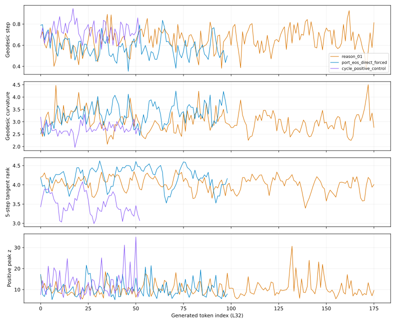

# ICA-Lens v3 思维链航海实验

按时间读 [DevHistory.md](DevHistory.md)，最后的Step 5给出测量修正和核心读数；不是论文报告。

44条真实裸文本轨迹、全64层，一次完整27B驻留；最后缓存核对不重载模型。

- L32：熟诗/推理正极峰值18.97/10.68；Top20能量13.49%/8.53%；本轮未出现高斯平摊深海。
- 负ΔC并不等于无尖峰；轴标签置换和正半轴对账已完成。
- 括号外收步未普遍复现：L32为1/8，L63为3/8。
- 真正屏蔽EOS后追加96 token，rank5升至4.22、经过53根主岛轴；未形成固定三四岛港口。

看：summary.json、phase_all_layers.json、port_matched_window_audit.json、real_eos_final_metrics.json、mask_permutation_ablation.json、traces/、events/、island_labels/、vertical_sections.json。

大数组只在 `/home/lmxxf/work/ica-lens-qwen38-27b-v3/experiments/exp2_cot_navigation`。轻量目录无超过10MB文件。

复现：bash run_all.sh。末审入口：`final_audit_exp2.py`，仅用已保存数据。
