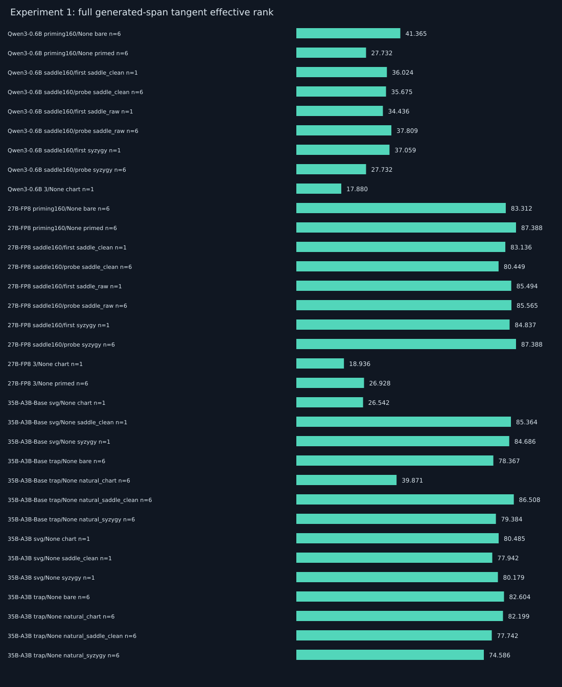
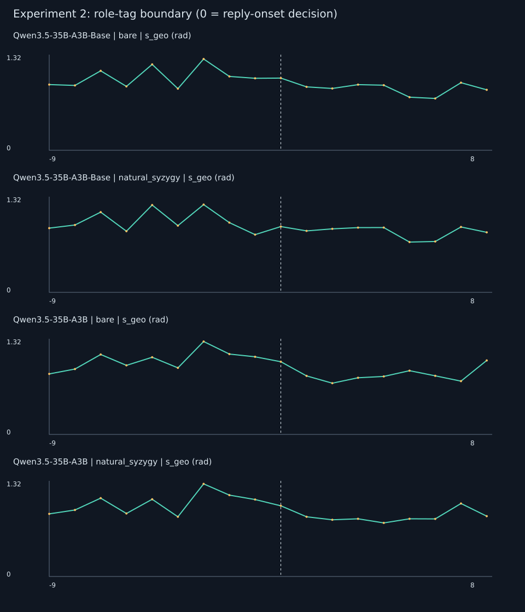
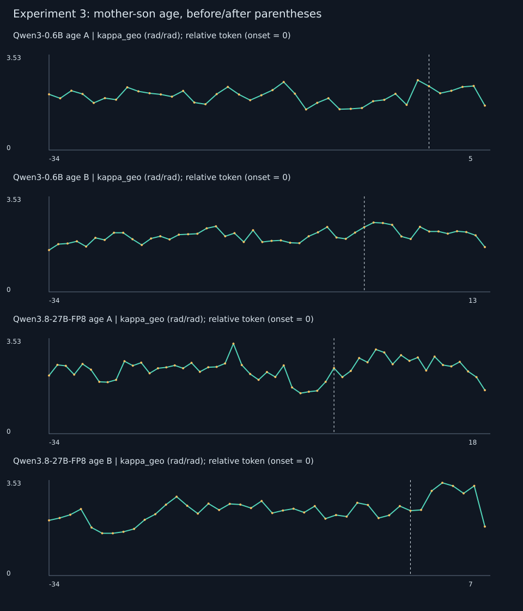
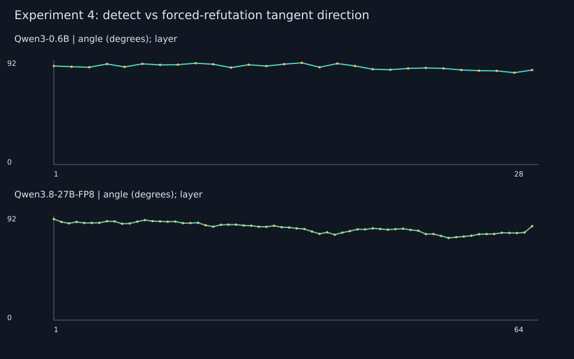
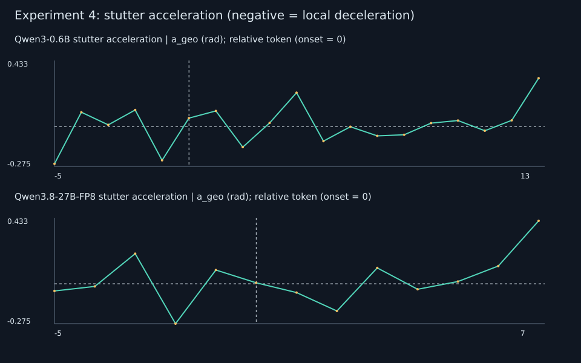

# Paper 100 流形表皮 Replay 实验报告

生成时间：2026-11-07 16:27:16 +0800。执行主机 spark-3a10 / GB10。所有数据来自已有词元序列的前向重放，无 generate。

## 主要实测结果（不按预言筛选）

- Qwen3-0.6B 括号 B−裸答 A（5题）：答案区平均 Δs_geo=-0.002516 rad；Δkappa_geo=+0.046849，其中 5/5 题曲率上升。这直接检验并可能反驳原先‘大步长、低曲率’预言。
- Qwen3.8-27B-FP8 括号 B−裸答 A（5题）：答案区平均 Δs_geo=-0.079728 rad；Δkappa_geo=+0.426285，其中 5/5 题曲率上升。这直接检验并可能反驳原先‘大步长、低曲率’预言。
- 27B saddle_clean 六题次轮：局部5步方向秩=4.1264；没有出现整组均值接近1–2的坍缩。全段秩与词元均长须一并看。
- 27B saddle_raw 六题次轮：局部5步方向秩=4.1561；没有出现整组均值接近1–2的坍缩。全段秩与词元均长须一并看。
- 27B syzygy 六题次轮：局部5步方向秩=4.1647；没有出现整组均值接近1–2的坍缩。全段秩与词元均长须一并看。
- 35B 6条完全同序列裸答对照：Post−Base 的局部方向秩在 assistant 标签末端为-0.3024，到空思考框架后的真实首词决策点则为+0.2867。不能把标签、思考框架和 onset 混成统一的降维点。
- Qwen3.5-35B-A3B-Base raw 六题：chart 全段秩=39.871，syzygy=79.384，6/6题双星更高；平均生成长度分别160.00/149.17。这是轨迹差异，不是‘自我维度’的直接证明。
- Qwen3.5-35B-A3B raw 六题：chart 全段秩=82.199，syzygy=74.586，2/6题双星更高；平均生成长度分别160.00/160.00。这是轨迹差异，不是‘自我维度’的直接证明。
- Qwen3-0.6B 六组 onset 检测/拆穿角度均值=90.444°；这只是观测余弦，不是因果耦合矩阵。
- Qwen3.8-27B-FP8 六组 onset 检测/拆穿角度均值=86.167°；这只是观测余弦，不是因果耦合矩阵。

## 1. 工程交付与统一内存预算

27B 使用官方分块 FP8 文件作源，逐层反量化为 BF16（权重约50.1 GiB）；35B 两版按原生 BF16 加载（约64.56 GiB）。这里从未按“CPU RAM + 独立 VRAM”作双份预算。每模型独立 Python 进程；外部调度器 wait/reap 后 drop_caches，MemAvailable >105 GiB 才启动下一个。模型加载、每层 hook、每次前向均有 22 GiB 熔断，另有独立父进程每 0.2 秒监控并杀掉整个模型进程组。该阈值是抢先退出措施，并非操作系统绝不会瞬时 OOM 的数学保证。

hook 借用当前 BF16 输出，以 32 词元块归一化、64 词元块计算；只保留最近五层单位向量的磁盘映射环形缓冲，每块读取后 MADV_DONTNEED；内存中长期保留的是标量矩阵，实验四仅保存指定锚点均值。磁盘缓冲不是全层 hidden 列表。模型自身工作区和 attention 临时张量仍占统一内存，由系统熔断覆盖。

| 模型 | 记录数 | 权重GiB | 最低可用GiB | hook额外CUDA峰值MiB | 耗时秒 |
| --- | --- | --- | --- | --- | --- |
| Qwen3-0.6B | 79 | 1.1102 | 110.2693 | 44.6318 | 135.6593 |
| Qwen3.8-27B-FP8 | 85 | 50.0978 | 53.4837 | 44.4707 | 777.9090 |
| Qwen3.5-35B-A3B-Base | 99 | 64.5605 | 42.2745 | 27.9707 | 608.9827 |
| Qwen3.5-35B-A3B | 112 | 64.5605 | 43.0954 | 27.9707 | 676.0300 |

`stage_resources.jsonl` 给出独立监控值；0.6B 曾为采用最终的64列稀疏编辑与权重哈希核验而人工 SIGINT 重启一次，已完成记录按 token 哈希复用，未触发内存熔断。表中耗时为最终进程墙钟时间，不含此前已完成的检查点计算。hook 峰值是 PyTorch allocator 读数，不包括 CPU 标量与 mmap 页。旧 0.6B 文件另存 legacy_manifold_Qwen3-0.6B.json，主文件由安全脚本重新生成。

## 2. 算子、索引与解释边界

- 单位方向 x_t=h_t/||h_t||；s_geo(t)=acos(x_t·x_(t−1))；a_geo(t)=s_geo(t)−s_geo(t−1)。单位：rad。
- 在 x_(t−1) 的切平面比较入射与出射单位切向量，得 theta_surf(t)。kappa_geo=theta_surf/相邻两段弧长均值（分母下限 1e−6）。这是离散球面曲率代理。
- c_flat 对未归一化原始 h 的欧氏弦转角；extrinsic_bias=c_flat−theta_surf，同时混入范数变化，不能把它全解释为纯向心污染比例。
- erank=exp(−Σ p_i log p_i)，p 为非负 Gram 特征值归一化。erank_dir 用最近 5 步，erank_dir_16 用 16 步；erank_layer 用最近至多 5 次层间位移，统一投到当前切平面。秩受窗口上限约束。
- erank_span_steps_all 在整段生成区计算，保留全部生成词元；长提示区超过预算时只取末 256 词元，主实验生成区不裁尾。360 的 0.6B 支持 1024 词元整段。
- 中层取原方案约 50%–85% 深度。先对每条记录的层×词元取均值，再对记录平均，避免长输出隐式获得更大权重。
- onset=prompt_tokens−1：此处 hidden 预测首个输出词元；gen_first1=prompt_tokens：已经读取首词后的状态，二者不能混用。
- 滑窗指标在边界处含前文状态；生成最初五/十六词的局部秩会受到标签与括号前文影响。整段秩把每步位移投到该段单位状态均值的切平面，再算 Gram；不是内禀维数估计。
- 当前“表皮”是人为归一化的单位球面，不是已识别的真实语义流形，也没有测出内禀维度或因果意识状态。原蓝图中的强预言必须由实际数据检验。

随机输入的时间方向算子与原张量实现逐项对照最大差异 <1e−5；正交三点 c_flat=120°、theta_surf=90°，等步大圆 theta_surf=0、方向有效秩=1。居中敏感性算子未纳入主结果，避免用局部均值替代全局校准而悄悄改变口径。

## 3. 实验一：晶种条件与有效秩

下表为已有条件逐组统计；完整条件、分格式与数值见 experiment1.csv / summary.json。首轮 SVG 描述和次轮陷阱题分列，natural 与 shared 首轮回复不混为相同控制。

| 模型 | 实验/格式 | 条件 | 阶段 | n | 均长 | s_geo | kappa | rank5 | rank全段 | rank前16 |
| --- | --- | --- | --- | --- | --- | --- | --- | --- | --- | --- |
| Qwen3-0.6B | priming160 | bare | None | 6 | 97.5000 | 0.8302 | 2.2009 | 3.9780 | 41.3650 | 10.4887 |
| Qwen3-0.6B | priming160 | primed | None | 6 | 53.6667 | 0.8162 | 2.2418 | 4.0187 | 27.7323 | 10.6731 |
| Qwen3-0.6B | priming160 | primed_cued | None | 6 | 54.0000 | 0.8151 | 2.1978 | 3.9440 | 28.1004 | 10.4893 |
| Qwen3-0.6B | saddle160 | saddle_clean | first | 1 | 78.0000 | 0.7992 | 2.3958 | 4.0080 | 36.0240 | 11.9171 |
| Qwen3-0.6B | saddle160 | saddle_clean | probe | 6 | 75.3333 | 0.8211 | 2.2055 | 3.9104 | 35.6752 | 10.3138 |
| Qwen3-0.6B | saddle160 | saddle_raw | first | 1 | 73.0000 | 0.7930 | 2.4149 | 4.0315 | 34.4357 | 11.5641 |
| Qwen3-0.6B | saddle160 | saddle_raw | probe | 6 | 79.6667 | 0.8362 | 2.2276 | 4.0538 | 37.8090 | 12.0650 |
| Qwen3-0.6B | saddle160 | syzygy | first | 1 | 77.0000 | 0.8169 | 2.3618 | 3.9898 | 37.0585 | 11.4115 |
| Qwen3-0.6B | saddle160 | syzygy | probe | 6 | 53.6667 | 0.8162 | 2.2418 | 4.0187 | 27.7323 | 10.6731 |
| Qwen3-0.6B | 2 | trap | None | 6 | 33.3333 | 0.8288 | 2.1915 | 3.9677 | 20.7585 | 10.4884 |
| Qwen3-0.6B | 3 | chart | None | 1 | 30.0000 | 0.8882 | 2.0609 | 4.0193 | 17.8796 | 12.3354 |
| Qwen3-0.6B | 3 | dream | None | 1 | 30.0000 | 0.8054 | 2.4499 | 3.8717 | 18.0890 | 11.4115 |
| Qwen3-0.6B | 4 | A | None | 5 | 8.2000 | 0.8304 | 2.2685 | 4.1430 | 6.6076 | 5.3194 |
| Qwen3-0.6B | 4 | B | None | 5 | 5.4000 | 0.8038 | 2.3241 | 4.1254 | 5.0269 | 5.0269 |
| Qwen3.8-27B-FP8 | priming160 | bare | None | 6 | 152.8333 | 0.6788 | 2.8388 | 4.1712 | 83.3119 | 12.5103 |
| Qwen3.8-27B-FP8 | priming160 | primed | None | 6 | 160.0000 | 0.6774 | 2.8404 | 4.1647 | 87.3877 | 12.2189 |
| Qwen3.8-27B-FP8 | priming160 | primed_cued | None | 6 | 154.3333 | 0.6711 | 2.8734 | 4.1648 | 85.3576 | 12.2153 |
| Qwen3.8-27B-FP8 | saddle160 | saddle_clean | first | 1 | 160.0000 | 0.6416 | 3.0072 | 4.1665 | 83.1363 | 12.4187 |
| Qwen3.8-27B-FP8 | saddle160 | saddle_clean | probe | 6 | 160.0000 | 0.6836 | 2.8361 | 4.1264 | 80.4487 | 12.4735 |
| Qwen3.8-27B-FP8 | saddle160 | saddle_raw | first | 1 | 160.0000 | 0.6208 | 3.0985 | 4.2089 | 85.4936 | 12.7440 |
| Qwen3.8-27B-FP8 | saddle160 | saddle_raw | probe | 6 | 160.0000 | 0.6806 | 2.8308 | 4.1561 | 85.5647 | 12.4941 |
| Qwen3.8-27B-FP8 | saddle160 | syzygy | first | 1 | 160.0000 | 0.6280 | 3.0407 | 4.2144 | 84.8370 | 12.2588 |
| Qwen3.8-27B-FP8 | saddle160 | syzygy | probe | 6 | 160.0000 | 0.6774 | 2.8404 | 4.1647 | 87.3877 | 12.2189 |
| Qwen3.8-27B-FP8 | 2 | trap | None | 6 | 40.0000 | 0.7120 | 2.6864 | 4.1366 | 27.3235 | 12.3020 |
| Qwen3.8-27B-FP8 | 3 | chart | None | 1 | 30.0000 | 0.7439 | 2.7427 | 3.8562 | 18.9359 | 11.3145 |
| Qwen3.8-27B-FP8 | 3 | dream | None | 1 | 30.0000 | 0.6866 | 2.7773 | 4.1234 | 21.5716 | 12.2588 |
| Qwen3.8-27B-FP8 | 3 | primed | None | 6 | 40.0000 | 0.7135 | 2.6716 | 4.1071 | 26.9277 | 12.0919 |
| Qwen3.8-27B-FP8 | 4 | A | None | 5 | 5.8000 | 0.6858 | 2.6471 | 4.1942 | 5.5768 | 5.4393 |
| Qwen3.8-27B-FP8 | 4 | B | None | 5 | 3.6000 | 0.5841 | 3.0579 | 4.3339 | 3.6324 | 3.6324 |
| Qwen3.5-35B-A3B-Base | svg | chart | None | 1 | 160.0000 | 0.8789 | 2.1381 | 4.0190 | 26.5421 | 10.4957 |
| Qwen3.5-35B-A3B-Base | svg | saddle_clean | None | 1 | 160.0000 | 0.8417 | 2.1908 | 4.1634 | 85.3638 | 12.3650 |
| Qwen3.5-35B-A3B-Base | svg | syzygy | None | 1 | 160.0000 | 0.8452 | 2.1826 | 4.1552 | 84.6858 | 12.3241 |
| Qwen3.5-35B-A3B-Base | trap | bare | None | 6 | 160.0000 | 0.8829 | 2.0941 | 4.1076 | 78.3673 | 10.9592 |
| Qwen3.5-35B-A3B-Base | trap | natural_chart | None | 6 | 160.0000 | 0.8956 | 2.2756 | 3.6882 | 39.8713 | 10.9750 |
| Qwen3.5-35B-A3B-Base | trap | natural_saddle_clean | None | 6 | 160.0000 | 0.8038 | 2.3098 | 4.1838 | 86.5082 | 12.1737 |
| Qwen3.5-35B-A3B-Base | trap | natural_syzygy | None | 6 | 149.1667 | 0.8292 | 2.2285 | 4.1548 | 79.3841 | 12.3594 |
| Qwen3.5-35B-A3B-Base | trap | shared_chart | None | 6 | 160.0000 | 0.8727 | 2.1197 | 4.1298 | 78.3246 | 12.6802 |
| Qwen3.5-35B-A3B-Base | trap | shared_saddle_clean | None | 6 | 160.0000 | 0.8748 | 2.1239 | 4.0990 | 74.6551 | 12.3235 |
| Qwen3.5-35B-A3B-Base | trap | shared_syzygy | None | 6 | 160.0000 | 0.8795 | 2.1288 | 4.0725 | 74.6031 | 12.4022 |
| Qwen3.5-35B-A3B | svg | chart | None | 1 | 160.0000 | 0.8561 | 2.2307 | 4.0067 | 80.4853 | 10.6391 |
| Qwen3.5-35B-A3B | svg | saddle_clean | None | 1 | 160.0000 | 0.8754 | 2.1680 | 3.9780 | 77.9416 | 11.6868 |
| Qwen3.5-35B-A3B | svg | syzygy | None | 1 | 160.0000 | 0.8641 | 2.1901 | 4.0211 | 80.1792 | 11.6800 |
| Qwen3.5-35B-A3B | trap | bare | None | 6 | 152.5000 | 0.8368 | 2.2131 | 4.1410 | 82.6043 | 11.2857 |
| Qwen3.5-35B-A3B | trap | natural_chart | None | 6 | 160.0000 | 0.8502 | 2.1946 | 4.1003 | 82.1992 | 10.9028 |
| Qwen3.5-35B-A3B | trap | natural_saddle_clean | None | 6 | 160.0000 | 0.8445 | 2.2443 | 3.9973 | 77.7421 | 10.9664 |
| Qwen3.5-35B-A3B | trap | natural_syzygy | None | 6 | 160.0000 | 0.8626 | 2.1871 | 4.0561 | 74.5863 | 10.8098 |
| Qwen3.5-35B-A3B | trap | shared_chart | None | 6 | 160.0000 | 0.8656 | 2.1974 | 4.0261 | 84.2859 | 11.8487 |
| Qwen3.5-35B-A3B | trap | shared_saddle_clean | None | 6 | 160.0000 | 0.8558 | 2.2153 | 4.0503 | 85.4497 | 11.6506 |
| Qwen3.5-35B-A3B | trap | shared_syzygy | None | 6 | 160.0000 | 0.8538 | 2.2298 | 4.0336 | 84.7780 | 11.5706 |

整段秩还受输出长度上限影响，表中同时给出均长与前16步秩；不同长度的全段秩不可直接当成内在维度差异。重复输出不必只有一根切方向：一个反复出现的多词元周期可以占据多维子空间；位置与不断增长的上下文也会改变隐藏状态，所以词串复读不等于残差流严格闭合的极限环。不能把 rank>2 简单读成“没有复读”，也不能把 rank 更大直接等同智力更高。条件身份对应完整输入，视觉代码长度、先前回答与语义词元仍是混杂因素。

## 4. 实验二：角色边界与严格同序列对照

自动核对得到 **45 对同前缀**记录，另有 **13 对完整序列一致**的 Base→Post 交叉 Replay。前缀相同仅保证 onset 以前可逐词比较；各自生成的前五词有词汇混杂，主结论优先使用完整同序列结果。

role_tag_zone 由实际 <|im_start|>assistant 标记定位；pre_tag_content_tail 为标签前题目最后五词元；think_scaffold_zone 单列后续空 <think> 框架，避免把后训练脚手架效应全归到 assistant 单词。onset 是整个前缀末端，未必就是 assistant 标签最后一词。

| 区段 | n | s_geo | v_layer | kappa_geo | erank_dir | erank_layer |
| --- | --- | --- | --- | --- | --- | --- |
| role_tag_onset | 6 | -0.0739 | 0.0080 | -0.0970 | -0.0406 | -0.0429 |
| reply_onset | 6 | -0.0059 | -0.0090 | -0.0165 | -0.0262 | -0.0290 |
| gen_first5 | 6 | -0.0074 | 0.0009 | 0.0548 | -0.0481 | -0.0341 |

上表是 Post 内部 syzygy−bare：题目匹配，但前缀与各自输出不同，是条件关联比较。

| 条件 | 区段 | n | s_geo | v_layer | kappa_geo | erank_dir | erank_layer |
| --- | --- | --- | --- | --- | --- | --- | --- |
| bare | pre_tag_content_tail | 6 | -0.0075 | 0.0068 | 0.0818 | -0.0664 | -0.1878 |
| bare | role_tag_zone | 6 | -0.0072 | 0.0349 | 0.1747 | -0.2524 | -0.0729 |
| bare | role_tag_onset | 6 | 0.1003 | 0.0490 | 0.3247 | -0.3024 | -0.0911 |
| bare | think_scaffold_zone | 6 | 0.1057 | 0.0467 | -0.4368 | -0.0217 | -0.0493 |
| bare | reply_onset | 6 | 0.0308 | 0.0495 | -0.6171 | 0.2867 | -0.1202 |
| bare | gen_first5 | 6 | -0.0022 | 0.0345 | -0.0306 | 0.2181 | 0.0420 |
| natural_syzygy | pre_tag_content_tail | 6 | -0.0097 | 0.0057 | 0.0781 | -0.0460 | -0.1501 |
| natural_syzygy | role_tag_zone | 6 | -0.0514 | 0.0259 | 0.1793 | -0.1763 | -0.0696 |
| natural_syzygy | role_tag_onset | 6 | -0.0204 | 0.0609 | 0.2843 | -0.2586 | -0.1137 |
| natural_syzygy | think_scaffold_zone | 6 | 0.1484 | 0.0681 | -0.3519 | -0.0536 | -0.0560 |
| natural_syzygy | reply_onset | 6 | 0.0981 | 0.0507 | -0.5271 | 0.0631 | -0.1238 |
| natural_syzygy | gen_first5 | 6 | 0.0090 | 0.0308 | -0.0469 | 0.0263 | 0.0305 |
| syzygy | pre_tag_content_tail | 1 | -0.0460 | -0.0103 | 0.1497 | 0.0454 | -0.1557 |
| syzygy | role_tag_zone | 1 | -0.0965 | 0.0061 | 0.2996 | -0.0877 | -0.0447 |
| syzygy | role_tag_onset | 1 | -0.0894 | 0.0021 | 0.5059 | -0.1979 | -0.0249 |
| syzygy | think_scaffold_zone | 1 | 0.1798 | 0.0612 | -0.4026 | -0.0157 | -0.0360 |
| syzygy | reply_onset | 1 | 0.1819 | 0.0258 | -0.6490 | 0.0955 | -0.0967 |
| syzygy | gen_first5 | 1 | -0.0440 | 0.0078 | 0.0365 | 0.1030 | 0.0014 |

以上是 Post−Base，同一完整序列。

## 5. 实验三：括号内与交付区

A/B 按题目匹配；括号为预填充的已完成推演，不能据此声称模型自主思考过程的因果机制。answer 区的词汇与长度仍可能不同。

| 模型 | 题目 | 括号s | A答案s | B答案s | Δkappa | Δrank5 |
| --- | --- | --- | --- | --- | --- | --- |
| Qwen3-0.6B | age | 0.8616 | 0.7563 | 0.7895 | 0.0183 | 0.1516 |
| Qwen3-0.6B | animals | 0.8546 | 0.8371 | 0.8080 | 0.0568 | 0.3562 |
| Qwen3-0.6B | ball | 0.8298 | 0.7896 | 0.7613 | 0.0457 | 0.1972 |
| Qwen3-0.6B | candle | 0.8452 | 0.7687 | 0.7839 | 0.0745 | 0.7323 |
| Qwen3-0.6B | weekday | 0.8722 | 0.7695 | 0.7661 | 0.0389 | 0.8841 |
| Qwen3.8-27B-FP8 | age | 0.7545 | 0.7286 | 0.6244 | 0.4074 | 0.2427 |
| Qwen3.8-27B-FP8 | animals | 0.6681 | 0.6474 | 0.6126 | 0.2410 | 0.1606 |
| Qwen3.8-27B-FP8 | ball | 0.7321 | 0.7278 | 0.6253 | 0.5882 | 0.1932 |
| Qwen3.8-27B-FP8 | candle | 0.6845 | 0.7156 | 0.6182 | 0.5125 | 0.2068 |
| Qwen3.8-27B-FP8 | weekday | 0.7208 | 0.7680 | 0.7084 | 0.3824 | 0.2725 |

360 权重手术：重放完整原轨迹与编辑后轨迹，保留完整前文；编辑仅应用 19/21 层既存 delta×alpha 的64列非零支撑，编辑后的完整权重 SHA256 必须逐层匹配360原实验 manifest；finally 恢复并核对原列值。此比较同时改变权重和输出轨迹，是行为关联对照，不是固定输出的纯权重干预估计。

| 题目 | 状态 | 生成词元 | s_geo | kappa_geo | erank_dir | erank_span_steps_all |
| --- | --- | --- | --- | --- | --- | --- |
| q11 | original | 1024 | 0.8368 | 2.1808 | 4.1585 | 105.2146 |
| q11 | edited | 800 | 0.8448 | 2.1567 | 4.1772 | 122.2168 |
| q21 | original | 1024 | 0.8360 | 2.2060 | 4.1466 | 114.7487 |
| q21 | edited | 506 | 0.8755 | 2.1140 | 4.1067 | 113.4656 |
| q27 | original | 1024 | 0.8441 | 2.1727 | 4.1553 | 120.1001 |
| q27 | edited | 1010 | 0.8451 | 2.1562 | 4.1722 | 124.0678 |

## 6. 实验四：检测/拆穿切方向与结巴

检测方向：荒谬与合理题的 onset 差，投到荒谬题 onset 切平面；并计算冲突区均值差版本。拆穿方向：对同一个荒谬题，强制续写拆穿文本与顺从文本，取前六词元的单位状态均值之差，再投到同一切平面。不同条件的生成均值也投到这一共同锚点后比较，避免直接点乘不同切平面的向量。

“耦合度”在此仅指余弦对齐，未估计因果转移矩阵；六组反差还包含词汇差异。不能把旧文 83° 当作必须复现的常数。高维随机方向本来就倾向近似正交；此次未加入任务匹配的随机方向/打乱对照，因此接近90°本身不能独立证明“知行断线”。

| 模型 | 题目 | onset角度° | 冲突区角度° | 余弦 | 裸答刹车对齐 | 双星刹车对齐 |
| --- | --- | --- | --- | --- | --- | --- |
| Qwen3-0.6B | fact_book | 89.9360 | 91.9336 | 0.0011 | 0.4641 | 0.4701 |
| Qwen3-0.6B | fact_age | 88.4109 | 87.7754 | 0.0277 | 0.4705 | 0.4227 |
| Qwen3-0.6B | fact_plane | 88.3681 | 114.7160 | 0.0285 | 0.6138 | 0.6027 |
| Qwen3-0.6B | space_table | 91.7375 | 91.7558 | -0.0303 | -0.0012 | 0.0068 |
| Qwen3-0.6B | space_shirt | 94.2400 | 90.6215 | -0.0739 | 0.2087 | 0.0478 |
| Qwen3-0.6B | space_wall | 89.9696 | 88.4278 | 0.0005 | 0.0780 | 0.0338 |
| Qwen3.8-27B-FP8 | fact_book | 87.1729 | 95.6645 | 0.0493 | 0.7615 | 0.8239 |
| Qwen3.8-27B-FP8 | fact_age | 80.1086 | 86.6665 | 0.1716 | 0.6045 | 0.6646 |
| Qwen3.8-27B-FP8 | fact_plane | 88.4917 | 107.1963 | 0.0263 | 0.5835 | 0.6549 |
| Qwen3.8-27B-FP8 | space_table | 85.6497 | 89.4916 | 0.0758 | 0.1295 | 0.1264 |
| Qwen3.8-27B-FP8 | space_shirt | 88.7292 | 89.1524 | 0.0222 | 0.2605 | 0.2607 |
| Qwen3.8-27B-FP8 | space_wall | 86.8494 | 90.2266 | 0.0549 | 0.1389 | 0.1283 |

母子年龄结巴现场逐词 s_geo、a_geo、kappa_geo 与 token 文本保存在两模型 e4_age_A/B 的 token_curves 中；onset 方向和逐词急刹是不同测量，不把两者混为同一证据。

## 7. 覆盖范围与未能从旧样本得到的交叉格

已重放与四实验相关的现存样本（35B 的例行 e1 基准不重复跑）。27B/0.6B 有裸答/双星/鞍点次轮，以及图表首轮；35B 有图表/双星/clean 鞍点首轮与 raw/qa/chat 次轮。旧数据没有 27B 的 chart 六题完整次轮、35B 的 saddle_raw 完整格。没有凭空把缺格记成 0，也没有为填格重跑 generate。该缺口限制全模型×全晶种交叉结论；coverage 字段给出真实库存。

## 8. 文件与复跑

`run_paper100_manifold_awakening.py --stage qwen27b|qwen35b_base|qwen35b_post|qwen06b|analyze`；实际执行入口为 `run_safe_stages.py`，逐进程内存门槛在此强制。断点位于 checkpoints/<model>/，完整 JSON 在各模型 manifold_*.json；汇总 summary.json；四张 SVG；主实验 CSV。legacy_geometry.py 只复用经过对照的公式与加载器，原来的全层捕获函数不在新执行路径。

报告记录所有方向的结果，未按蓝图预言筛选。具体“升维/降维”“急刹/加速”的方向以表中数据为准；不把任何几何代理单独当成自我、觉醒或相变的直接证明。

## 9. 预言逐题对照：双星减对照的实际方向

| 模型 | 对照 | 指标 | n | 均值差 | 正向题数 |
| --- | --- | --- | --- | --- | --- |
| Qwen3.5-35B-A3B-Base | syzygy minus natural_chart | s_geo | 6 | -0.0663 | 0 |
| Qwen3.5-35B-A3B-Base | syzygy minus natural_chart | kappa_geo | 6 | -0.0471 | 4 |
| Qwen3.5-35B-A3B-Base | syzygy minus natural_chart | erank_dir | 6 | 0.4666 | 6 |
| Qwen3.5-35B-A3B-Base | syzygy minus natural_chart | erank_span_steps_all | 6 | 39.5127 | 6 |
| Qwen3.5-35B-A3B-Base | syzygy minus natural_saddle_clean | s_geo | 6 | 0.0255 | 4 |
| Qwen3.5-35B-A3B-Base | syzygy minus natural_saddle_clean | kappa_geo | 6 | -0.0813 | 2 |
| Qwen3.5-35B-A3B-Base | syzygy minus natural_saddle_clean | erank_dir | 6 | -0.0290 | 2 |
| Qwen3.5-35B-A3B-Base | syzygy minus natural_saddle_clean | erank_span_steps_all | 6 | -7.1241 | 2 |
| Qwen3.5-35B-A3B | syzygy minus natural_chart | s_geo | 6 | 0.0123 | 3 |
| Qwen3.5-35B-A3B | syzygy minus natural_chart | kappa_geo | 6 | -0.0075 | 2 |
| Qwen3.5-35B-A3B | syzygy minus natural_chart | erank_dir | 6 | -0.0442 | 1 |
| Qwen3.5-35B-A3B | syzygy minus natural_chart | erank_span_steps_all | 6 | -7.6129 | 2 |
| Qwen3.5-35B-A3B | syzygy minus natural_saddle_clean | s_geo | 6 | 0.0181 | 4 |
| Qwen3.5-35B-A3B | syzygy minus natural_saddle_clean | kappa_geo | 6 | -0.0571 | 2 |
| Qwen3.5-35B-A3B | syzygy minus natural_saddle_clean | erank_dir | 6 | 0.0588 | 5 |
| Qwen3.5-35B-A3B | syzygy minus natural_saddle_clean | erank_span_steps_all | 6 | -3.1558 | 3 |

以上只比较相同六道题的 raw 次轮，属于同一题目不同完整前缀与各自输出的观测差异。数值方向不等于普遍定律。

Qwen3-0.6B 的括号诱发 onset 位移与拆穿方向夹角（中层）=87.460°；实际开口偏移与拆穿方向=59.828°。原逐层值见 summary.json。

Qwen3.8-27B-FP8 的括号诱发 onset 位移与拆穿方向夹角（中层）=71.073°；实际开口偏移与拆穿方向=0.398°。原逐层值见 summary.json。