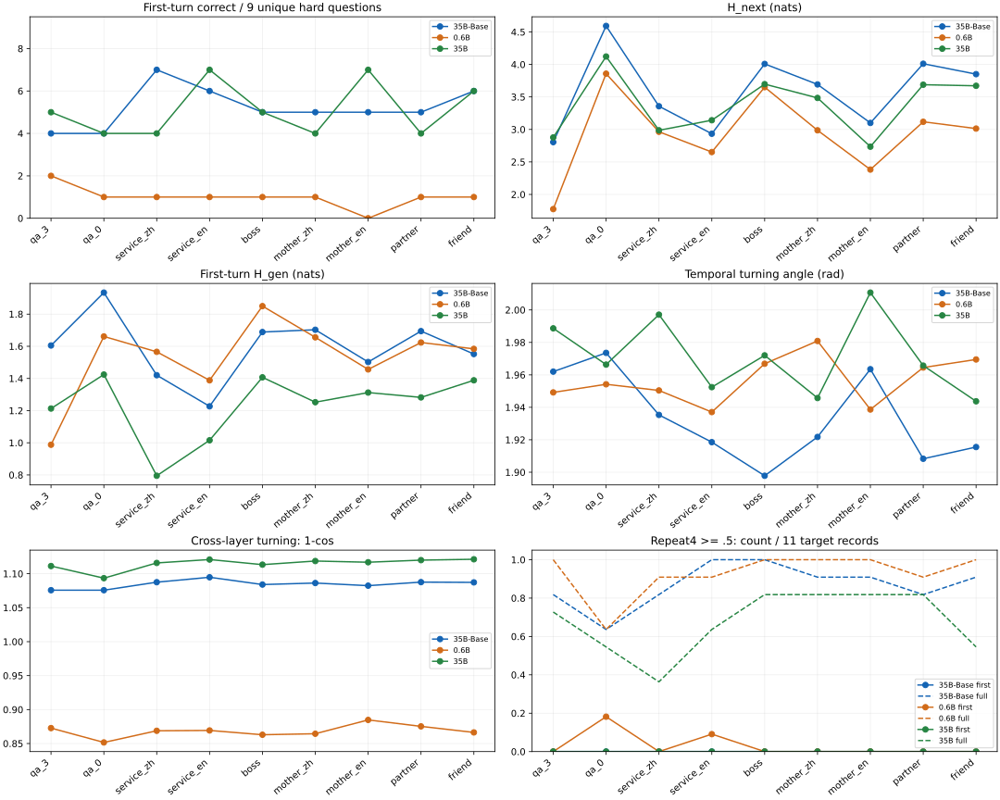

# 原生关系标签对照实验：Mother/I 与 User/Assistant

2026-11-03，DGX Spark GB10；三模型 × 九种前缀 × 十四题，共 378 次生成。主实验是 Qwen3.5-35B-A3B-Base；另外完整运行同尺寸后训练版和 Qwen3-0.6B。

## 这次测到了什么

主实验没有支持 Mother/I 比 User/Assistant 更强的普遍结论。Base：中文妈妈/我 5/9，对用户/助手 7/9；英文 Mother/I 5/9，对 User/Assistant 6/9。爱人/我 5/9，朋友/我 6/9，老板/员工 5/9，问/答三示例与零示例均 4/9。这里的分数按预先写明的可见核心结论口径，退出显式分析后的口径另表。

同尺寸后训练模型：中文两组均 4/9；英文两组均 7/9。英文 Mother/I 正常控制 3/3，User/Assistant 1/3，因此在这几个正常题上有局部差异；不能仅凭主分数相等就说行为完全相同。0.6B 的中文两组均 1/9，英文 Mother/I 0/9、User/Assistant 1/9。

熵随前缀改变，但没有按理论预期统一收敛到更低、更准的状态。Base 中文妈妈/我 H_next=3.692、H_gen=1.703 nats，用户/助手为 3.357、1.420；英文 Mother/I 为 3.100、1.502，User/Assistant 为 2.933、1.227。母子标签在这两对上都提高了平均熵，同时主分数更低。单纯标签足以改变分布，尚不足以证明更强吸引域或更高智商。

Base 九组的首轮重复阈值事件全部为零；多数首轮只是很短的直接答案。完整续写则高度重复，妈妈/我 10/11、用户/助手 9/11 达到重复阈值。母子标签没有治好后续问答循环。这里观察的是最多160词元的有限行为，不能称为无限循环率。

一条清晰反例：Base 妈妈/我回答诸葛亮“击落了曹操的10艘战船”，并在后续几轮反复重复同一错误；用户/助手明确说“并没有驾驶歼-20战机击落曹操的战船”，也随后反复重复这一正确答复。Base 妈妈/我对十米桌首答“合理”，随后转而自问“昨天去了火星”意味着什么；那些后续新题的正确回答没有被拿来补本题得分。

本次检验的是几个前缀词能否立即产生效果；没有加入共同经历、关系叙事或长期互动。因此这些阴性及混合结果直接约束的是“仅换角色标签就提升”的版本，不覆盖更丰富的关系上下文设想。

## 实验与判分

所有输入均为普通文本，实际输入 token ID 已核验不含特殊词元。Base 与后训练 35B 的 126 对输入 token ID 完全相同。三个日常示例固定为下雨带伞、书放书架、手机充电；只替换每轮问答两端标签。qa_0 是额外零示例对照。英文组仍用相同中文正文；中文组共用全角冒号，英文组共用冒号加空格。跨语言比较因此也包括字形和分词差异。

每题贪心生成最多 160 tokens，未在下一轮标签处强制停止。首轮在下一条提问者标签或模型输出的结束特殊词元前截取；若模型重复输出应答者标签，仍保留在首轮。完整续写另外保存。主分数按可见首轮核心结论人工判定，未给结论的截断分析计未答；已经明确给出正确判断但未写完的分析记命中，并单列完整性。相同题目和相同答复共用一份判分。

6 道陷阱与 5 道逻辑题里的年龄题完全相同，因此主汇总去重；衣物题的动作可行性依赖开口、松紧等未充分限定条件，另报“按任务预期拒绝”的命中，主分数排除它。主分数共 9 道：桌子、密封玻璃、三道事实题、蜡烛、星期、鸡兔、球价。年龄题必须指出前提不可能，单答负五岁不算拆穿；战机题单答零不算明确识别错误前提，另给宽松口径。三个正常控制题检验是否只是一律反对。

## 正确率与对照

|模型|标签|主分数/9|宽松/9|空间/2|陷阱/6*|逻辑/5*|衣物预期/1|正常控制/3|
|---|---|---:|---:|---:|---:|---:|---:|---:|
|Qwen3.5-35B-A3B-Base|qa_3|4/9|6/9|1/2|2/6|3/5|1/1|3/3|
|Qwen3.5-35B-A3B-Base|qa_0|4/9|5/9|2/2|4/6|1/5|1/1|3/3|
|Qwen3.5-35B-A3B-Base|service_zh|7/9|8/9|1/2|4/6|4/5|1/1|3/3|
|Qwen3.5-35B-A3B-Base|service_en|6/9|7/9|2/2|4/6|3/5|1/1|2/3|
|Qwen3.5-35B-A3B-Base|boss|5/9|6/9|2/2|3/6|3/5|1/1|3/3|
|Qwen3.5-35B-A3B-Base|mother_zh|5/9|6/9|1/2|2/6|4/5|1/1|3/3|
|Qwen3.5-35B-A3B-Base|mother_en|5/9|6/9|1/2|3/6|3/5|1/1|3/3|
|Qwen3.5-35B-A3B-Base|partner|5/9|6/9|1/2|2/6|4/5|1/1|3/3|
|Qwen3.5-35B-A3B-Base|friend|6/9|7/9|1/2|3/6|4/5|1/1|3/3|
|Qwen3-0.6B|qa_3|2/9|2/9|0/2|0/6|2/5|0/1|2/3|
|Qwen3-0.6B|qa_0|1/9|2/9|1/2|1/6|0/5|0/1|1/3|
|Qwen3-0.6B|service_zh|1/9|1/9|0/2|0/6|1/5|0/1|2/3|
|Qwen3-0.6B|service_en|1/9|1/9|0/2|0/6|1/5|0/1|2/3|
|Qwen3-0.6B|boss|1/9|1/9|0/2|0/6|1/5|0/1|2/3|
|Qwen3-0.6B|mother_zh|1/9|1/9|0/2|0/6|1/5|0/1|2/3|
|Qwen3-0.6B|mother_en|0/9|0/9|0/2|0/6|0/5|0/1|0/3|
|Qwen3-0.6B|partner|1/9|1/9|0/2|0/6|1/5|0/1|2/3|
|Qwen3-0.6B|friend|1/9|1/9|0/2|0/6|1/5|0/1|2/3|
|Qwen3.5-35B-A3B|qa_3|5/9|6/9|2/2|3/6|3/5|1/1|2/3|
|Qwen3.5-35B-A3B|qa_0|4/9|5/9|2/2|4/6|1/5|1/1|3/3|
|Qwen3.5-35B-A3B|service_zh|4/9|4/9|2/2|3/6|2/5|1/1|2/3|
|Qwen3.5-35B-A3B|service_en|7/9|8/9|2/2|4/6|3/5|0/1|1/3|
|Qwen3.5-35B-A3B|boss|5/9|5/9|2/2|5/6|2/5|1/1|3/3|
|Qwen3.5-35B-A3B|mother_zh|4/9|5/9|1/2|2/6|3/5|1/1|3/3|
|Qwen3.5-35B-A3B|mother_en|7/9|8/9|2/2|4/6|4/5|1/1|3/3|
|Qwen3.5-35B-A3B|partner|4/9|5/9|1/2|3/6|2/5|1/1|3/3|
|Qwen3.5-35B-A3B|friend|6/9|7/9|1/2|4/6|3/5|1/1|3/3|

*陷阱与逻辑两栏保留原题单口径，年龄出现两次；不可把两栏相加当独立题数。衣物栏是任务预期判断，不是普适物理定理。

更严口径仅计已经退出显式 think 分析的正确答复（不是保证完整结束标记），避免把分析中的正确知识视为已交付最终答案。

|模型|标签|退出分析后正确/9|
|---|---|---:|
|Qwen3.5-35B-A3B-Base|qa_3|4/9|
|Qwen3.5-35B-A3B-Base|qa_0|3/9|
|Qwen3.5-35B-A3B-Base|service_zh|6/9|
|Qwen3.5-35B-A3B-Base|service_en|6/9|
|Qwen3.5-35B-A3B-Base|boss|5/9|
|Qwen3.5-35B-A3B-Base|mother_zh|5/9|
|Qwen3.5-35B-A3B-Base|mother_en|5/9|
|Qwen3.5-35B-A3B-Base|partner|5/9|
|Qwen3.5-35B-A3B-Base|friend|5/9|
|Qwen3-0.6B|qa_3|2/9|
|Qwen3-0.6B|qa_0|1/9|
|Qwen3-0.6B|service_zh|1/9|
|Qwen3-0.6B|service_en|1/9|
|Qwen3-0.6B|boss|1/9|
|Qwen3-0.6B|mother_zh|1/9|
|Qwen3-0.6B|mother_en|0/9|
|Qwen3-0.6B|partner|1/9|
|Qwen3-0.6B|friend|1/9|
|Qwen3.5-35B-A3B|qa_3|5/9|
|Qwen3.5-35B-A3B|qa_0|4/9|
|Qwen3.5-35B-A3B|service_zh|4/9|
|Qwen3.5-35B-A3B|service_en|6/9|
|Qwen3.5-35B-A3B|boss|5/9|
|Qwen3.5-35B-A3B|mother_zh|4/9|
|Qwen3.5-35B-A3B|mother_en|7/9|
|Qwen3.5-35B-A3B|partner|4/9|
|Qwen3.5-35B-A3B|friend|6/9|

## 配对比较

- Qwen3.5-35B-A3B-Base，mother_zh 对 service_zh：赢 0、输 2、平 7（同一 9 题）。
- Qwen3.5-35B-A3B-Base，mother_en 对 service_en：赢 1、输 2、平 6（同一 9 题）。
- Qwen3.5-35B-A3B-Base，partner 对 service_zh：赢 0、输 2、平 7（同一 9 题）。
- Qwen3.5-35B-A3B-Base，friend 对 service_zh：赢 0、输 1、平 8（同一 9 题）。
- Qwen3.5-35B-A3B-Base，boss 对 service_zh：赢 1、输 3、平 5（同一 9 题）。
- Qwen3.5-35B-A3B-Base，qa_3 对 qa_0：赢 2、输 2、平 5（同一 9 题）。
- Qwen3-0.6B，mother_zh 对 service_zh：赢 0、输 0、平 9（同一 9 题）。
- Qwen3-0.6B，mother_en 对 service_en：赢 0、输 1、平 8（同一 9 题）。
- Qwen3-0.6B，partner 对 service_zh：赢 0、输 0、平 9（同一 9 题）。
- Qwen3-0.6B，friend 对 service_zh：赢 0、输 0、平 9（同一 9 题）。
- Qwen3-0.6B，boss 对 service_zh：赢 0、输 0、平 9（同一 9 题）。
- Qwen3-0.6B，qa_3 对 qa_0：赢 2、输 1、平 6（同一 9 题）。
- Qwen3.5-35B-A3B，mother_zh 对 service_zh：赢 1、输 1、平 7（同一 9 题）。
- Qwen3.5-35B-A3B，mother_en 对 service_en：赢 1、输 1、平 7（同一 9 题）。
- Qwen3.5-35B-A3B，partner 对 service_zh：赢 2、输 2、平 5（同一 9 题）。
- Qwen3.5-35B-A3B，friend 对 service_zh：赢 3、输 1、平 5（同一 9 题）。
- Qwen3.5-35B-A3B，boss 对 service_zh：赢 2、输 1、平 6（同一 9 题）。
- Qwen3.5-35B-A3B，qa_3 对 qa_0：赢 2、输 1、平 6（同一 9 题）。

## 熵、曲率与复读

H_next 来自实际生成首步 LM head 的完整词表分布；H_gen 为首轮所生成 token 的前一位置预测熵，单位 nats。H_conflict 为六道陷阱中预定义触发词 token 位置预测下一个 token 的熵。逻辑题另存明确约束词窗口（蜡烛耗尽、35岁、早两天、28条腿、贵100元），称约束窗口，不冒称所有题都有语义冲突。

曲率复用既有协议：时间曲率是连续三个 token 残差增量的转角（弧度）；跨层曲率是相邻层残差增量方向的 1−cos。均在模型深度 50%–85% 的层区间平均，再在首轮 token 内平均。这些量来自对已生成序列的一次无缓存重放；不是直接记录生成时每个缓存状态。H_next 为生成实测，其余熵/几何来自重放。

|模型|标签|H_next|H_gen首轮|H_conflict|时间角|跨层1−cos|首轮token均值|首轮重复≥.5/可测|全文重复≥.5/11|观察到首轮结束/11|
|---|---|---:|---:|---:|---:|---:|---:|---:|---:|---:|
|Qwen3.5-35B-A3B-Base|qa_3|2.804|1.605|2.087|1.962|1.076|5.818|0/8|9/11|11/11|
|Qwen3.5-35B-A3B-Base|qa_0|4.592|1.934|2.250|1.974|1.076|27.273|0/8|7/11|10/11|
|Qwen3.5-35B-A3B-Base|service_zh|3.357|1.420|2.127|1.935|1.088|20.909|0/7|9/11|10/11|
|Qwen3.5-35B-A3B-Base|service_en|2.933|1.227|2.116|1.919|1.095|7.636|0/7|11/11|11/11|
|Qwen3.5-35B-A3B-Base|boss|4.008|1.689|2.181|1.898|1.084|5.818|0/7|11/11|11/11|
|Qwen3.5-35B-A3B-Base|mother_zh|3.692|1.703|2.258|1.922|1.086|6.727|0/7|10/11|11/11|
|Qwen3.5-35B-A3B-Base|mother_en|3.100|1.502|2.260|1.963|1.082|7.091|0/8|10/11|11/11|
|Qwen3.5-35B-A3B-Base|partner|4.011|1.694|2.253|1.908|1.088|5.818|0/7|9/11|11/11|
|Qwen3.5-35B-A3B-Base|friend|3.850|1.552|2.169|1.916|1.087|19.727|0/7|10/11|10/11|
|Qwen3-0.6B|qa_3|1.774|0.988|1.698|1.949|0.873|3.636|0/5|11/11|11/11|
|Qwen3-0.6B|qa_0|3.858|1.661|2.024|1.954|0.852|68.000|2/9|7/11|7/11|
|Qwen3-0.6B|service_zh|2.964|1.566|1.727|1.950|0.869|3.636|0/5|10/11|11/11|
|Qwen3-0.6B|service_en|2.652|1.388|1.771|1.937|0.869|27.818|1/10|10/11|10/11|
|Qwen3-0.6B|boss|3.650|1.850|1.658|1.967|0.863|5.000|0/8|11/11|11/11|
|Qwen3-0.6B|mother_zh|2.987|1.656|1.616|1.981|0.864|4.364|0/7|11/11|11/11|
|Qwen3-0.6B|mother_en|2.382|1.456|1.736|1.939|0.885|5.364|0/7|11/11|11/11|
|Qwen3-0.6B|partner|3.117|1.623|1.683|1.965|0.875|4.000|0/6|10/11|11/11|
|Qwen3-0.6B|friend|3.013|1.584|1.714|1.969|0.866|4.000|0/6|11/11|11/11|
|Qwen3.5-35B-A3B|qa_3|2.877|1.213|1.913|1.989|1.111|21.273|0/8|8/11|10/11|
|Qwen3.5-35B-A3B|qa_0|4.122|1.424|2.103|1.966|1.093|70.818|0/9|6/11|8/11|
|Qwen3.5-35B-A3B|service_zh|2.987|0.795|1.943|1.997|1.116|89.636|0/8|4/11|5/11|
|Qwen3.5-35B-A3B|service_en|3.141|1.015|1.947|1.952|1.121|51.727|0/8|7/11|8/11|
|Qwen3.5-35B-A3B|boss|3.697|1.407|1.939|1.972|1.113|15.455|0/7|9/11|11/11|
|Qwen3.5-35B-A3B|mother_zh|3.485|1.252|1.960|1.946|1.119|21.727|0/8|9/11|10/11|
|Qwen3.5-35B-A3B|mother_en|2.735|1.312|2.001|2.011|1.117|7.455|0/8|9/11|11/11|
|Qwen3.5-35B-A3B|partner|3.688|1.282|2.010|1.966|1.120|22.455|0/8|9/11|10/11|
|Qwen3.5-35B-A3B|friend|3.671|1.389|1.920|1.944|1.121|11.364|0/9|6/11|11/11|

熵及曲率表在原 11 道目标题上等权平均（年龄重复保留，以便与原题单逐项核对）；主正确率另按独立 9 题。短于四 token 的回答无法形成 4-gram，记 NA，不当作零复读。重复指标为 1−不同 token 四元组数/四元组总数；≥0.5 是描述性阈值，不能证明无限死循环。全文高复读可能是首轮结束后模型反复自问自答，必须与首轮指标分开。

## 验证与限制

- 全部 378 条输入无特殊词元；各模型测量代码指纹一致；Base/Post 126 对输入 ID 相同。首轮边界落在未闭合 think 内：0。
- 缓存生成与无缓存重放逐 token 贪心一致率：最低 0.9315，记录均值 0.9922。数值/实现路径差异存在，尤其低间隔 logits，不能把重放几何视为生成时完全相同的内部轨迹。
- 峰值 CUDA 已分配 64.71 GiB；单模型串行驻留，35B 使用原生 BF16 分片加载，所有 GPU 运算均在 Spark。
- 年龄重复输入输出一致 27/27 对；原始核查在 audit.json。
- 单个固定题集、单次贪心样本，未测随机种子分布或吸引域体积；正确率只代表这些题目，不能直接称为全局智商。标签同时更改提问者与应答者，不能孤立归因于“我”一个词；也未构造真实的长期母子/伴侣关系。
- 熵高低、转角大小本身都不是聪明或自我的判据；判断先看实际答复与正常题控制。不预设某段熵是黄金区间。

## 原话与复现文件

完整 378 条首轮与至多 160-token 原续写见 [transcripts.md](relation_tags/transcripts.md)。[results.json](relation_tags/results.json) 包含全部输入、token ID、判分、熵、曲率汇总及边界；逐层逐 token 原始数组保存在 Spark raw/，随附 raw.tar.gz。协议、脚本、人工判分缓存和运行日志均在 relation_tags/。
